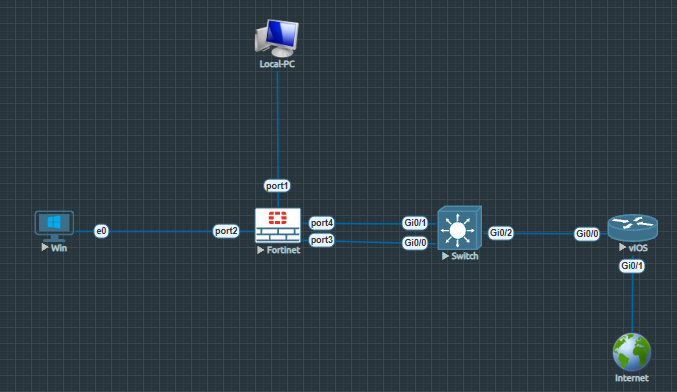
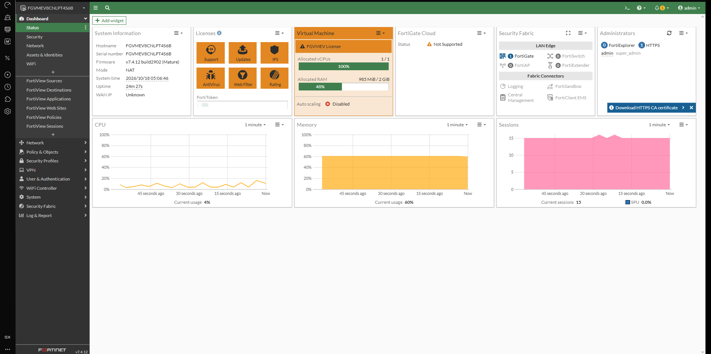
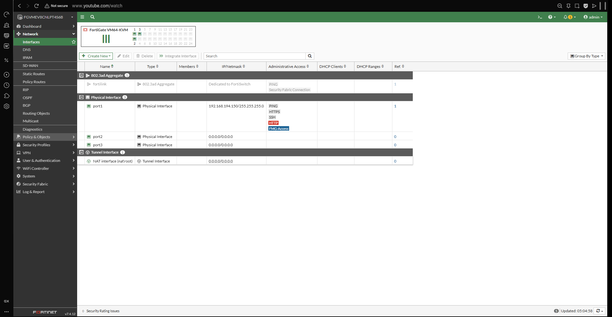
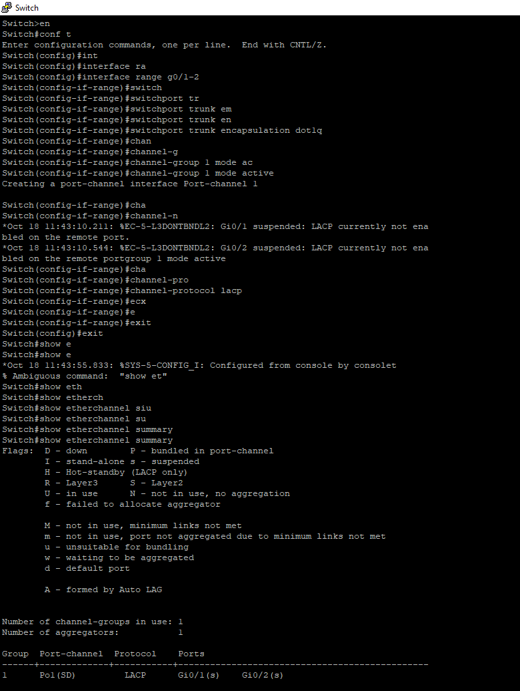

# 🛡️ FortiGate Interface Types: Aggregate (802.3ad) vs Redundant Interface Deployment Guide

A production-grade, highly detailed documentation covering the theoretical concepts, EVE-NG lab topology, step-by-step GUI/CLI configurations, switch-side trunking/LACP setups, and verification steps for **Aggregate (802.3ad)** and **Redundant** interfaces on FortiGate Firewalls (FortiOS 7.4.x).

---

## 📜 Table of Contents
1. [Overview & Theoretical Concepts](#-overview--theoretical-concepts)
   - [Redundant Interface](#1-redundant-interface)
   - [Aggregate Interface (802.3ad / LACP)](#2-aggregate-interface-8023ad--lacp)
   - [Comparison Matrix](#3-comparison-matrix)
2. [Lab Topology & Connection Matrix](#-lab-topology--connection-matrix)
   - [Network Diagram](#network-diagram)
   - [Connection Matrix](#connection-matrix)
3. [System & Interface Baseline Status](#-system--interface-baseline-status)
4. [Step-by-Step Configuration Guide](#-step-by-step-configuration-guide)
   - [Task 1: FortiGate Aggregate Interface Configuration](#task-1-fortigate-aggregate-interface-configuration)
   - [Task 2: Cisco L2 Switch LACP & Trunking Configuration](#task-2-cisco-l2-switch-lacp--trunking-configuration)
   - [Task 3: FortiGate Redundant Interface Configuration](#task-3-fortigate-redundant-interface-configuration)
5. [Verification & Command Reference](#-verification--command-reference)
   - [Cisco L2 Switch LACP Verification](#cisco-l2-switch-lacp-verification)
   - [FortiGate CLI Debug & Status Commands](#fortigate-cli-debug--status-commands)
6. [EVE-NG Virtualization Limitations & Edge Cases](#-eve-ng-virtualization-limitations--edge-cases)
7. [Firewall Policy Mapping & Traffic Flow Analysis](#-firewall-policy-mapping--traffic-flow-analysis)
8. [Key Takeaways & Lessons Learned](#-key-takeaways--lessons-learned)

---

## 🌐 Overview & Theoretical Concepts

When interconnecting FortiGate firewalls with core/distribution switches or edge routers, interface redundancy and bandwidth aggregation are critical architectural requirements. FortiOS supports two main high-availability link features: **Redundant Interfaces** and **Aggregate Interfaces (IEEE 802.3ad / LACP)**.



### 1. Redundant Interface
* **Mechanism:** Operates in an **Active-Passive** mode.
* **Functionality:** Multiple physical interfaces are bundled into a single logical interface. Only **one interface actively forwards traffic** at any given time while member links remain in standby mode.
* **Failover:** If the active physical link goes down, FortiOS instantly transfers active traffic forwarding to the standby link without dropping active connections.
* **Bandwidth:** Total available throughput is limited to the capacity of a single physical member link.
* **Switch Requirement:** Does **not** require LACP or EtherChannel configuration on the connected switch.

### 2. Aggregate Interface (802.3ad / LACP)
* **Mechanism:** Operates in an **Active-Active** mode utilizing Link Aggregation Control Protocol (LACP - IEEE 802.3ad).
* **Functionality:** Combines multiple physical interfaces into one logical link (Port Channel). Traffic is load-balanced across all operational member links.
* **Failover & Load Balancing:** Provides both link redundancy and increased aggregate bandwidth. If one member link fails, traffic seamlessly redistributes over remaining links.
* **Bandwidth:** Total bandwidth equals the sum of all active member link capacities.
* **Switch Requirement:** **Requires matching LACP / EtherChannel configuration** on the adjacent network switch or device.

### 3. Comparison Matrix

| Feature / Metric | Redundant Interface | Aggregate Interface (802.3ad) |
| :--- | :--- | :--- |
| **Operational Mode** | Active-Passive (Primary / Backup) | Active-Active (Load Balanced) |
| **Bandwidth** | 1x Speed of active link | Combined speed of all member links |
| **Protocol Support** | Proprietary FortiOS logic | IEEE 802.3ad LACP / Dynamic bundling |
| **Switch Configuration** | Standard ports (No special configuration) | Port-Channel / LACP Active Mode |
| **Use Case** | Connecting to two different upstream ISPs/switches without LACP | Connecting to LACP-enabled switch stacks/cores |

---

## 📐 Lab Topology & Connection Matrix

### Network Diagram

```text
               +-----------------------------+
               |   Management PC (Local-PC)  |
               +--------------+--------------+
                              |
                              | port1 (192.168.194.150/24)
                       +------+------+
                       |  FortiGate  |
                       |  Firewall   |
                       +---+-----+---+
     port2 (LAN)           |     |
    (192.168.1.0/24)       |     | port3 & port4 (Aggregate / Redundant Link)
           |               |     |
     +-----+-----+     +---+-----+---+                     +-----------+
     | Win PC    |     | Cisco L2    |  Gi0/2       Gi0/0  | Cisco vIOS|  Gi0/1      +----------+
     | (e0)      |     | Switch      +---------------------+ Router    +-------------+ Internet |
     +-----------+     +-------------+                     +-----------+             +----------+
```

### Connection Matrix

| Node Name | Local Interface | Connected Node | Remote Interface | Purpose / Role |
| :--- | :--- | :--- | :--- | :--- |
| **FortiGate** | `port1` | Local-PC | `eth0` | Out-of-Band Management (HTTPS/SSH) |
| **FortiGate** | `port2` | Win PC | `e0` | LAN Client Network Interface |
| **FortiGate** | `port3` | Cisco Switch | `Gi0/0` | Member 1 of Aggregate / Redundant Link |
| **FortiGate** | `port4` | Cisco Switch | `Gi0/1` | Member 2 of Aggregate / Redundant Link |
| **Cisco Switch**| `Gi0/2` | Cisco vIOS | `Gi0/0` | Uplink to Edge Router |
| **Cisco vIOS** | `Gi0/1` | Internet Cloud | `N/A` | External Internet WAN Gateway |

---

## 🖥️ System & Interface Baseline Status



### System Hardware & License Details
* **Hostname:** `FGVMEV8CNLPT4S6B`
* **Firmware:** FortiOS `v7.4.12 build2902 (Mature)`
* **System Mode:** NAT Mode
* **Resource Allocation:** 1 vCPU / 2.0 GiB RAM (Current usage ~60% Memory, ~4% CPU)
* **Management WAN IP:** `192.168.194.150` (`port1`)



### Initial Interface Table

| Interface Name | Type | IP / Netmask | Administrative Access | Role / Status |
| :--- | :--- | :--- | :--- | :--- |
| `port1` | Physical | `192.168.194.150/255.255.255.0` | PING, HTTPS, SSH, HTTP, FMG-Access | Management Interface |
| `port2` | Physical | `0.0.0.0/0.0.0.0` | None | Unassigned LAN Port |
| `port3` | Physical | `0.0.0.0/0.0.0.0` | None | Unassigned WAN Link 1 |
| `port4` | Physical | `0.0.0.0/0.0.0.0` | None | Unassigned WAN Link 2 |

---

## ⚙️ Step-by-Step Configuration Guide

### Task 1: FortiGate Aggregate Interface Configuration

#### 1. Via FortiGate GUI:
1. Navigate to **Network > Interfaces**.
2. Click **Create New > Interface**.
3. Configure the following parameters:
   * **Interface Name:** `van_interface` (or `LAG-WAN`)
   * **Type:** `802.3ad Aggregate`
   * **Interface Members:** Select `port3` and `port4`
   * **Role:** `WAN`
   * **Addressing Mode:** Manual / Unassigned (Layer 2 Mode) or Assign Static IP as per topology requirement.
4. Click **OK**.

#### 2. Via FortiGate CLI:
```haproxy
config system interface
    edit "van_interface"
        set vdom "root"
        set type aggregate
        set member "port3" "port4"
        set role wan
        set snmp-index 5
    next
end
```

---

### Task 2: Cisco L2 Switch LACP & Trunking Configuration

To form an operational 802.3ad bundle, the adjacent Cisco switch ports (`Gi0/1` and `Gi0/2` or `Gi0/0` and `Gi0/1`) must be configured for LACP dynamic negotiation and 802.1Q encapsulation.



#### Cisco IOS CLI Configuration Commands:
```cisco
Switch> enable
Switch# configure terminal
Switch(config)# interface range GigabitEthernet 0/1 - 2
Switch(config-if-range)# switchport trunk encapsulation dot1q
Switch(config-if-range)# switchport mode trunk
Switch(config-if-range)# channel-protocol lacp
Switch(config-if-range)# channel-group 1 mode active
Switch(config-if-range)# no shutdown
Switch(config-if-range)# exit
Switch(config)# exit
Switch# write memory
```

---

### Task 3: FortiGate Redundant Interface Configuration

If switching from Aggregate to Redundant interface mode (or in environments where the upstream switch does not support LACP):

#### 1. Via FortiGate CLI:
First, remove the aggregate interface bindings:
```haproxy
config system interface
    delete "van_interface"
end
```

Then create the Redundant Interface bundle:
```haproxy
config system interface
    edit "van_redundant"
        set vdom "root"
        set type redundant
        set member "port3" "port4"
        set role wan
    next
end
```

---

## 🔍 Verification & Command Reference

### Cisco L2 Switch LACP Verification

To verify the status of the LACP bundle on the Cisco switch, execute:

```cisco
Switch# show etherchannel summary
```

#### Expected CLI Output Analysis:
```text
Group  Port-channel  Protocol    Ports
------+-------------+-----------+-----------------------------------------------
1      Po1(SU)       LACP        Gi0/1(P)    Gi0/2(P)
```

* **Flags Status:**
  * `S` - Switch (Layer 2)
  * `U` - In use (Operational)
  * `P` - Bundled in port-channel (Active LACP participant)

---

### FortiGate CLI Debug & Status Commands

#### 1. Check Link Aggregation Status
```haproxy
diagnose netlink aggregate name van_interface
```

#### 2. Check Physical Interface Status
```haproxy
get system interface physical
```

#### 3. Monitor LACP Negotiated State
```haproxy
diagnose netlink aggregate list
```

---

## ⚠️ EVE-NG Virtualization Limitations & Edge Cases

1. **Layer 3 EtherChannel Support:**
   * In EVE-NG virtualized environments (Cisco vIOS-L2 / IOL images), configuring Layer 3 EtherChannels (`no switchport` on Port-Channel) can cause control-plane instabilty or fail to establish.
   * **Workaround:** Always deploy Layer 2 EtherChannels with `switchport mode trunk` and assign Layer 3 IP configurations directly to SVIs or the virtual firewall logical interface.

2. **Redundant Interface Switch-Side Limitations:**
   * Redundant interfaces cannot be tested with LACP commands on the switch side. The switch ports connected to a FortiGate redundant interface must be configured as standard, independent access or trunk ports.

---

## 📊 Firewall Policy Mapping & Traffic Flow Analysis

When an Aggregate or Redundant interface is created, it functions as a single logical entity across security policies.

```haproxy
config firewall policy
    edit 1
        set name "LAN_to_WAN_Access"
        set srcintf "port2"
        set dstintf "van_interface"
        set srcaddr "all"
        set dstaddr "all"
        set action accept
        set schedule "always"
        set service "ALL"
        set nat enable
    next
end
```

### Dynamic Traffic Flow Logic:
* **Aggregate Interface Mode:** Packets leaving `port2` towards `van_interface` are distributed across `port3` and `port4` based on source-destination IP/MAC hashing algorithms.
* **Redundant Interface Mode:** All traffic flows strictly via primary member `port3`. If `port3` physically link-downs, traffic instantly re-routes out `port4` without requiring policy adjustments or routing updates.

---

## 💡 Key Takeaways & Lessons Learned

1. **Active-Active vs. Active-Passive:** Aggregate interfaces increase available bandwidth and provide fault tolerance via standard IEEE 802.3ad (LACP). Redundant interfaces provide simple active-passive link backup without requiring LACP support on network switches.
2. **Switching Consistency:** Always ensure `channel-group 1 mode active` is configured on Cisco switches when peering with FortiGate aggregate interfaces to enable active LACP negotiation.
3. **Configuration Order:** Physical interfaces must be free of references (no IP, no existing firewall policies, no zones) before they can be added as members to an Aggregate or Redundant bundle.
4. **Policy Simplification:** Logical interface bundling abstracts physical link complexities, keeping firewall policy definitions clean, scalable, and manageable.
