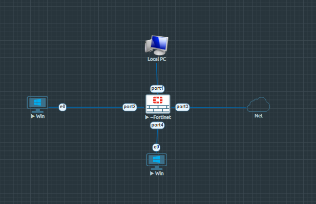
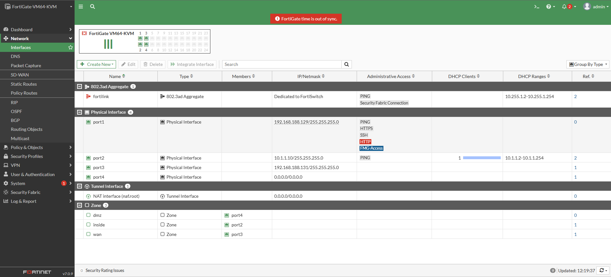
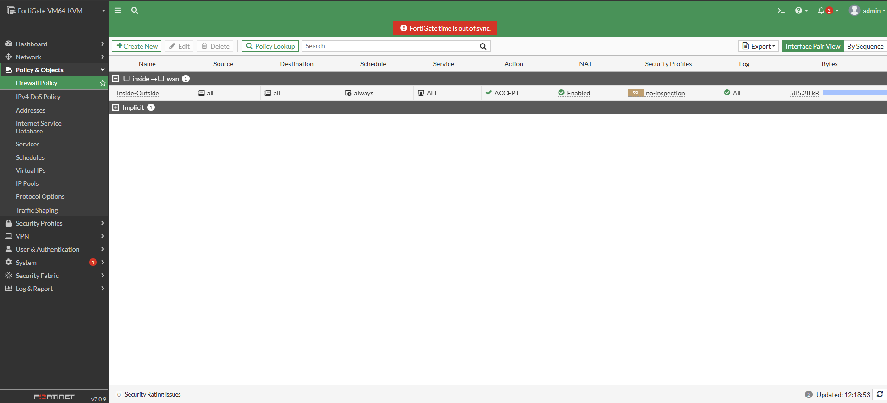
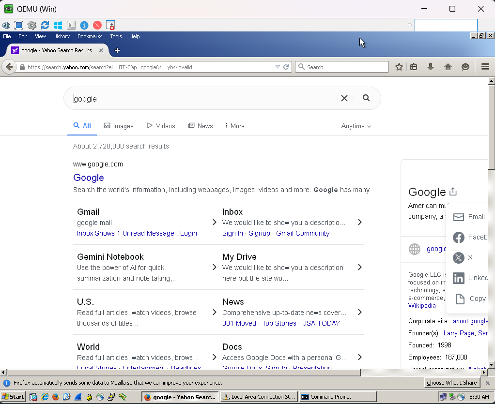
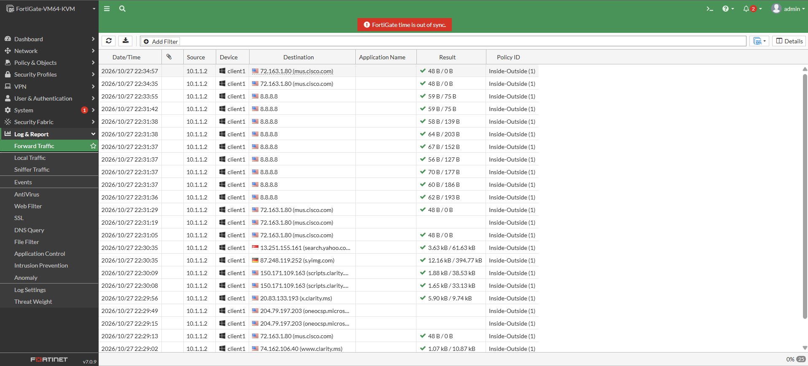

# 🛡️ Lab 06 — FortiGate L3 Interfaces, Zones, and Source NAT Setup

A complete hands-on guide covering the theoretical concepts, EVE-NG lab implementation, zone segmentation, L3 interface configuration, Source NAT (SNAT), firewall policy setup, traffic generation, and real-world troubleshooting on FortiGate Firewalls (FortiOS v7.0.x / v7.4.x).

## 📜 Table of Contents

1. [Overview & Theoretical Concepts](#-overview--theoretical-concepts)
   * [Layer 3 (L3) Interfaces](#1-layer-3-l3-interfaces)
   * [Security Zones & Network Segmentation](#2-security-zones--network-segmentation)
   * [Source NAT (SNAT) Fundamentals](#3-source-nat-snat-fundamentals)
2. [Lab Topology & Connection Matrix](#-lab-topology--connection-matrix)
   * [Topology Diagram](#topology-diagram)
   * [Connection Matrix](#connection-matrix)
3. [System & Baseline Status](#-system--baseline-status)
4. [Step-by-Step Configuration Guide](#-step-by-step-configuration-guide)
   * [Task 1: Creating Security Zones](#task-1-creating-security-zones)
   * [Task 2: Configuring L3 Interfaces & DHCP Services](#task-2-configuring-l3-interfaces--dhcp-services)
   * [Task 3: Default Routing Setup](#task-3-default-routing-setup)
   * [Task 4: IPv4 Firewall Policy & SNAT Configuration](#task-4-ipv4-firewall-policy--snat-configuration)
5. [Traffic Verification & Real-World Troubleshooting](#-traffic-verification--real-world-troubleshooting)
   * [Traffic Generation](#traffic-generation)
   * [Log Verification](#log-verification)
   * [Edge Case: Resolving DNS Resolution Failure](#edge-case-resolving-dns-resolution-failure)
6. [Key Takeaways & Lessons Learned](#-key-takeaways--lessons-learned)

---

## 🌐 Overview & Theoretical Concepts

### 1. Layer 3 (L3) Interfaces
Unlike Virtual Wire Pairs (V-Wire) or Layer 2 (L2) interfaces, a **Layer 3 Interface** operates at the Network Layer of the OSI Model.
* **IP Assignment:** Supports direct IPv4/IPv6 address assignment (Static or DHCP Client).
* **Routing Support:** Allows Static Routes, Dynamic Routing protocols (OSPF, BGP, RIP), and Policy-Based Routing (PBR).
* **VPN Termination:** Essential for terminating IPsec VPN tunnels, SSL VPNs, and GRE tunnels.
* **Trade-off:** L3 interfaces are visible during IP traceroutes (TTL decrement), unlike transparent L2/V-Wire interfaces.

### 2. Security Zones & Network Segmentation
A **Zone** is a logical grouping of one or more physical/virtual interfaces that share similar security requirements and policies.
* **Policy Simplification:** Instead of creating separate security policies per physical interface, policies can be applied directly between zones (e.g., `inside` to `wan`).
* **Resource Efficiency:** Reduces policy table complexity, making firewall lookups faster and administrative management cleaner.
* **Intra-Zone Blocking:** FortiOS supports blocking intra-zone traffic, preventing hosts inside the same zone from communicating unless explicitly allowed.

### 3. Source NAT (SNAT) Fundamentals
Private IP addresses (RFC 1918) are non-routable over the public Internet.
* **Mechanism:** Source NAT translates the private source IP address of an internal host (e.g., `10.1.1.2`) to a public IP address (typically the egress WAN interface IP `192.168.188.131`).
* **Session Tracking:** The firewall maintains a NAT connection table to map returning inbound traffic back to the originating internal host.

---

## 📐 Lab Topology & Connection Matrix

### Topology Diagram



### Connection Matrix

| Node Name | Local Interface | Connected Node | Remote Interface | IP Address / Subnet | Security Zone | Role / Purpose |
| :--- | :--- | :--- | :--- | :--- | :--- | :--- |
| **FortiGate** | `port1` | Local-PC | `eth0` | `192.168.188.129/24` | N/A | Management (GUI/SSH) |
| **FortiGate** | `port2` | Win Client 1 | `e0` | `10.1.1.10/24` | `inside` | Internal LAN Gateway |
| **FortiGate** | `port3` | Net (Cloud/WAN) | `eth0` | `192.168.188.131/24` | `wan` | External WAN Interface |
| **FortiGate** | `port4` | Win Client 2 | `e0` | Unassigned | `dmz` | DMZ Interface |

---

## 🖥️ System & Baseline Status

* **Device Hostname:** FortiGate-VM64-KVM
* **Firmware Version:** FortiOS v7.0.9 (Build 0444)
* **Operation Mode:** NAT / Route Mode
* **Management Access:** `port1` (`https://192.168.188.129`)

---

## ⚙️ Step-by-Step Configuration Guide

### Task 1: Creating Security Zones

1. Navigate to **Network** > **Interfaces**.
2. Click **Create New** > **Zone**.
3. Create the following three security zones:
   * **Zone Name:** `inside` | **Interface Member:** `port2`
   * **Zone Name:** `wan` | **Interface Member:** `port3`
   * **Zone Name:** `dmz` | **Interface Member:** `port4`

---

### Task 2: Configuring L3 Interfaces & DHCP Services

#### 1. WAN Interface (`port3`) — Dynamic Addressing
* **Addressing Mode:** DHCP (Retrieves IP and Default Gateway automatically from the ISP Cloud).

#### 2. LAN Interface (`port2`) — Static Gateway & DHCP Server
Via FortiGate GUI:
* **IP/Netmask:** `10.1.1.10/255.255.255.0`
* **Administrative Access:** PING enabled.
* **DHCP Server:** Enabled.
  * **IP Range:** `10.1.1.2` – `10.1.1.254`
  * **Default Gateway:** Same as Interface IP (`10.1.1.10`)
  * **DNS Server:** Specify System DNS (`8.8.8.8`, `8.8.4.4`)

*GUI Reference for Interface State:*


Via CLI:
```text
config system interface
    edit "port2"
        set vdom "root"
        set ip 10.1.1.10 255.255.255.0
        set allowaccess ping
        set type physical
        set role lan
    next
end

config system dhcp server
    edit 1
        set default-gateway 10.1.1.10
        set interface "port2"
        config ip-range
            edit 1
                set start-ip 10.1.1.2
                set end-ip 10.1.1.254
            next
        end
        set dns-service default
    next
end
```

---

### Task 3: Default Routing Setup

Because `port3` uses DHCP, FortiOS automatically installs a default static route pointing to the upstream ISP router. To verify from FortiGate CLI:

```text
get router info routing-table all
```

*Output Verification:*
`S* 0.0.0.0/0 [5/0] via 192.168.188.2, port3`

---

### Task 4: IPv4 Firewall Policy & SNAT Configuration

To permit internal LAN hosts to browse the internet, an explicit policy from `inside` to `wan` with **Source NAT (SNAT)** is required.

1. Go to **Policy & Objects** > **Firewall Policy**.
2. Click **Create New** and set:
   * **Name:** `Inside-Outside`
   * **Incoming Interface:** `inside` (Zone)
   * **Outgoing Interface:** `wan` (Zone)
   * **Source:** `all`
   * **Destination:** `all`
   * **Schedule:** `always`
   * **Service:** `ALL`
   * **Action:** `ACCEPT`
   * **NAT:** **ENABLED** (Use Outgoing Interface Address)
   * **Log Allowed Traffic:** **All Sessions**



---

## 🔍 Traffic Verification & Real-World Troubleshooting

### Traffic Generation

On the client host (`Win`), verify IP configuration via DHCP and test HTTP/HTTPS browsing.



### Log Verification

Check outbound traffic under **Log & Report** > **Forward Traffic**.



### ⚠️ Edge Case: Resolving DNS Resolution Failure

#### **Problem Statement:**
During initial testing, the Windows client could successfully ping internet IP addresses (`ping 8.8.8.8`), confirming that **Routing, Security Policy, and SNAT were fully functional**. However, web pages failed to load in the browser with a **"Server Not Found"** error (e.g., `search.yahoo.com`).

#### **Root Cause Analysis:**
The client PC's network adapter had not received or configured valid public DNS resolvers, preventing domain name translation.

#### **Resolution Steps:**
1. **Client Adapter Update:**
   Configure explicit DNS servers on the Windows Client TCP/IP properties:
   * **Preferred DNS:** `8.8.8.8`
   * **Alternate DNS:** `8.8.4.4`
2. **Flush Client DNS Cache:**
   Run the following in Windows Command Prompt:
   ```cmd
   ipconfig /flushdns
   ```
3. **Verify FortiGate System DNS:**
   Ensure FortiGate DNS settings are pointing to reliable resolvers (**Network** > **DNS**).

After completing these steps, domain resolution succeeded and full web browsing functionality was restored.

---

## 💡 Key Takeaways & Lessons Learned

1. **Layer 3 Versatility:** L3 interfaces form the bedrock of enterprise network edge configurations, supporting IP addressing, routing, VPNs, and inspection.
2. **Zone-Based Efficiency:** Logical zones streamline administration by allowing policies to scale cleanly without per-interface policy clutter.
3. **SNAT Necessity:** Internet access for private networks requires SNAT on egress WAN interfaces to translate non-routable private addresses into public routing endpoints.
4. **Isolate Connectivity vs Resolution:** A successful `ping 8.8.8.8` proves Layer 3 reachability and NAT translation; domain loading failures point specifically to DNS misconfigurations.