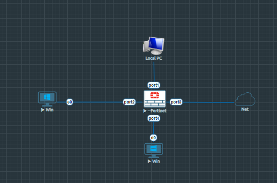
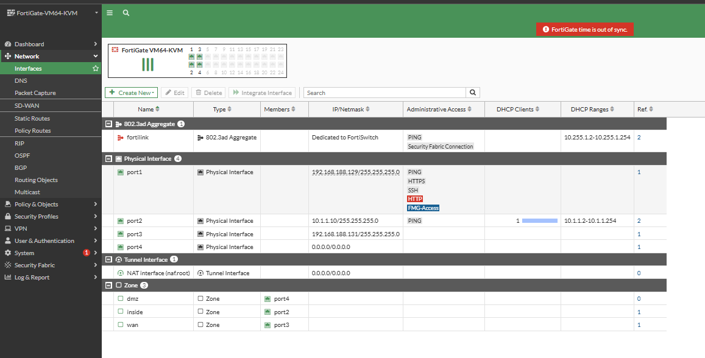
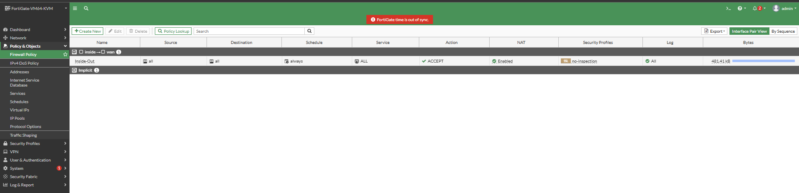
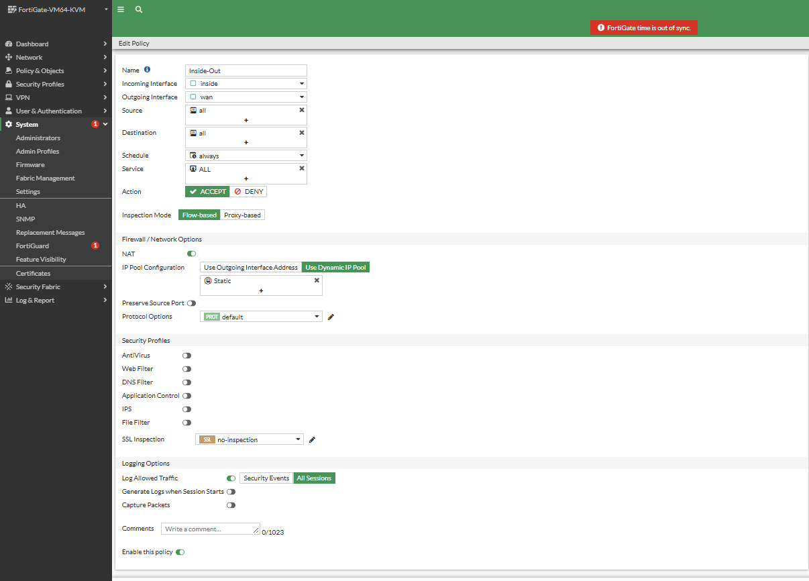
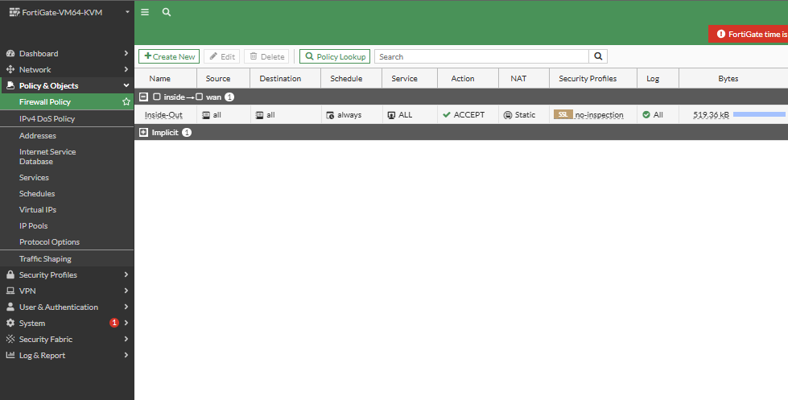
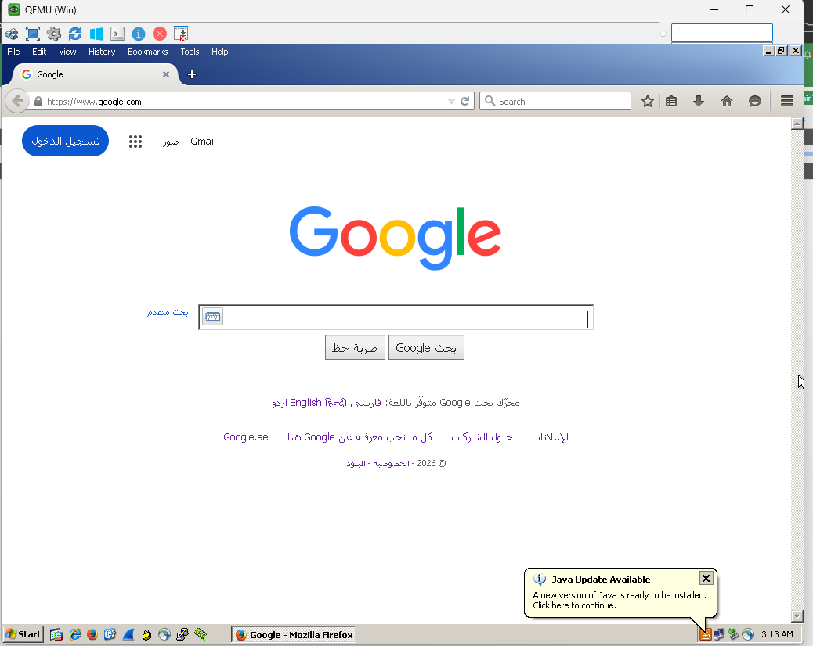
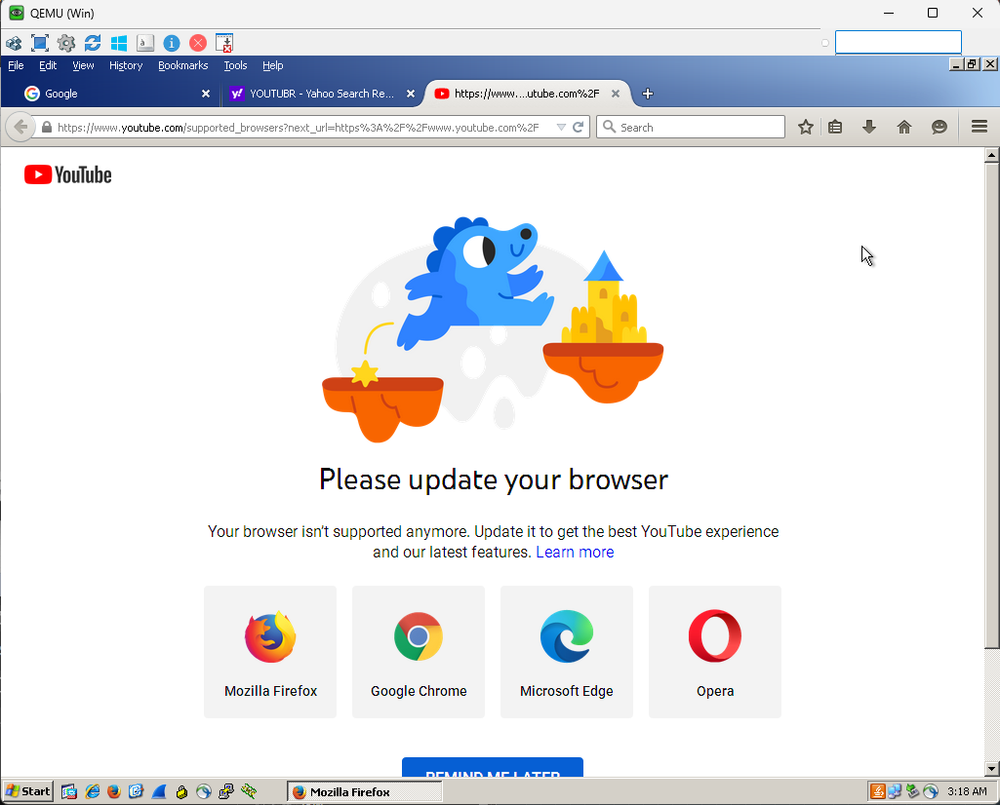
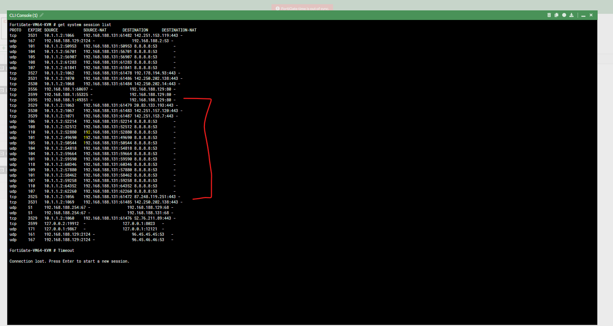
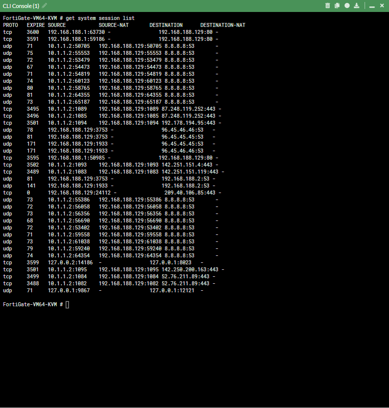
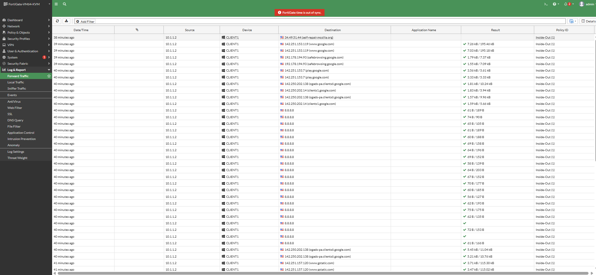

# FortiGate Firewall: Source NAT, Dynamic IP Pool, and PAT Deep Dive

A comprehensive, production-grade lab and conceptual guide covering Network Address Translation (NAT) on FortiGate firewalls running FortiOS. This document provides theoretical concepts, detailed network topology specifications, step-by-step graphical and CLI configuration steps, traffic testing workflows, and real-time session verification logs.

---

## Table of Contents

- [1. Overview and Theoretical Concepts](#1-overview-and-theoretical-concepts)
  - [What is Network Address Translation (NAT)?](#what-is-network-address-translation-nat)
  - [Why is NAT Required in Modern Networks?](#why-is-nat-required-in-modern-networks)
  - [Private vs. Public IP Addresses](#private-vs-public-ip-addresses)
  - [Core Classifications: Source NAT vs. Destination NAT](#core-classifications-source-nat-vs-destination-nat)
- [2. Deep Dive: Types of Source NAT (SNAT)](#2-deep-dive-types-of-source-nat-snat)
  - [Static 1-to-1 NAT](#1-static-1-to-1-nat)
  - [NAT Pool (Many-to-Many)](#2-nat-pool-many-to-many)
  - [Policy-Based NAT](#3-policy-based-nat)
  - [Port Address Translation (PAT / Overload)](#4-port-address-translation-pat--overload)
  - [SNAT Types Comparison Matrix](#snat-types-comparison-matrix)
- [3. Lab Topology and System Baseline](#3-lab-topology-and-system-baseline)
  - [Topology Diagram](#topology-diagram)
  - [Addressing and Interface Connection Table](#addressing-and-interface-connection-table)
- [4. Step-by-Step Configuration Guide](#4-step-by-step-configuration-guide)
  - [Step 1: Interface Verification and Setup](#step-1-interface-verification-and-setup)
  - [Step 2: Basic PAT (Overload) Firewall Policy Setup](#step-2-basic-pat-overload-firewall-policy-setup)
  - [Step 3: Dynamic IP Pool Configuration](#step-3-dynamic-ip-pool-configuration)
  - [Step 4: Static 1-to-1 SNAT Policy Binding](#step-4-static-1-to-1-snat-policy-binding)
- [5. Traffic Generation and Verification](#5-traffic-generation-and-verification)
  - [Client-Side Traffic Test (PAT Mode)](#client-side-traffic-test-pat-mode)
  - [Client-Side Traffic Test (Static 1-to-1 Mode)](#client-side-traffic-test-static-1-to-1-mode)
  - [CLI Kernel Session Table Analysis](#cli-kernel-session-table-analysis)
  - [FortiGate Forward Traffic Log Verification](#fortigate-forward-traffic-log-verification)
- [6. Key Takeaways and Architectural Best Practices](#6-key-takeaways-and-architectural-best-practices)

---

## 1. Overview and Theoretical Concepts

### What is Network Address Translation (NAT)?

Network Address Translation (NAT) is an essential networking technique defined in RFC 1631 and RFC 3022. It modifies IP address information inside the Layer 3 (IP) header of network packets while they are in transit across a routing device or firewall.

When a device on an internal network sends a packet across an edge firewall toward the internet, the firewall intercepts the packet and replaces the original source IP address with a globally routable public IP address. When the response arrives back at the firewall, it performs the reverse operation, re-substituting the internal device's private IP address before passing the packet inward.

```
+------------------+         +--------------------+         +------------------+
| Internal Device  | ------> | FortiGate Firewall | ------> | Internet Target  |
| (10.1.1.2)       |         | (Translates Src IP)|         | (8.8.8.8)        |
+------------------+         +--------------------+         +------------------+
```

---

### Why is NAT Required in Modern Networks?

1. **IPv4 Address Exhaustion Mitigation:**
   The global IPv4 address pool contains approximately $2^{32}$ ($\sim 4.29$ billion) unique addresses, which is insufficient for global demand. NAT enables thousands of private hosts to access the internet using a single public IP address or a small block of IP addresses.

2. **Network Security and IP Hiding:**
   NAT acts as an initial security boundary by obscuring internal IP structures from external networks. External internet endpoints only see the public IP address of the edge firewall, preventing direct external probing of internal systems.

3. **Flexibility and Independence from ISPs:**
   Internal networks can use RFC 1918 private address ranges without needing to re-IP internal endpoints if the upstream Internet Service Provider (ISP) or public IP assignment changes.

---

### Private vs. Public IP Addresses

| IP Address Category | Defined Range (RFC 1918) | Internet Routability | Usage Context |
| :--- | :--- | :--- | :--- |
| **Class A Private** | `10.0.0.0` to `10.255.255.255` (`10.0.0.0/8`) | Non-Routable | Enterprise internal LANs |
| **Class B Private** | `172.16.0.0` to `172.31.255.255` (`172.16.0.0/12`) | Non-Routable | Corporate subnets and DMZs |
| **Class C Private** | `192.168.0.0` to `192.168.255.255` (`192.168.0.0/16`) | Non-Routable | Small office / Home networks |
| **Public IP Addresses** | All remaining valid IPv4 unicast blocks | Routable | Global WAN and Internet routing |

> **Note:** Public internet routers drop packets containing RFC 1918 private source or destination addresses. Outbound private traffic must be translated to a public IP address before reaching an upstream ISP router.

---

### Core Classifications: Source NAT vs. Destination NAT

```
                                  +-----------------------+
                                  | NAT Translation Types |
                                  +-----------------------+
                                              |
                     +------------------------+------------------------+
                     |                                                 |
         +-----------------------+                         +-----------------------+
         |    Source NAT (SNAT)   |                         | Destination NAT(DNAT) |
         +-----------------------+                         +-----------------------+
         | Changes Source IP     |                         | Changes Destination IP|
         | Used for Outbound LAN |                         | Used for Inbound DMZ  |
         +-----------------------+                         +-----------------------+
```

1. **Source NAT (SNAT):**
   Modifies the **Source IP** address (and optionally the source port) in the packet header. Used when internal users or servers make outbound connections toward external destinations or the internet.

2. **Destination NAT (DNAT):**
   Modifies the **Destination IP** address (and optionally the destination port) in the packet header. Used when external users on the internet access internal services, such as a web or application server hosted inside a DMZ.

---

## 2. Deep Dive: Types of Source NAT (SNAT)

FortiOS supports four primary Source NAT methods:

```
                           +-----------------------------------+
                           |        Source NAT Variants        |
                           +-----------------------------------+
                                             |
       +--------------------+----------------+--------------------+--------------------+
       |                    |                                     |                    |
+--------------+     +--------------+                      +--------------+     +--------------+
| Static 1-to-1|     |   NAT Pool   |                      |  Policy NAT  |     | PAT Overload |
| Translation  |     | (Many-to-Many|                      | (Conditional)|     | (1-to-Many)  |
+--------------+     +--------------+                      +--------------+     +--------------+
```

### 1. Static 1-to-1 NAT
- **Definition:** Dedicated, bidirectional dynamic mapping where one specific private IP address converts directly to one assigned public IP address.
- **Use Case:** High-priority enterprise servers requiring a consistent public identity for outward communication.

### 2. NAT Pool (Many-to-Many)
- **Definition:** Maps a range of internal private IP addresses to a specified range of external public IP addresses (for example, `192.168.188.129` through `192.168.188.135`).
- **Use Case:** Environments where a group of users requires outbound access using a limited block of public IP addresses.

### 3. Policy-Based NAT
- **Definition:** Conditional translation triggered only when outbound traffic matches specific source, destination, port, or protocol rules.
- **Use Case:** Complex VPN setups or site-to-site WAN routing policies.

### 4. Port Address Translation (PAT / Overload)
- **Definition:** Maps multiple internal private IP addresses to a single public IP address (such as an outgoing firewall interface address).
- **Mechanism:** The firewall tracks individual traffic streams by substituting unique layer 4 source port numbers (TCP/UDP) for each host.
- **Use Case:** Standard enterprise LAN-to-Internet access.

---

### SNAT Types Comparison Matrix

| SNAT Type | Address Ratio | Port Modification | Public IP Requirement | Typical Scenario |
| :--- | :--- | :--- | :--- | :--- |
| **Static 1-to-1** | 1 Private to 1 Public | No (Maintains source port) | Dedicated Public IP per client | Publicly accessible enterprise servers |
| **NAT Pool** | Multiple Private to Multiple Public | Optional | Block of sequential Public IPs | Outbound translation for subnet blocks |
| **Policy NAT** | Variable | Rule Dependent | Conditional IP Assignment | B2B IPsec VPNs with IP overlap |
| **PAT (Overload)** | Many Private to 1 Public | Yes (Dynamic source port assignment) | Single Public IP Address | Standard LAN workstation internet egress |

---

## 3. Lab Topology and System Baseline

### Topology Diagram

The lab topology shown below is built in EVE-NG. It contains a FortiGate Next-Generation Firewall (`FortiGate-VM64-KVM`), a Local Management Workstation (`Local-PC`), an internal LAN Client (`CLIENT1`), and an external Internet Gateway.



*Figure 1: Lab Topology showing internal management connection (`port1`), internal client subnet (`port2`), and external egress network (`port3`).*

---

### Addressing and Interface Connection Table

| Device Name | Local Interface | IP Address / Subnet Mask | Connected Host / Network | Role and Function |
| :--- | :--- | :--- | :--- | :--- |
| **FortiGate** | `port1` | `192.168.188.129/24` | Management PC | Out-of-Band Management (HTTPS/SSH) |
| **FortiGate** | `port2` | `10.1.1.10/24` | CLIENT1 (`10.1.1.2`) | Inside / LAN Default Gateway |
| **FortiGate** | `port3` | `192.168.188.131/24` | WAN Router / Internet | Outside / WAN Egress Interface |
| **CLIENT1** | `eth0` | `10.1.1.2/24` | FortiGate `port2` | Internal Test PC |

---

## 4. Step-by-Step Configuration Guide

### Step 1: Interface Verification and Setup

Before enabling translation policies, confirm that physical interfaces and administrative permissions are correctly assigned in FortiOS.



*Figure 2: `Interfaces.png` - FortiGate Network Interfaces table showing active ports (`port1`, `port2`, and `port3`) along with their assigned network zones (`inside` and `wan`).*

#### Why I Configured It:
Verifying interface status ensures Layer 1 through Layer 3 connectivity is functional across all zones (`inside`, `wan`, `management`) before configuring stateful security rules.

#### CLI Configuration Equivalent:
```haproxy
config system interface
    edit "port1"
        set ip 192.168.188.129 255.255.255.0
        set allowaccess ping https ssh http
    next
    edit "port2"
        set ip 10.1.1.10 255.255.255.0
        set allowaccess ping
    next
    edit "port3"
        set ip 192.168.188.131 255.255.255.0
        set allowaccess ping
    next
end
```

---

### Step 2: Basic PAT (Overload) Firewall Policy Setup

To allow the internal workstation (`10.1.1.2`) on `port2` to reach external networks, configure an outbound security policy with NAT enabled using the outgoing interface address.



*Figure 3: `Firewall_Policy.png` - Outbound Firewall Policy (`Inside-Out`) allowing traffic from zone `inside` to zone `wan` with NAT enabled.*

#### Why I Configured It:
Enabling **Use Outgoing Interface Address** sets up Port Address Translation (PAT). All outgoing packets from `10.1.1.0/24` have their private source IP converted to `port3`'s IP address (`192.168.188.131`).

#### Step-by-Step GUI Instructions:
1. Navigate to **Policy & Objects > Firewall Policy** and click **Create New**.
2. Configure the following parameters:
   - **Name:** `Inside-Out`
   - **Incoming Interface:** `inside` (`port2`)
   - **Outgoing Interface:** `wan` (`port3`)
   - **Source:** `all`
   - **Destination:** `all`
   - **Schedule:** `always`
   - **Service:** `ALL`
   - **Action:** `ACCEPT`
3. Scroll down to **Firewall / Network Options**.
4. Toggle **NAT** to **Enabled**.
5. Select **Use Outgoing Interface Address**.
6. Click **OK** to commit and activate the policy.

#### CLI Configuration Equivalent:
```haproxy
config firewall policy
    edit 1
        set name "Inside-Out"
        set srcintf "inside"
        set dstintf "wan"
        set srcaddr "all"
        set dstaddr "all"
        set action accept
        set schedule "always"
        set service "ALL"
        set nat enable
    next
end
```

---

### Step 3: Dynamic IP Pool Configuration

When outbound traffic requires a specific public IP address or range instead of the interface IP, create a Dynamic IP Pool.



*Figure 4: `Dynamic_IP_POOL.png` - Setting up a Dynamic IP Pool inside the Firewall Policy parameters.*

#### Why I Configured It:
Configuring a Dynamic IP Pool allows the firewall to translate internal client addresses using defined external IP allocations rather than sharing the firewall's main interface IP address.

#### Step-by-Step GUI Instructions:
1. Navigate to **Policy & Objects > IP Pools** and click **Create New**.
2. Set **Name** to `Static_Pool`.
3. Set **Type** to `One-to-One`.
4. Enter the **External IP Range**: `192.168.188.129` to `192.168.188.129`.
5. Enable **ARP Reply** so the FortiGate answers ARP requests for the pool IP address.
6. Click **OK**.

---

### Step 4: Static 1-to-1 SNAT Policy Binding

After defining the IP Pool, bind it to the outbound firewall policy.



*Figure 5: `ONE-ONE_NAT_POLICY.png` - Firewall Policy table showing policy `Inside-Out` updated to use the Static 1-to-1 Dynamic IP Pool.*

#### Why I Configured It:
Binding `Static_Pool` to the firewall policy instructs FortiOS to override standard PAT overload translation and process outbound sessions using 1-to-1 static translation.

#### Step-by-Step GUI Instructions:
1. Go to **Policy & Objects > Firewall Policy**.
2. Select policy `Inside-Out` and click **Edit**.
3. Under **Firewall / Network Options**, ensure **NAT** is enabled.
4. Switch **IP Pool Configuration** from *Use Outgoing Interface Address* to **Use Dynamic IP Pool**.
5. Add `Static_Pool` into the pool selection box.
6. Click **OK**.

---

## 5. Traffic Generation and Verification

### Client-Side Traffic Test (PAT Mode)

Generate outbound web sessions from internal client `CLIENT1` (`10.1.1.2`) to test internet access while PAT overload is active.



*Figure 6: `Traffic_Generation.png` - Internal client accessing google.com during PAT testing.*

---

### Client-Side Traffic Test (Static 1-to-1 Mode)

Generate web traffic while the policy is configured for Static 1-to-1 dynamic pool translation.



*Figure 7: `ONE-ONE_TRAFFIC_GENERATION.png` - Internal client accessing youtube.com during Static 1-to-1 NAT pool testing.*

---

### CLI Kernel Session Table Analysis

Run the following diagnostic command in the FortiGate CLI to inspect active kernel translation sessions:

```bash
get system session list
```

#### 1. PAT (Port Address Translation) Session Output Analysis



*Figure 8: `NAT_Translation.png` - CLI kernel session table showing active PAT sessions translating `10.1.1.2` to `192.168.188.131`.*

Key fields from the CLI session output:
- **PROTO:** `udp` / `tcp`
- **SOURCE (Internal Private Host):** `10.1.1.2`
- **SOURCE-NAT (Translated WAN IP):** `192.168.188.131` (Interface IP of `port3`)
- **Port Mapping:** The firewall dynamically alters source port values (e.g., source port `52880` translates to outward port `52880`).

---

#### 2. Static 1-to-1 NAT Session Output Analysis



*Figure 9: `ONE-ONE_NAT_TRANSLATION.png` - CLI kernel session table showing active 1-to-1 translation sessions from `10.1.1.2` to dynamic pool IP `192.168.188.129`.*

Key fields from the CLI session output:
- **SOURCE (Internal Private Host):** `10.1.1.2`
- **SOURCE-NAT (Translated IP):** `192.168.188.129` (Assigned Dynamic IP Pool)
- **Port Mapping:** Port mapping maintains 1-to-1 alignment with the original source port where possible because the external IP address is dedicated to this client.

---

### FortiGate Forward Traffic Log Verification

Inspect real-time session records in the FortiOS event logger under **Log & Report > Forward Traffic**.



*Figure 10: `Traffic_Log.png` - Forward Traffic logs detailing allowed outbound sessions, policy association, and translation records.*

Log Breakdown:
- **Source:** Displays client source IP `10.1.1.2`.
- **Destination:** Displays target internet IP addresses (e.g., Google DNS `8.8.8.8` and web servers).
- **Policy ID:** Identifies matching policy `1` (`Inside-Out`).
- **Result:** Displays allowed status with NAT enabled.

---

## 6. Key Takeaways and Architectural Best Practices

1. **PAT for General Workstations:**
   Use Port Address Translation (PAT / Overload) for standard user network segments to optimize public IPv4 address usage.

2. **Dedicated Pools for Outbound Services:**
   Use Dynamic IP Pools or Static 1-to-1 SNAT for servers that require persistent outbound identity for IP-whitelisting or security auditing.

3. **Proxy ARP Requirements:**
   When an IP pool uses an address on the same subnet as an external interface (but not assigned directly to the interface), enable **Proxy ARP** on the IP pool. This ensures the firewall responds to ARP requests for that pool address from upstream routers.

4. **CLI Diagnostics:**
   Use `get system session list` or `diagnose sys session filter` to inspect active translated sessions directly in the kernel table during network troubleshooting.