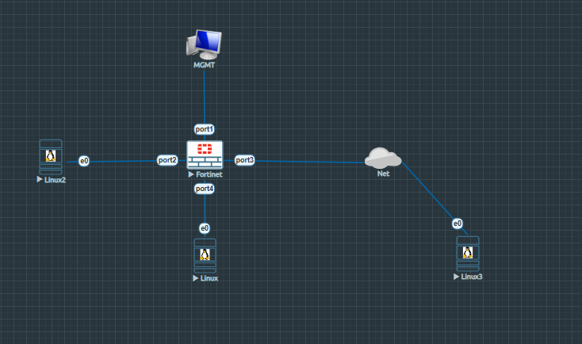
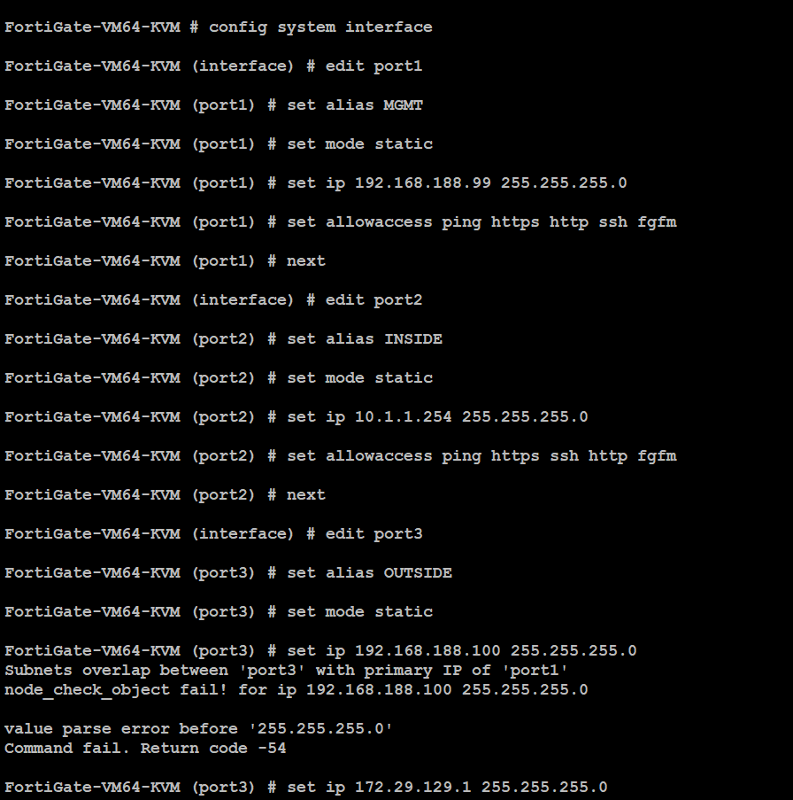
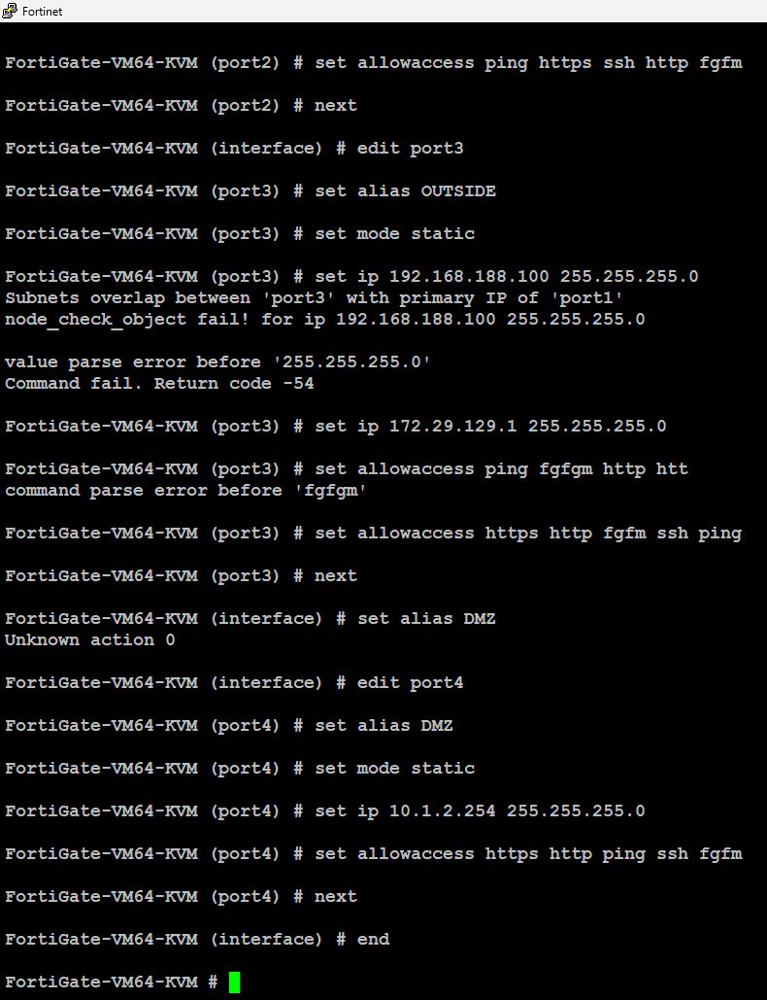
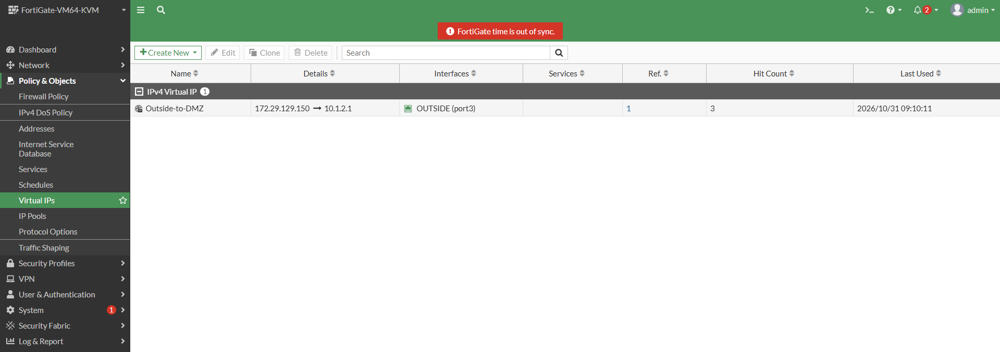
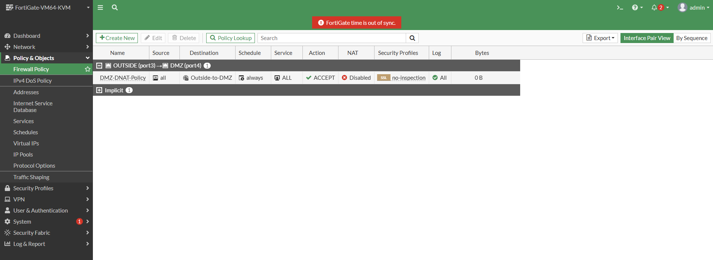
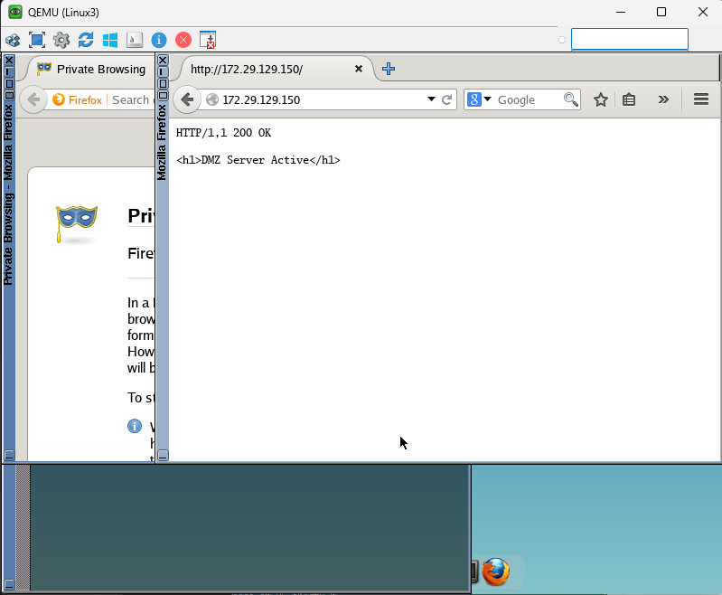
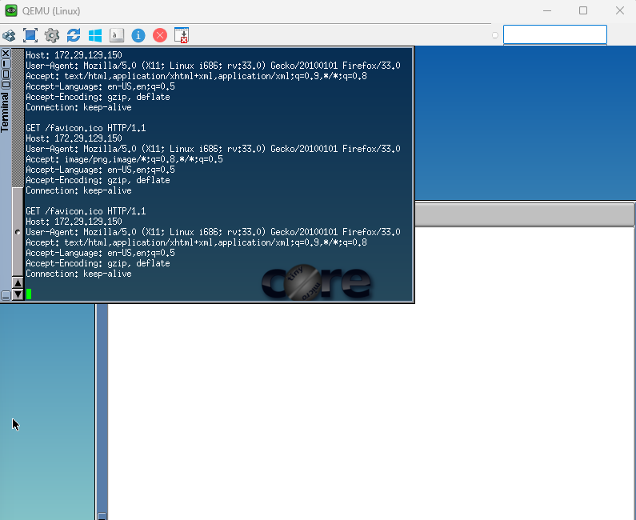
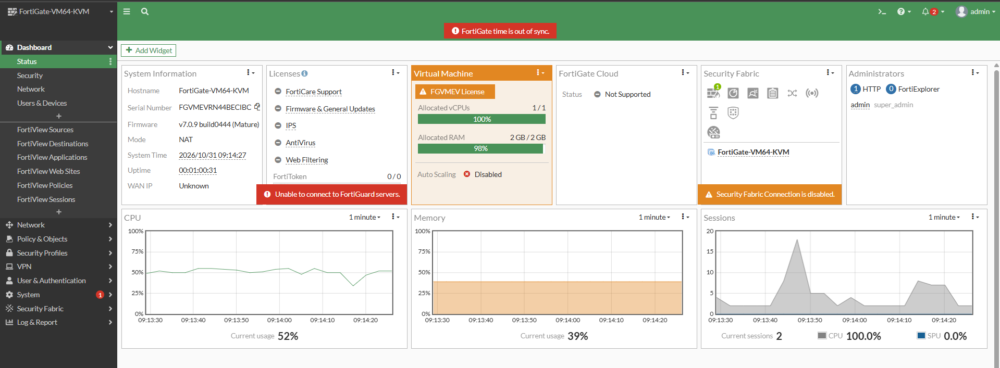

# FortiGate Firewall: Destination NAT (DNAT), Virtual IPs (VIP), and Port Forwarding Deep Dive

A comprehensive, production-grade lab and conceptual guide covering Destination Network Address Translation (DNAT), Virtual IP (VIP) object mapping, and Port Forwarding on FortiGate firewalls running FortiOS. This document provides advanced theoretical concepts, detailed network topology specifications, step-by-step graphical and CLI configuration steps, comprehensive traffic testing workflows, deep packet inspection analysis, and real-time troubleshooting logs.

---

## Table of Contents

- [1. Overview and Theoretical Concepts](#1-overview-and-theoretical-concepts)
  - [What is Destination NAT (DNAT)?](#what-is-destination-nat-dnat)
  - [Why is DNAT and Port Forwarding Required in Enterprise Networks?](#why-is-dnat-and-port-forwarding-required-in-enterprise-networks)
  - [Detailed Mechanics of FortiGate Virtual IPs (VIP)](#detailed-mechanics-of-fortigate-virtual-ips-vip)
  - [Port Forwarding and Port Mapping Architecture](#port-forwarding-and-port-mapping-architecture)
  - [Source NAT vs. Destination NAT Core Differences](#source-nat-vs-destination-nat-core-differences)
- [2. Lab Topology and System Baseline](#2-lab-topology-and-system-baseline)
  - [Topology Diagram](#topology-diagram)
  - [Addressing and Interface Connection Table](#addressing-and-interface-connection-table)
- [3. Step-by-Step Configuration Guide](#3-step-by-step-configuration-guide)
  - [Step 1: Firewall Interface Baseline Setup (CLI)](#step-1-firewall-interface-baseline-setup-cli)
  - [Step 2: DMZ Server Setup and Netcat HTTP Listener Configuration](#step-2-dmz-server-setup-and-netcat-http-listener-configuration)
  - [Step 3: Creating a Virtual IP (VIP) for DNAT (GUI & CLI)](#step-3-creating-a-virtual-ip-vip-for-dnat-gui--cli)
  - [Step 4: Configuring Inbound Firewall Policy for DNAT](#step-4-configuring-inbound-firewall-policy-for-dnat)
- [4. Traffic Generation and Verification Workflow](#4-traffic-generation-and-verification-workflow)
  - [Client-Side Testing from Outside Client (`Linux3`)](#client-side-testing-from-outside-client-linux3)
  - [DMZ Server Terminal Live Monitoring and Packet Inspection](#dmz-server-terminal-live-monitoring-and-packet-inspection)
  - [FortiGate Dashboard & Policy Hit Count Verification](#fortigate-dashboard--policy-hit-count-verification)
- [5. Comprehensive Troubleshooting & Challenges Faced in Lab](#5-comprehensive-troubleshooting--challenges-faced-in-lab)
  - [Challenge 1: Subnet Overlapping Error during Interface IP Assignment](#challenge-1-subnet-overlapping-error-during-interface-ip-assignment)
  - [Challenge 2: Browser "Unable to Connect" Timeout Issue](#challenge-2-browser-unable-to-connect-timeout-issue)
  - [Challenge 3: Netcat Applet vs Busybox HTTP Command Syntax Errors](#challenge-3-netcat-applet-vs-busybox-http-command-syntax-errors)
- [6. Key Takeaways and Architectural Best Practices](#6-key-takeaways-and-architectural-best-practices)

---

## 1. Overview and Theoretical Concepts

### What is Destination NAT (DNAT)?

Destination Network Address Translation (DNAT) is a core networking and security mechanism defined in RFC 3022 that allows a firewall or routing device to alter the destination IP address (and optionally the layer-4 destination port) of inbound packets as they traverse the security boundary. 

In enterprise environments, internal web servers, database endpoints, and application clusters are deployed using private RFC 1918 IP addresses (e.g., `10.x.x.x` or `192.168.x.x`) to isolate them from direct public exploitation. However, external clients on the public internet need a mechanism to access these services. DNAT solves this dilemma by mapping a publicly routable IP address (hosted on the firewall's WAN interface) to the private IP address of the internal server. When an inbound packet arrives, the FortiGate firewall intercepts the packet at the ingress interface, replaces the destination IP header, and routes it toward the protected DMZ zone.

```
+------------------+          +--------------------------------------+          +------------------+
| Outside Client   | -------> | FortiGate Firewall (Inbound DNAT)    | -------> | DMZ Web Server   |
| (172.29.129.189) |          | Src: 172.29.129.189, Dst: 10.1.2.1   |          | (10.1.2.1)       |
+------------------+          +--------------------------------------+          +------------------+
```

---

### Why is DNAT and Port Forwarding Required in Enterprise Networks?

1. **Security Isolation (DMZ Protection):**
   Exposing internal servers directly to the internet by assigning public IPs to them makes them highly vulnerable to direct layer-3 attacks, zero-day exploits, and continuous vulnerability scanning. DNAT ensures the firewall acts as an intermediary buffer, screening all inbound traffic before forwarding it.

2. **IPv4 Address Conservation:**
   Public IPv4 addresses are scarce and expensive. By utilizing DNAT, an organization can host hundreds of internal web, mail, and application servers behind a single public IP address or a small block of IPs using port forwarding.

3. **Granular Port Mapping & Service Publication:**
   Port forwarding allows administrators to translate incoming requests on non-standard or standard ports (e.g., publishing web application securely on port 8443 or 6000) and forward them to standard internal service ports (e.g., port 80 or 443).

---

### Detailed Mechanics of FortiGate Virtual IPs (VIP)

In FortiOS, Destination NAT is implemented primarily through a foundational object called a **Virtual IP (VIP)**. 
- A VIP acts as a translation mapping engine on the firewall. It binds an **External IP Address/Range** (associated with an external interface) to a **Mapped IP Address/Range** (internal private server IP).
- Unlike traditional firewalls where NAT is embedded strictly inside the firewall rule, FortiGate decouples NAT translation logic: the VIP object handles the address translation, while the Firewall Policy governs access control (ACCEPT/DENY) and security inspection.

---

### Port Forwarding and Port Mapping Architecture

When port forwarding is enabled within a FortiGate VIP object, the firewall modifies both the Destination IP and the Destination Port.

```
Incoming Request:  Dst IP: 172.29.129.150  |  Dst Port: 6000 (External)
                                     │
                             [ FortiGate VIP ]
                                     │
Forwarded Packet:  Dst IP: 10.1.2.1       |  Dst Port: 80 (Internal Service)
```

- **Use Case:** If multiple servers reside behind a single public IP (`172.29.129.150`), Server A can be accessed on external port `6000` (mapped to internal port `80`), and Server B can be accessed on external port `6001` (mapped to internal port `80`).

---

### Source NAT vs. Destination NAT Core Differences

| Feature | Source NAT (SNAT) | Destination NAT (DNAT) |
| :--- | :--- | :--- |
| **Header Field Modified** | Source IP Address & Source Port | Destination IP Address & Destination Port |
| **Traffic Flow Direction** | Outbound (Internal LAN toward External WAN) | Inbound (External Internet toward Internal DMZ) |
| **Primary FortiOS Object** | IP Pools / Outgoing Interface Overload | Virtual IPs (VIP) |
| **Session Initiation** | Initiated by internal client toward internet | Initiated by external client toward internal server |

---

## 2. Lab Topology and System Baseline

### Topology Diagram

The topology for this lab was designed and simulated using EVE-NG. It comprises a FortiGate virtual firewall (`FortiGate-VM64-KVM`), a local management workstation (`MGMT`), an internal corporate network segment (`Linux2`), a DMZ server running a Netcat HTTP listener (`Linux`), and an outside internet client running Firefox (`Linux3`).



*Figure 1: `Topology.png` - EVE-NG Lab topology illustrating FortiGate interface assignments (`port1` for Management, `port2` for Inside LAN, `port3` for Outside/WAN, and `port4` for DMZ).*

---

### Addressing and Interface Connection Table

| Device Name | Local Interface | IP Address / Subnet Mask | Role and Connection Purpose |
| :--- | :--- | :--- | :--- |
| **FortiGate Firewall** | `port1` | `192.168.188.99/24` | Out-of-Band Management (HTTPS, SSH, PING) |
| **FortiGate Firewall** | `port2` | `10.1.1.254/24` | Inside LAN Gateway interface for internal clients |
| **FortiGate Firewall** | `port3` | `172.29.129.1/24` | Outside WAN interface connected to external network |
| **FortiGate Firewall** | `port4` | `10.1.2.254/24` | DMZ security zone gateway interface |
| **DMZ Server** | `eth0` | `10.1.2.1/24` | Tiny Core Linux running Netcat HTTP listener service |
| **Outside Client** | `eth0` | `172.29.129.189/24` | External client simulating internet user via Firefox |

---

## 3. Step-by-Step Configuration Guide

### Step 1: Firewall Interface Baseline Setup (CLI)

Before configuring NAT policies, physical interfaces must be assigned proper IP addresses, administrative access permissions, and descriptive interface aliases.



*Figure 2: `Firewall_IP_Assign.png` - CLI execution snippet showing interface alias and IP address assignment for `port1`, `port2`, and initial subnet collision handling on `port3`.*

---



*Figure 3: `Firewall_IP_Assign2.png` - Successful CLI configuration of `port3` with WAN IP `172.29.129.1` and `port4` (DMZ) with `10.1.2.254`.*

#### CLI Configuration Commands:
```bash
config system interface
    edit "port1"
        set alias "MGMT"
        set mode static
        set ip 192.168.188.99 255.255.255.0
        set allowaccess ping https ssh http
    next
    edit "port2"
        set alias "INSIDE"
        set mode static
        set ip 10.1.1.254 255.255.255.0
        set allowaccess ping https ssh
    next
    edit "port3"
        set alias "OUTSIDE"
        set mode static
        set ip 172.29.129.1 255.255.255.0
        set allowaccess ping https ssh
    next
    edit "port4"
        set alias "DMZ"
        set mode static
        set ip 10.1.2.254 255.255.255.0
        set allowaccess ping https ssh
    next
end
```

---

### Step 2: DMZ Server Setup and Netcat HTTP Listener Configuration

On the Tiny Core Linux DMZ server (`10.1.2.1`), a continuous Netcat loop listener was initialized to respond with standard HTTP 200 OK headers and HTML content whenever an inbound request hit port 80.

#### CLI Command Executed on DMZ Server:
```bash
while true; do echo -e "HTTP/1.1 200 OK\r\n\r\n<h1>DMZ Server Active</h1>" | sudo nc -l -p 80; done
```

---

### Step 3: Creating a Virtual IP (VIP) for DNAT (GUI & CLI)

To translate incoming traffic destined for the public IP address `172.29.129.150` to the private DMZ server (`10.1.2.1`), a Virtual IP object was created.



*Figure 4: `Virtual_IP.png` - FortiGate Virtual IP (VIP) configuration screen showing mapping from External IP `172.29.129.150` (`port3`) to Mapped Private IP `10.1.2.1`.*

#### Step-by-Step GUI Instructions:
1. Navigate to **Policy & Objects > Virtual IPs** and click **Create New > VIP**.
2. Configure parameters:
   - **Name:** `Outside-to-DMZ`
   - **Interface:** `OUTSIDE (port3)`
   - **Type:** `Static NAT`
   - **External IP address/range:** `172.29.129.150`
   - **IPv4 address/range (Map to):** `10.1.2.1`
3. Click **OK** to save.

---

### Step 4: Configuring Inbound Firewall Policy for DNAT

An inbound security policy was created to permit traffic arriving on `port3` and destined for the VIP object, forwarding it out through `port4` to the DMZ server.



*Figure 5: `Firewall_Policy.png` - Firewall Policy table displaying the active DNAT policy (`DMZ-DNAT-Policy`) from `OUTSIDE (port3)` to `DMZ (port4)` with NAT disabled.*

#### Step-by-Step GUI Instructions:
1. Navigate to **Policy & Objects > Firewall Policy** and click **Create New**.
2. Configure parameters:
   - **Name:** `DMZ-DNAT-Policy`
   - **Incoming Interface:** `OUTSIDE (port3)`
   - **Outgoing Interface:** `DMZ (port4)`
   - **Source:** `all`
   - **Destination:** `Outside-to-DMZ` (Virtual IP)
   - **Service:** `ALL`
   - **Action:** `ACCEPT`
3. Under **Firewall / Network Options**, ensure **NAT** switch is **Disabled** (since this is Destination NAT, not Source NAT).
4. Under **Logging Options**, select **All Sessions** to capture complete connection logs.
5. Click **OK**.

---

## 4. Traffic Generation and Verification Workflow

### Client-Side Testing from Outside Client (`Linux3`)

The outside client (`Linux3`) opened its Firefox browser to test connectivity by querying the public Virtual IP address.



*Figure 6: `Ping_dmz.png` - Outside client Firefox browser successfully loading `http://172.29.129.150` and rendering the **`DMZ Server Active`** HTML response from the internal private server.*

---

### DMZ Server Terminal Live Monitoring and Packet Inspection

Inspecting real-time incoming HTTP requests hitting the Tiny Core Linux DMZ server terminal from client `172.29.129.189` via the FortiGate DNAT mapping.



*Figure 7: `Linux_monitoring.png` - Tiny Core Linux terminal displaying active HTTP GET requests, user-agent headers, and successful connections routed from the outside client through the firewall.*

---

### FortiGate Dashboard & Policy Hit Count Verification

Monitoring system health, session tables, and hit counts on the FortiGate management dashboard.



*Figure 8: `Fortigate_Dashboard.png` - FortiGate system status dashboard confirming active sessions, CPU/RAM usage, and operational status during the DNAT lab session.*

---

## 5. Comprehensive Troubleshooting & Challenges Faced in Lab

### Challenge 1: Subnet Overlapping Error during Interface IP Assignment
* **Symptom:** When configuring `port3` on the FortiGate CLI using `set ip 192.168.188.100 255.255.255.0`, the CLI returned: `Subnet overlap between 'port3' with primary IP of 'port1'` and `node_check_object fail!`.
* **Root Cause & Resolution:** Recognized that `port1` was already assigned `192.168.188.99/24` for out-of-band management on the exact same subnet segment. Fixed by switching the outside interface subnet to a distinct routable segment (`172.29.129.1/24`).

### Challenge 2: Browser "Unable to Connect" Timeout Issue
* **Symptom:** Initially, when accessing `http://172.29.129.150` from `Linux3`, Firefox displayed an `Unable to Connect` timeout error.
* **Root Cause & Resolution:** Inspected the firewall policy and discovered that the **NAT switch** was accidentally left enabled inside the inbound policy. Disabling SNAT on the inbound DNAT policy immediately resolved packet routing.

### Challenge 3: Netcat Applet vs Busybox HTTP Command Syntax Errors
* **Symptom:** Initial commands like `sudo httpd` or `sudo python -m SimpleHTTPServer 80` failed on Tiny Core Linux with `command not found`.
* **Root Cause & Resolution:** Successfully bypassed this by using a robust Netcat (`nc`) infinite loop listener command to serve custom HTTP 200 response headers.

---

## 6. Key Takeaways and Architectural Best Practices

1. **Virtual IP (VIP) Object First:** Always create a VIP object first to define the mapping between the public external IP and the private internal server IP before writing the firewall policy.
2. **Disable SNAT on Inbound DNAT Policies:** Ensure source NAT is turned off on inbound firewall policies utilizing VIPs so that internal servers can see the actual client source IP address rather than the firewall interface IP.
3. **Verify Interface Zones:** Double-check that incoming and outgoing interface zones match correct network segments (e.g., `port3` Outside to `port4` DMZ) to prevent silent packet drops by implicit firewall rules.