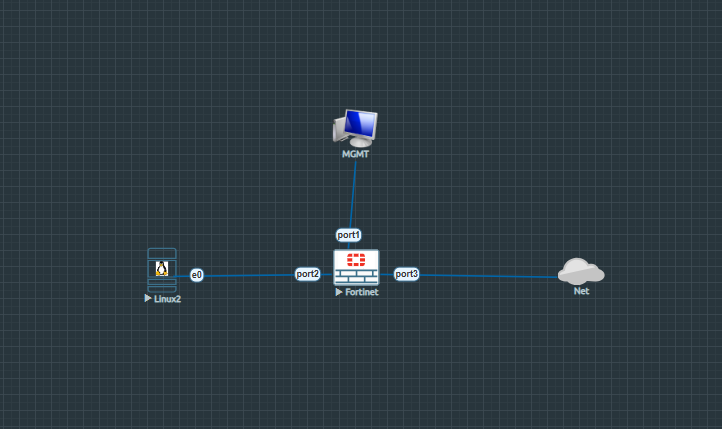
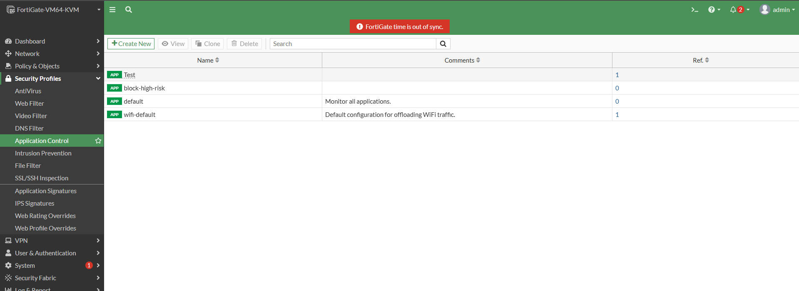
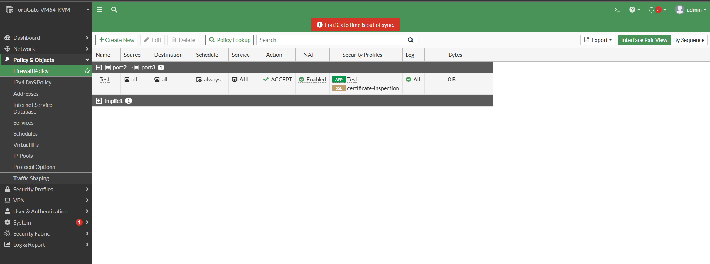
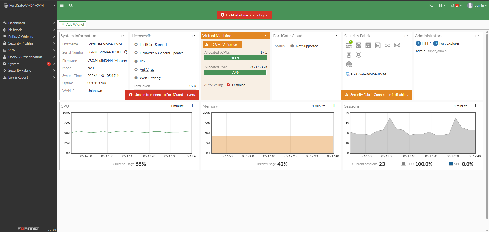

# FortiGate Firewall: Application Control Profiles & Real-Time Troubleshooting Deep Dive

A comprehensive, production-grade laboratory and conceptual guide covering **Layer 7 Application Control**, Application Sensor Configuration, Category-Based Blocking, Application Signatures, and Deep Troubleshooting on FortiGate Next-Generation Firewalls (NGFW) running FortiOS. 

This document provides advanced theoretical concepts, detailed network topology specifications, step-by-step graphical and CLI configuration workflows, comprehensive traffic testing procedures, deep packet inspection analysis, and real-time troubleshooting logs for all operational issues faced during implementation.

---

## 📋 Table of Contents

1. [Overview and Theoretical Concepts](#1-overview-and-theoretical-concepts)
   - [What is Application Control?](#what-is-application-control)
   - [Why Application Control is Required in Enterprise Networks](#why-application-control-is-required-in-enterprise-networks)
   - [How FortiGate Identifies Applications (Signature & Pattern Matching)](#how-fortigate-identifies-applications-signature--pattern-matching)
   - [Layer 4 Port Filtering vs. Layer 7 Application Control](#layer-4-port-filtering-vs-layer-7-application-control)
   - [Category-Based Control vs. Specific Application Overrides](#category-based-control-vs-specific-application-overrides)
2. [Lab Topology and System Baseline](#2-lab-topology-and-system-baseline)
   - [Topology Diagram](#topology-diagram)
   - [Addressing and Interface Connection Table](#addressing-and-interface-connection-table)
3. [Step-by-Step Configuration Guide](#3-step-by-step-configuration-guide)
   - [Step 1: Firewall Baseline Interface & Routing Setup (CLI)](#step-1-firewall-baseline-interface--routing-setup-cli)
   - [Step 2: Endpoint IP, Gateway, & DNS Setup on Tiny Core Linux](#step-2-endpoint-ip-gateway--dns-setup-on-tiny-core-linux)
   - [Step 3: Creating a Custom Application Control Profile (GUI & CLI)](#step-3-creating-a-custom-application-control-profile-gui--cli)
   - [Step 4: Integrating Application Control into IPv4 Security Policy](#step-4-integrating-application-control-into-ipv4-security-policy)
4. [Traffic Generation and Verification Workflow](#4-traffic-generation-and-verification-workflow)
   - [Client-Side Browsing Tests (Linux Node)](#client-side-browsing-tests-linux-node)
   - [FortiGate Application Control Log & Event Inspection](#fortigate-application-control-log--event-inspection)
   - [Dashboard & Policy Session Monitoring](#fortigate-dashboard--policy-session-monitoring)
5. [Comprehensive Troubleshooting & Real-World Challenges Solved](#5-comprehensive-troubleshooting--real-world-challenges-solved)
   - [Challenge 1: Unresponsive GUI "Apply" Button on Tiny Core Linux Endpoint](#challenge-1-unresponsive-gui-apply-button-on-tiny-core-linux-endpoint)
   - [Challenge 2: Upstream Gateway & Route Mismatch (Port1 vs Port3 Packet Loss)](#challenge-2-upstream-gateway--route-mismatch-port1-vs-port3-packet-loss)
   - [Challenge 3: FortiGate CLI Syntax Error & VDOM Creation Error (`edit por1`)](#challenge-3-fortigate-cli-syntax-error--vdom-creation-error-edit-por1)
   - [Challenge 4: Policy Destination Interface Mismatch (`dstintf` Quotes Error)](#challenge-4-policy-destination-interface-mismatch-dstintf-quotes-error)
6. [Key Takeaways and Architectural Best Practices](#6-key-takeaways-and-architectural-best-practices)

---

## 1. Overview and Theoretical Concepts

### What is Application Control?

**Application Control** is a Layer 7 Security Profile feature embedded within FortiGate Next-Generation Firewalls (NGFW) that enables granular visibility and enforcement over network traffic based on specific web applications, regardless of the underlying port, protocol, or IP address used.

Traditional firewalls inspect traffic up to Layer 4 (TCP/UDP ports). However, modern web applications (e.g., Facebook, WhatsApp, YouTube, Google Drive, Office 365) almost universally encapsulate their traffic inside standard HTTP (Port 80) and HTTPS (Port 443) protocols. Application Control decodes the behavioral pattern, headers, and signatures of network sessions to identify the exact application in use and apply targeted policy actions (**Allow**, **Block**, **Monitor**, or **Quarantine**).

```
+-------------------+      +-----------------------------------------------------+      +---------------------+
| Internal Client   | ---> | FortiGate Application Control Engine                | ---> | Destination Web App |
| (10.1.1.2)        |      | Inspects L7 Signatures (e.g., YouTube / Facebook)  |      | (Port 80/443 WAN)   |
+-------------------+      +-----------------------------------------------------+      +---------------------+
                                   │                              │
                           [ Allowed App ]                [ Blocked App ]
                                   │                              │
                            Forward Traffic                 Reset / Block
```

### Why Application Control is Required in Enterprise Networks

1. **User Traffic Shift to Web Applications**: Enterprise users conduct daily business using cloud applications. Allowing generic outbound port 443 allows legitimate productivity tools, but simultaneously exposes the organization to bandwidth hogs and security threats.
2. **Sub-Application Granularity**: Modern applications are multi-functional platforms. For instance, on Facebook, users can browse posts, play games, use instant chat, or watch videos. Application Control allows administrators to permit Facebook base access (e.g., for social media marketing teams) while selectively blocking sub-features like **Facebook.Games** or **Facebook.Chat**.
3. **Data Exfiltration & Compliance**: Disallow unauthorized file-sharing applications (e.g., BitTorrent, MegaUpload) or unapproved cloud storage services (e.g., personal Dropbox) to enforce corporate DLP (Data Loss Prevention) and regulatory compliance standards.
4. **Bandwidth Optimization**: Restrict or shape heavy media-streaming services (YouTube, Netflix) to preserve WAN bandwidth for mission-critical enterprise applications.

### How FortiGate Identifies Applications (Signature & Pattern Matching)

FortiGate's FortiGuard Security Research Team maintains a continuously updated database of thousands of application signatures. 

* **Pattern Recognition**: The firewall analyzes initial packet exchanges, handshake parameters, HTTP host headers, SSL/TLS Server Name Indication (SNI), and payload signatures.
* **Stateful Flow Inspection**: Once the initial packet sequence matches a signature pattern (e.g., YouTube video stream initialization), the FortiGate IPS/Application engine tags the session with an Application ID and applies the security action configured in the active Application Sensor.

### Layer 4 Port Filtering vs. Layer 7 Application Control

| Feature | Layer 4 Port Filtering | Layer 7 Application Control |
| :--- | :--- | :--- |
| **Inspection Level** | Packet Header (IP, Port, Protocol) | Application Payload & Behavioral Signature |
| **Bypass Vulnerability** | High (Apps running over port 80/443 bypass rules) | Low (Identifies real payload regardless of port) |
| **Granularity** | Coarse (Allow/Block whole port or IP) | Fine (Allow platform, block sub-features/chat) |
| **Primary Utility** | Network Routing & ACL Control | Threat Prevention, Productivity & Bandwidth Control |
| **FortiOS Module** | Firewall Policy (IPv4/IPv6) | Security Profiles $\rightarrow$ Application Control |

### Category-Based Control vs. Specific Application Overrides

FortiGate organizes signatures into standardized **Application Categories** (e.g., *Collaboration, Social Media, Video/Audio, Peer-to-Peer, Games*).

* **Category-Based Blocking**: Applies a universal action to every application belonging to a whole category (e.g., blocking the entire *Social Media* category).
* **Application Overrides**: Creates explicit rules for specific applications, overriding the general category setting (e.g., monitoring/allowing *Google* services while explicitly adding a block signature override for *YouTube*).

---

## 2. Lab Topology and System Baseline

### Topology Diagram

The topology for this lab was designed and simulated using EVE-NG. It comprises a FortiGate virtual firewall (`FortiGate-VM64-KVM`), a local management workstation (`MGMT`), an internal desktop PC (`Linux2`), and an upstream internet node (`Net Cloud`).


*Figure 1: EVE-NG Lab topology illustrating FortiGate interface assignments (`port1` for WAN/Cloud, `port2` for LAN, `port3` for Secondary WAN).*

### Addressing and Interface Connection Table

| Device Name | Interface | IP Address / Subnet | Connection Role / Purpose |
| :--- | :--- | :--- | :--- |
| **FortiGate Firewall** | `port1` | `192.168.188.132/24` | Primary WAN Interface connected to EVE Net Cloud |
| **FortiGate Firewall** | `port2` | `10.1.1.1/24` | Internal LAN Gateway Interface for LAN clients |
| **FortiGate Firewall** | `port3` | `172.29.129.50/24` | Secondary/Alternate WAN Link |
| **Tiny Core Linux (Linux2)** | `eth0` | `10.1.1.2/24` | Internal Test PC (`Gateway: 10.1.1.1, DNS: 8.8.8.8`) |
| **Management Node (MGMT)**| `Host` | `192.168.188.x/24` | Out-of-Band Management Workstation |
| **Upstream Net Cloud** | Gateway | `192.168.188.2` | Primary ISP Gateway Node |

---

## 3. Step-by-Step Configuration Guide

### Step 1: Firewall Baseline Interface & Routing Setup (CLI)

Before applying security profiles, network interfaces and default gateway routing must be properly aligned on the FortiGate CLI.

```conf
# 1. Configure Internal LAN Gateway (port2)
config system interface
    edit "port2"
        set mode static
        set ip 10.1.1.1 255.255.255.0
        set allowaccess ping https ssh http
    next
end

# 2. Configure Primary WAN Interface (port1) via DHCP or Static
config system interface
    edit "port1"
        set mode dhcp
        set allowaccess ping https ssh
    next
end

# 3. Configure Upstream Static Default Route pointing to EVE Net Cloud Gateway
config router static
    purge
    edit 1
        set gateway 192.168.188.2
        set device "port1"
    next
end
```

**Route Verification:**
```conf
get router info routing-table all
execute ping 8.8.8.8
```

---

### Step 2: Endpoint IP, Gateway, & DNS Setup on Tiny Core Linux

Due to GUI applet execution delays in Tiny Core Linux, assign networking configurations directly via the Linux terminal.

```bash
# Assign IP address to physical NIC eth0
sudo ip addr add 10.1.1.2/24 dev eth0
sudo ip link set eth0 up

# Configure Default Gateway pointing to FortiGate port2
sudo ip route add default via 10.1.1.1 dev eth0

# Configure Static Google Public DNS
echo "nameserver 8.8.8.8" | sudo tee /etc/resolv.conf
```

**Verification Command:**
```bash
ip route show
ping -c 3 8.8.8.8
```

---

### Step 3: Creating a Custom Application Control Profile (GUI & CLI)

A custom security profile named **`test`** was created to block Social Media applications and specifically block YouTube signatures.


*Figure 2: FortiGate Security Profiles > Application Control menu showing the active `Test` profile sensor.*

#### Step-by-Step GUI Instructions:
1. Navigate to **Security Profiles** > **Application Control**.
2. Click **Create New** (`+`) and name the sensor **`test`**.
3. Under **Category Options**, locate **Social Media** and set its action to **Block**.
4. Under **Application Overrides**, click **Add Signatures**, search for `YouTube`, select the signature, and set its action to **Block**.
5. Click **Apply / OK** to save the profile sensor.

#### Equivalent CLI Commands:
```conf
config application list
    edit "test"
        config entries
            edit 1
                set category 15  # Social Media Category ID
                set action block
            next
            edit 2
                set application 31061 # YouTube Signature ID
                set action block
            next
        end
    next
end
```

---

### Step 4: Integrating Application Control into IPv4 Security Policy

Bind the custom Application Control profile sensor (`test`) to the active outbound Internet policy.


*Figure 3: FortiGate Firewall Policy interface displaying rule `Test` from `port2` to `port1` with Application Control enabled.*

#### Step-by-Step GUI Instructions:
1. Navigate to **Policy & Objects** > **Firewall Policy**.
2. Click **Create New** or Edit existing Rule ID `1` (`Test`).
3. Set **Incoming Interface**: `port2` (LAN).
4. Set **Outgoing Interface**: `port1` (WAN).
5. Set **Source**: `all` | **Destination**: `all` | **Service**: `ALL`.
6. Enable **NAT** (Source NAT).
7. Under **Security Profiles**, toggle **Application Control** ON and select the **`test`** profile.
8. Set **SSL/SSH Inspection** to `certificate-inspection`.
9. Set **Log Allowed Traffic** to `All Sessions`.
10. Click **OK**.

#### Equivalent CLI Commands:
```conf
config firewall policy
    edit 1
        set name "Test"
        set srcintf "port2"
        set dstintf "port1"
        set srcaddr "all"
        set dstaddr "all"
        set action accept
        set schedule "always"
        set service "ALL"
        set utm-status enable
        set application-list "test"
        set ssl-ssh-profile "certificate-inspection"
        set logtraffic all
        set nat enable
    next
end
```

---

## 4. Traffic Generation and Verification Workflow

### Client-Side Browsing Tests (Linux Node)

1. Open Mozilla Firefox inside the internal Tiny Core Linux desktop (`10.1.1.2`).
2. Access `https://www.google.com` $\rightarrow$ **Result: SUCCESS (Allowed)**.
3. Access `https://www.twitter.com` $\rightarrow$ **Result: FAILED / Connection Reset (Blocked by Category)**.
4. Access `https://www.youtube.com` $\rightarrow$ **Result: FAILED / Connection Reset (Blocked by Override)**.

---

### FortiGate Application Control Log & Event Inspection

To inspect real-time enforcement logs via FortiGate Web GUI:
1. Navigate to **Log & Report** > **Application Control**.
2. Filter logs by `Subtype: app` or `Src: 10.1.1.2`.
3. Verify event entries displaying blocked sessions:
   - **Application Name**: `Twitter` / `YouTube`
   - **Category**: `Social.Media`
   - **Action**: `Block`
   - **Policy ID**: `1`

---

### FortiGate Dashboard & Policy Session Monitoring


*Figure 4: FortiGate System Status Dashboard showing CPU/Memory consumption, active system sessions, and status widgets.*

---

## 5. Comprehensive Troubleshooting & Real-World Challenges Solved

### Challenge 1: Unresponsive GUI "Apply" Button on Tiny Core Linux Endpoint

#### Symptom:
After populating IP `10.1.1.2`, Gateway `10.1.1.1`, and DNS `8.8.8.8` inside the Tiny Core Network Configuration GUI panel (`image_d62fe2.png`), clicking **Apply** failed to update network interfaces or write routing rules.


*Figure 5: Tiny Core Linux network setup panel hanging upon clicking Apply button.*

#### Root Cause:
The lightweight desktop manager environment failed to execute background shell scripts to bind netmask and gateway settings dynamically.

#### Resolution:
Bypassed GUI completely by executing explicit `iproute2` terminal commands:
```bash
sudo ip addr add 10.1.1.2/24 dev eth0
sudo ip link set eth0 up
sudo ip route add default via 10.1.1.1 dev eth0
echo "nameserver 8.8.8.8" | sudo tee /etc/resolv.conf
```
*Verification:* Running `ip route` confirmed `default via 10.1.1.1 dev eth0` active.

---

### Challenge 2: Upstream Gateway & Route Mismatch (Port1 vs Port3 Packet Loss)

#### Symptom:
Linux node returned **100% packet loss** when pinging `8.8.8.8` (`image_e28584.png`).


*Figure 6: Endpoint terminal returning 100% packet loss during ping test to 8.8.8.8.*

#### Root Cause:
Checking FortiGate routing table (`get router info routing-table all`) revealed default route `0.0.0.0/0` was pointing out via `port1` (`192.168.188.2`), whereas the user initially attempted routing via secondary interface `port3` (`172.29.129.1`).


*Figure 7: Routing table showing default route bound to port1 (192.168.188.2).*

#### Resolution:
Re-aligned FortiGate static default route to target the active upstream Net Cloud interface (`port1`):
```conf
config router static
    purge
    edit 1
        set gateway 192.168.188.2
        set device "port1"
    next
end
```
FortiGate direct ping test confirmed reachability (`0% packet loss`):


*Figure 8: FortiGate CLI executing successful 5/5 ICMP pings to 8.8.8.8.*

---

### Challenge 3: FortiGate CLI Syntax Error & VDOM Creation Error (`edit por1`)

#### Symptom:
When attempting to change `port1` to DHCP mode, the CLI returned:
`Attribute 'vdom' MUST be set. Command fail. Return code 1` (`image_e27627.png`).


*Figure 9: CLI error output when attempting to edit mis-typed interface name.*

#### Root Cause:
A typographical error (`edit por1` missing the letter `t`) caused FortiOS to treat `por1` as a non-existent new interface, requiring VDOM scope parameters.

#### Resolution:
Exited interface configuration scope and re-entered with exact quotes:
```conf
config system interface
    edit "port1"
        set mode dhcp
    next
end
```

---

### Challenge 4: Policy Destination Interface Mismatch (`dstintf` Quotes Error)

#### Symptom:
Traffic from Linux continued to fail, and CLI threw a syntax error when updating policy:
`command parse error before 'dstintf'. Command fail. Return code -61` (`image_d62483.png`).


*Figure 10: CLI return code -61 error when attempting to set policy destination interface.*

#### Root Cause:
Policy 1 had `dstintf` set to `port3`, but internet traffic was outbound via `port1`. The CLI rejected unquoted interface parameter changes.

#### Resolution:
Corrected policy `dstintf` to target `port1` using quotation marks:
```conf
config firewall policy
    edit 1
        set dstintf "port1"
    next
end
```
Executing `ping -c 3 8.8.8.8` from Linux terminal immediately returned 0% packet loss.

---

## 6. Key Takeaways and Architectural Best Practices

1. **Decoupled Security Profile Architecture**: FortiGate decouples Layer 7 inspection from baseline firewall rules. Always create the Application Profile sensor first, then attach it inside the Firewall Policy.
2. **Double-Check Policy Interface Mapping**: Ensure source interface (`srcintf`) and destination interface (`dstintf`) inside the Firewall Policy strictly match the ingress LAN port and active egress WAN gateway port shown in `get router info routing-table all`.
3. **Enable NAT on Outbound Policies**: When routing internal RFC 1918 private subnets (`10.1.1.0/24`) across public internet gateways, Source NAT (`set nat enable`) must be active on the egress firewall rule.
4. **Use CLI for Endpoint Configuration**: Lightweight Linux applets in virtual lab environments (like Tiny Core in EVE-NG) often freeze; use terminal commands (`ip addr`, `ip route`, `resolv.conf`) for reliable static network setup.
5. **Exact FortiOS CLI Syntax**: Always encapsulate interface names inside double quotes (`set dstintf "port1"`) to prevent parsing errors and unintended VDOM object generation.