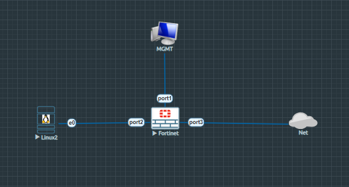
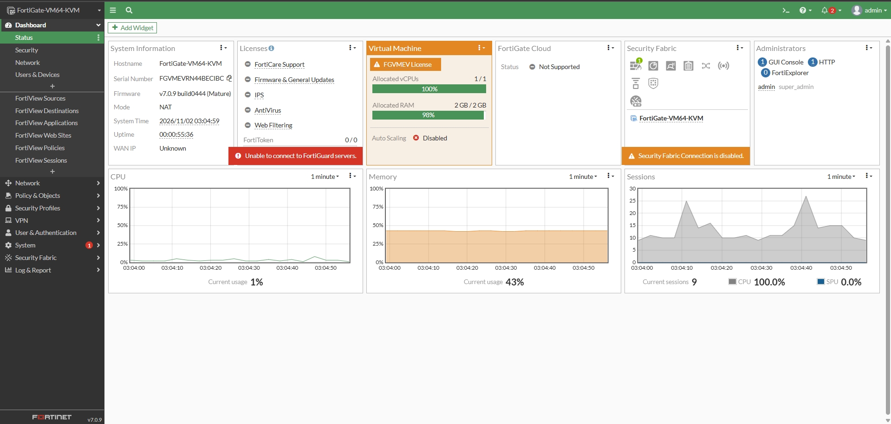
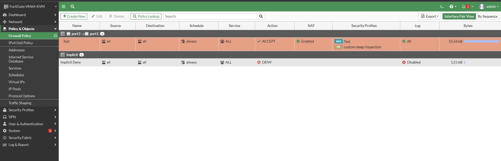
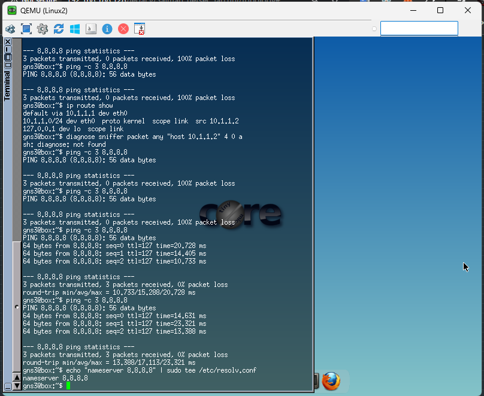
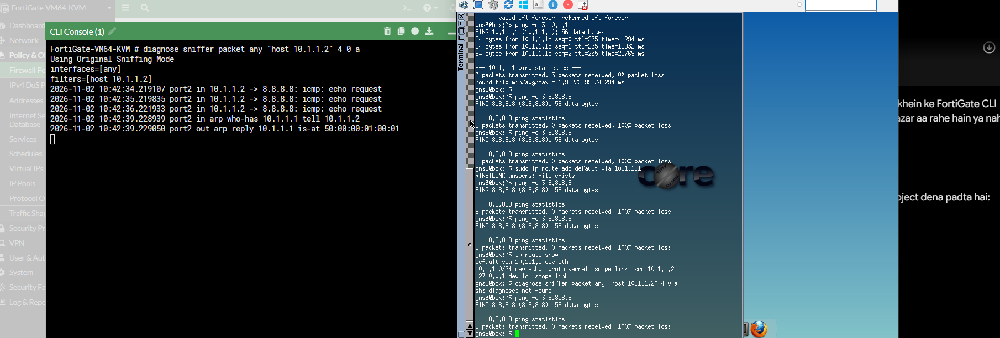
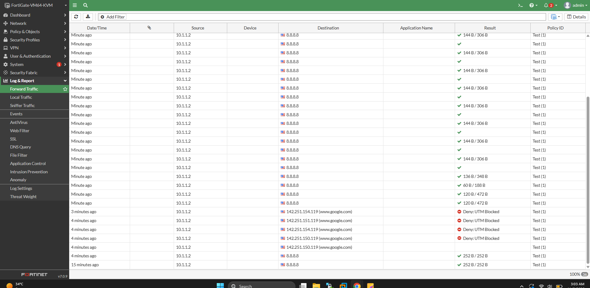
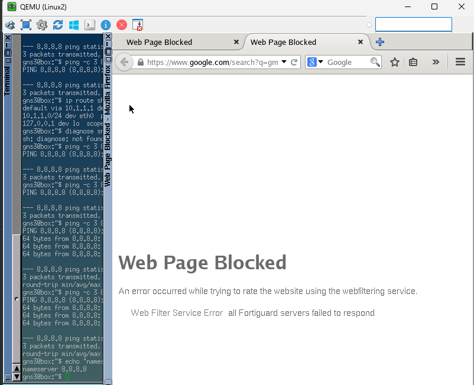

# FortiGate Firewall: Web & URL Filtering Setup, FortiGuard Categorization, and Real-Time Troubleshooting Deep Dive

A comprehensive, production-grade laboratory and conceptual guide covering **Web & URL Filtering**, **FortiGuard Category-Based Blocking**, **Firewall Policy Integration**, and **Real-Time Network & Routing Troubleshooting** on FortiGate Next-Generation Firewalls (NGFW) running FortiOS.

This document provides complete theoretical concepts, detailed network topology specifications, step-by-step graphical and CLI configuration workflows, traffic verification, deep packet inspection analysis, and real-time troubleshooting logs for all operational issues faced during implementation.

---

## Table of Contents
1. [Overview & Theoretical Concepts](#overview--theoretical-concepts)
   * [What is URL Filtering?](#what-is-url-filtering)
   * [Why URL Filtering is Required in Enterprise Networks](#why-url-filtering-is-required-in-enterprise-networks)
   * [How FortiGuard Service Analyzes & Categorizes Websites](#how-fortiguard-service-analyzes--categorizes-websites)
   * [FortiGate Category Filtering vs. Explicit URL Matching](#fortigate-category-filtering-vs-explicit-url-matching)
2. [Lab Topology & Architecture](#lab-topology--architecture)
   * [Topology Diagram](#topology-diagram)
   * [Interface & Addressing Table](#interface--addressing-table)
   * [Component Roles Breakdown](#component-roles-breakdown)
3. [Step-by-Step Configuration Workflow](#step-by-step-configuration-workflow)
   * [Step 1: FortiGate System & Interface Verification](#step-1-fortigate-system--interface-verification)
   * [Step 2: Configuring Web Filter Security Profile](#step-2-configuring-web-filter-security-profile)
   * [Step 3: Creating IPv4 Firewall Policy & Attaching Security Profiles](#step-3-creating-ipv4-firewall-policy--attaching-security-profiles)
   * [Step 4: Linux End-Device Networking & DNS Setup](#step-4-linux-end-device-networking--dns-setup)
4. [Real-Time Troubleshooting & Debugging Log](#real-time-troubleshooting--debugging-log)
   * [Issue 1: 100% Packet Loss to Public IPs (`8.8.8.8`) from Linux Client](#issue-1-100-packet-loss-to-public-ips-8888-from-linux-client)
   * [Issue 2: Packet Forwarding Failure (`port2 in` without `port1 out`)](#issue-2-packet-forwarding-failure-port2-in-without-port1-out)
   * [Issue 3: Browser `Server Not Found` Error (DNS Failure)](#issue-3-browser-server-not-found-error-dns-failure)
5. [Verification & Web Filtering Test Results](#verification--web-filtering-test-results)
   * [CLI Sniffer Verification](#cli-sniffer-verification)
   * [GUI Forward Traffic Logs Analysis](#gui-forward-traffic-logs-analysis)
   * [End-User Web Filter Block Page Verification](#end-user-web-filter-block-page-verification)
6. [Key Learnings & Best Practices Summary](#key-learnings--best-practices-summary)

---

## Overview & Theoretical Concepts

### What is URL Filtering?
URL Filtering is a critical Layer 7 Next-Generation Firewall (NGFW) security feature that inspects outbound web traffic (HTTP/HTTPS) and restricts user access to specific web addresses (URLs), domains, or entire content categories based on corporate security policies.

### Why URL Filtering is Required in Enterprise Networks
With over 1 billion active websites on the public internet, end users are often unaware of whether a target website is safe, malicious, or non-compliant with organizational guidelines.
* **Malware & Phishing Protection:** Prevents users from accidentally navigating to malicious or high-risk domains.
* **Bandwidth Optimization:** Restricts access to bandwidth-intensive categories (e.g., Video Streaming, Peer-to-Peer file sharing).
* **Productivity & Compliance:** Blocks access to non-work-related categories such as News & Media, Gambling, Adult Content, or Social Networks during office hours.

### How FortiGuard Service Analyzes & Categorizes Websites
1. **Domain Registration:** When a new website (e.g., `abc.com`) is registered on the internet, FortiGuard threat intelligence servers automatically detect it.
2. **Content Analysis:** FortiGuard automated crawlers and AI systems analyze site content, language patterns, structural indicators, and reputation parameters.
3. **Categorization & Database Sync:** FortiGuard assigns the domain to specific categories (e.g., Google $\rightarrow$ *Search Engines*, CNN $\rightarrow$ *News & Media*, YouTube $\rightarrow$ *Bandwidth Consuming*).
4. **Dynamic Enforcement:** FortiGate firewalls query FortiGuard servers (or local cached databases) in real time to enforce allow, block, or monitor decisions when users initiate web requests.

### FortiGate Category Filtering vs. Explicit URL Matching
* **Category-Based Filtering:** Blocks or allows entire groups of websites dynamically without writing individual domain rules.
* **Explicit URL Override:** Allows administrators to create granular exceptions—for example, blocking the entire *Video Streaming* category while specifically allowing `youtube.com` for marketing teams.

---

## Lab Topology & Architecture

### Topology Diagram



### Interface & Addressing Table

| Device Name | Interface / Role | IP Address / Subnet | Gateway / Next Hop | Purpose |
| :--- | :--- | :--- | :--- | :--- |
| **FortiGate NGFW** | `port1` (WAN/MGMT) | `192.168.188.128/24` | `192.168.188.2` | Internet Access & GUI Management |
| **FortiGate NGFW** | `port2` (LAN Inside) | `10.1.1.1/24` | N/A | LAN Default Gateway |
| **Linux2 Client** | `eth0` | `10.1.1.2/24` | `10.1.1.1` | End-user Workstation |
| **MGMT PC** | Physical Host | `192.168.188.x/24` | N/A | Admin Console for FortiGate Web UI |
| **Net (Cloud)** | Public Internet | Dynamic / Cloud | N/A | External Internet Connectivity |

### Component Roles Breakdown
1. **FortiGate Firewall (`Fortinet`):** Enforces security policies, perform NAT, inspects HTTP/HTTPS traffic, and executes URL category filtering.
2. **Linux2 Client:** Simulated LAN workstation running a Linux shell and Mozilla Firefox browser for ICMP and web testing.
3. **MGMT PC:** Administrator workstation connected to `port1` to manage the FortiGate via HTTP/HTTPS Web UI.
4. **Net (Cloud):** EVE-NG Nat/Cloud interface providing real-world internet connectivity to `8.8.8.8` and public domain resolution.

---

## Step-by-Step Configuration Workflow

### Step 1: FortiGate System & Interface Verification
Verify that FortiGate system health and licenses are operational.



* Check dashboard status, system usage, and verify `port1` and `port2` link states.

### Step 2: Configuring Web Filter Security Profile
1. Navigate to **Security Profiles** $\rightarrow$ **Web Filter**.
2. Click **Create New** and set the profile name to `Test`.
3. Enable **FortiGuard Category Based Filter**.
4. Locate **General Interest - Topics** $\rightarrow$ **News and Media**.
5. Right-click **News and Media** and select **Block**.
6. Save the security profile.

### Step 3: Creating IPv4 Firewall Policy & Attaching Security Profiles
1. Navigate to **Policy & Objects** $\rightarrow$ **Firewall Policy**.
2. Click **Create New** and configure:
   * **Name:** `Test`
   * **Incoming Interface:** `port2` (Inside LAN)
   * **Outgoing Interface:** `port1` (WAN Internet Connection)
   * **Source:** `all`
   * **Destination:** `all`
   * **Schedule:** `always`
   * **Service:** `ALL`
   * **Action:** `ACCEPT`
   * **NAT:** **Enabled** (Required for private LAN address translation)
3. Under **Security Profiles**, enable **Web Filter** and select the profile **`Test`**.
4. Set SSL Inspection to **`custom-deep-inspection`** or **`certificate-inspection`**.



### Step 4: Linux End-Device Networking & DNS Setup
Configure the IP parameters and default route on the Linux workstation terminal:

```bash
# 1. Assign IP address to interface eth0
sudo ip addr add 10.1.1.2/24 dev eth0

# 2. Add default gateway pointing to FortiGate LAN port2
sudo ip route add default via 10.1.1.1

# 3. Configure public DNS resolution in resolv.conf
echo "nameserver 8.8.8.8" | sudo tee /etc/resolv.conf
```



---

## Real-Time Troubleshooting & Debugging Log

During lab execution, three major operational issues occurred and were resolved.

### Issue 1: 100% Packet Loss to Public IPs (`8.8.8.8`) from Linux Client
* **Symptom:** `ping 10.1.1.1` succeeded, but `ping 8.8.8.8` resulted in $100\%$ packet loss.
* **Root Cause Analysis:** The Linux workstation lacked a valid default route pointing to FortiGate `10.1.1.1`.
* **Resolution:** Executed `sudo ip route add default via 10.1.1.1` on Linux2.

### Issue 2: Packet Forwarding Failure (`port2 in` without `port1 out`)
* **Symptom:** Running CLI packet sniffer showed `port2 in` packets arriving from `10.1.1.2`, but no egress packets left `port1` or `port3`.
* **Root Cause Analysis:** The firewall policy was misconfigured with Outgoing Interface as `port3` (or `port2`), whereas FortiGate's static default route (`0.0.0.0/0`) pointed out of **`port1`** (`192.168.188.2`). Because the firewall policy interface did not match the routing table egress interface, FortiGate silently dropped the traffic.
* **Resolution:** Re-edited the `Test` Firewall Policy in GUI and updated the **Outgoing Interface** to **`port1`**.



### Issue 3: Browser `Server Not Found` Error (DNS Failure)
* **Symptom:** Terminal ICMP pings to `8.8.8.8` succeeded, but opening `https://www.google.com` in Firefox displayed `Server not found`.
* **Root Cause Analysis:** Domain Name System (DNS) was not configured on Linux2, preventing hostname resolution.
* **Resolution:** Populated Linux DNS settings by executing `echo "nameserver 8.8.8.8" | sudo tee /etc/resolv.conf`.

---

## Verification & Web Filtering Test Results

### CLI Sniffer Verification
Executed real-time packet capture on FortiGate CLI to confirm bidirectional traffic flow:

```text
FortiGate-VM64-KVM # diagnose sniffer packet any "host 10.1.1.2" 4 0 a
filters=[host 10.1.1.2]
2026-11-02 10:42:34.219107 port2 in 10.1.1.2 -> 8.8.8.8: icmp: echo request
2026-11-02 10:42:35.219835 port2 in 10.1.1.2 -> 8.8.8.8: icmp: echo request
2026-11-02 10:42:36.221933 port2 in 10.1.1.2 -> 8.8.8.8: icmp: echo request
```

### GUI Forward Traffic Logs Analysis
Under **Log & Report** $\rightarrow$ **Forward Traffic**, verified active sessions generated by Linux2 (`10.1.1.2`).



* ICMP traffic to `8.8.8.8` passed successfully under Policy ID `1`.
* HTTPS requests to blocked categories resulted in **`Deny: UTM Blocked`** actions.

### End-User Web Filter Block Page Verification
Opened Firefox on Linux2 and navigated to `https://www.google.com` (allowed) and `https://www.cnn.com` (blocked category).



* **Result:** FortiGate intercepted the HTTP/HTTPS connection and served the standard **Web Page Blocked** replacement page to the user.

---

## Key Learnings & Best Practices Summary

1. **Routing-Policy Symmetry:** Firewall Policies **must** match the underlying routing table destination interfaces (`port2 -> port1`). An interface mismatch results in silent packet drops.
2. **NAT Necessity:** NAT must be enabled on LAN-to-WAN policy rules to translate private IP ranges (`10.1.1.0/24`) to public/WAN gateway subnets (`192.168.188.x`).
3. **DNS Prerequisites:** IP connectivity alone does not guarantee web browsing. Ensure end-devices have functional DNS resolvers (`8.8.8.8` / `1.1.1.1`) before testing web security profiles.
4. **FortiGuard Categorization:** Always verify category ratings using FortiGuard Lookup services when designing enterprise web filter policies.

---
*Lab Completed Successfully as part of Day 15 - FortiGate Firewall Deep-Dive Learning Series.*