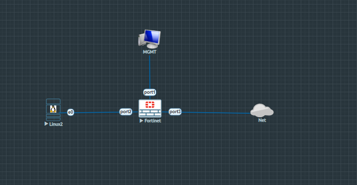
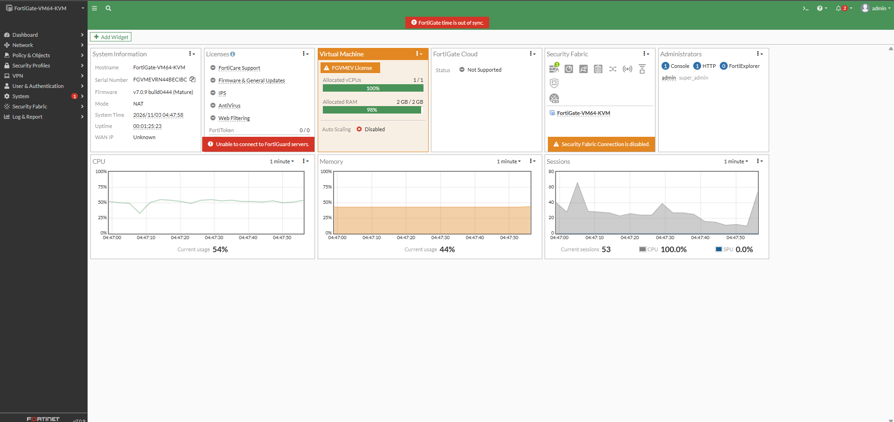
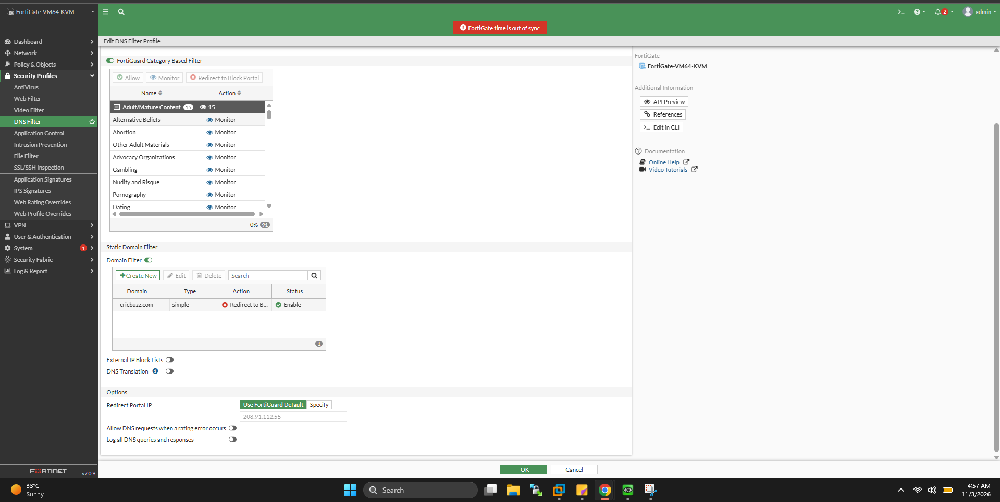
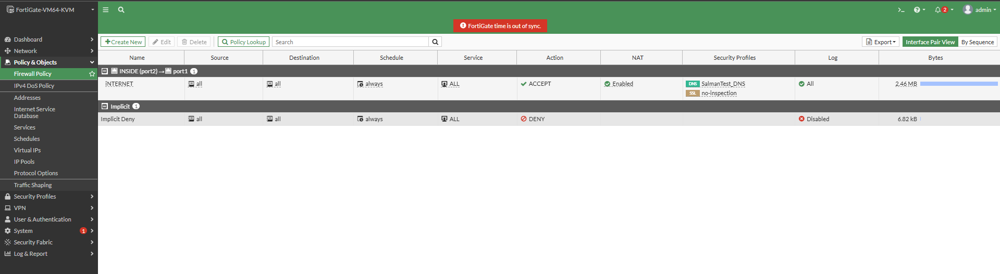
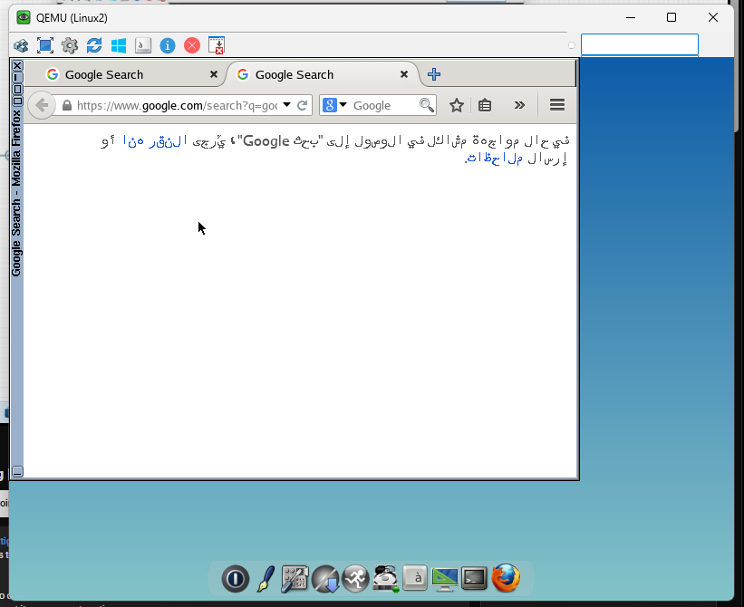
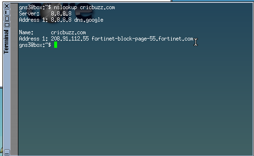
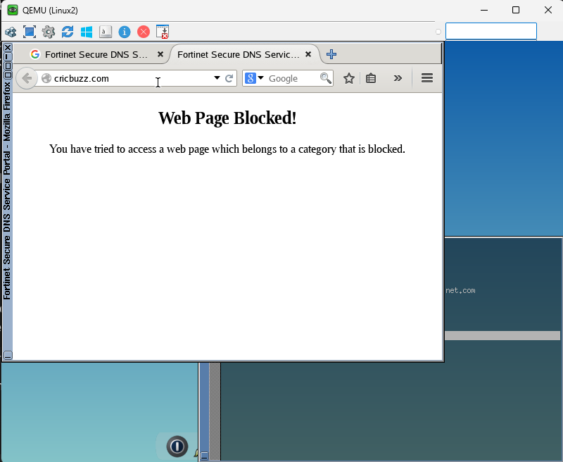
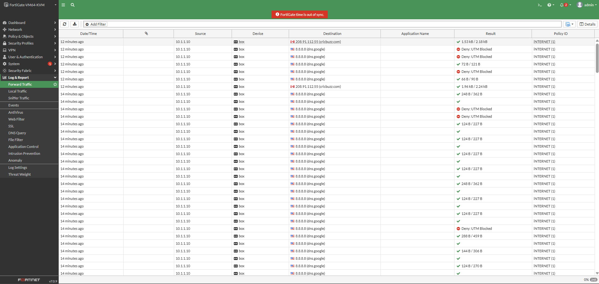

# Lab 11 — FortiGate DNS Filtering Setup, FortiGuard Domain Categorization & Packet Drop Troubleshooting

A comprehensive, enterprise-grade laboratory and conceptual guide covering **FortiGate DNS Filtering**, **UDP Port 53 Traffic Inspection**, **FortiGuard Category-Based Blocking vs. Static Domain Filtering**, **Difference between DNS Filtering & URL Filtering**, and **Real-Time Network Debugging** (diagnosing Routing vs. Firewall Policy Interface Mismatch).

---

## 📁 Repository Directory & File Structure Guide

To maintain consistency with your existing repository (`salman-network-security-labs/Fortigate-labs/`), create your next folder with the following exact structure:

```text
salman-network-security-labs/
└── Fortigate-labs/
    ├── Lab 10 — Web & URL Filtering Setup, FortiGuard Categorization,...
    └── Lab 11 — FortiGate DNS Filtering Setup, FortiGuard Domain Categorization & Packet Drop Troubleshooting/
        ├── README.md
        ├── Topology.png
        ├── Fortigate_Dashboard.png
        ├── Firewall_Policy.png
        ├── DNS_Filter.png
        ├── DNS_FILTER_IN_ACTION.png
        ├── Google_Access.png
        ├── Terminal_Verification.png
        └── Traffic_Log.png
```

---

## 📑 Table of Contents
- [Executive Overview](#-executive-overview)
- [Key Learning Objectives](#-key-learning-objectives)
- [Conceptual Fundamentals: DNS & Filtering Architecture](#-conceptual-fundamentals-dns--filtering-architecture)
  - [How DNS Resolution Works (UDP 53)](#how-dns-resolution-works-udp-53)
  - [Why DNS Filtering is Critical for Enterprise Security](#why-dns-filtering-is-critical-for-enterprise-security)
  - [DNS Filtering vs. URL Filtering: What is the Difference?](#dns-filtering-vs-url-filtering-what-is-the-difference)
- [Network Topology & Environment Specifications](#-network-topology--environment-specifications)
- [Step-by-Step Implementation & Configuration Guide](#-step-by-step-implementation--configuration-guide)
  - [Step 1: Network Interfaces & Routing Verification](#step-1-network-interfaces--routing-verification)
  - [Step 2: DNS Security Profile Configuration](#step-2-dns-security-profile-configuration)
  - [Step 3: Firewall Policy Creation & Profile Attachment](#step-3-firewall-policy-creation--profile-attachment)
- [Troubleshooting Deep Dive: The Routing vs. Policy Interface Mismatch](#-troubleshooting-deep-dive-the-routing-vs-policy-interface-mismatch)
  - [Root Cause Analysis](#root-cause-analysis)
  - [Sniffer Packet Capture Diagnosis](#sniffer-packet-capture-diagnosis)
  - [The Resolution](#the-resolution)
- [Lab Verification & Verification Evidence](#-lab-verification--verification-evidence)
  - [1. Internal PC Routing & ICMP Test](#1-internal-pc-routing--icmp-test)
  - [2. DNS Interception & Redirection Verification](#2-dns-interception--redirection-verification)
  - [3. Web Browser Block Portal Display](#3-web-browser-block-portal-display)
  - [4. FortiGate Forward Traffic Logs](#4-fortigate-forward-traffic-logs)
- [Golden Troubleshooting Workflow for Future Labs](#-golden-troubleshooting-workflow-for-future-labs)
- [Reference Links & Acknowledgments](#-reference-links--acknowledgments)

---

## 🌐 Executive Overview

Domain Name System (DNS) filtering is one of the first lines of defense in modern Network Security Architecture. Because end users are often unaware of whether a domain is safe or malicious, **FortiGate Next-Generation Firewalls (NGFW)** inspect outgoing DNS queries operating on **UDP Port 53** to intercept and filter traffic before an actual HTTP/HTTPS session is established.

In this lab, we configured and validated **DNS Filtering on FortiOS 7.0.9**, implemented domain categorization, executed static domain blocking, and performed live CLI packet capturing (`diagnose sniffer packet`) to isolate and resolve an interface routing mismatch between `port1` (Internet/DHCP Gateway) and `port3` (Unused WAN interface).

---

## 🎯 Key Learning Objectives

- **Understand DNS Protocol Execution:** How domain resolution moves from End-User Client $\rightarrow$ Local Gateway $\rightarrow$ DNS Resolver (`8.8.8.8`) $\rightarrow$ Root Servers / TLDs.
- **Master FortiGate DNS Filtering:** Intercepting UDP 53 packets to allow, monitor, or block traffic based on FortiGuard category or custom static domain rules.
- **Compare Security Mechanisms:** Differentiate between **DNS Filtering** (Domain-level blocking) and **URL Filtering** (Deep path/page-level blocking).
- **Diagnose Traffic Drops:** Utilize `diagnose sniffer packet` and `get router info routing-table all` to fix routing table vs. firewall policy interface mismatches.
- **Validate Redirection Portals:** Verify DNS sinkholing and redirection to FortiGate's block IP (`208.91.112.55`).

---

## 🧠 Conceptual Fundamentals: DNS & Filtering Architecture

### How DNS Resolution Works (UDP 53)
When a user attempts to access a domain like `www.example.com`:
1. **Query Generation:** The client sends a DNS query over **UDP 53** requesting the IPv4 address of `www.example.com`.
2. **DNS Resolver:** The request reaches the DNS resolver (e.g., Google DNS `8.8.8.8`).
3. **Recursive Hierarchy:** If uncached, the resolver queries the **Root Servers**, then **Top-Level Domain (TLD) `.com` Servers**, and finally the **Authoritative Name Server** for `example.com`.
4. **Response:** The IP address is returned to the client, allowing HTTP/HTTPS connection establishment.

### Why DNS Filtering is Critical for Enterprise Security
Users cannot manually verify thousands of web domains. FortiGate inspects UDP 53 packets in real time against:
- **Botnet Command & Control (C&C) Databases:** Blocking infected internal hosts from contacting attacker servers.
- **FortiGuard Category Ratings:** Grouping domains (e.g., Sports, Adult, Gambling, Games) for automated corporate policy enforcement.
- **Static Domain Filters:** Explicitly preventing access to prohibited domains.

### DNS Filtering vs. URL Filtering: What is the Difference?

| Feature | DNS Filtering | URL Filtering |
| :--- | :--- | :--- |
| **Protocol & Port** | UDP / TCP Port 53 | HTTP / HTTPS (Ports 80 / 443) |
| **Inspection Layer** | Domain Name Resolution (Before Connection) | Application Layer (After Connection) |
| **Scope of Block** | **Entire Domain** (e.g., `abc.com` is completely blocked) | **Specific Sub-path / Page** (e.g., blocks `abc.com/contact-us` while allowing `abc.com`) |
| **Performance Impact** | Extremely Low (Fast DNS interception) | Higher (Requires Deep Packet / SSL Inspection) |
| **Use Case** | Global perimeter domain blocking & C&C sinkholing | Fine-grained web application control |

---

## 🛠 Network Topology & Environment Specifications

The laboratory setup is hosted on GNS3 / EVE-NG with the following topology:



### Interface & Addressing Summary

| Device / Node | Interface | IP Address / Subnet | Role / Description |
| :--- | :--- | :--- | :--- |
| **FortiGate VM64-KVM** | `port1` | `192.168.188.132/24` (DHCP) | Management Network & Default Internet Gateway |
| **FortiGate VM64-KVM** | `port2` | `10.1.1.1/24` (Static) | Internal LAN Gateway (INSIDE) |
| **FortiGate VM64-KVM** | `port3` | `172.29.129.100/24` (Static) | Unused WAN Interface (Lab Outside Cloud Connection) |
| **Linux Client (Linux2)** | `eth0` | `10.1.1.10/24` | Test Machine (Default Gateway: `10.1.1.1`, DNS: `8.8.8.8`) |
| **MGMT Workstation** | -- | `192.168.188.x/24` | FortiGate Web GUI Management (`http://192.168.188.132`) |

---

## ⚙ Step-by-Step Implementation & Configuration Guide

### Step 1: Network Interfaces & Routing Verification

Check physical interfaces and static route status on FortiGate CLI:

```text
# Verify interface status and assigned IPs
get system interface physical

# Display active static routes
show router static
```



### Step 2: DNS Security Profile Configuration

Navigate to **Security Profiles > DNS Filter** in the FortiGate GUI and configure a profile named `SalmanTest_DNS`:



1. **Profile Name:** `SalmanTest_DNS`
2. **FortiGuard Category Filter:** Select **Sports** $\rightarrow$ Set Action to **Redirect to Block Portal**.
3. **Static Domain Filter:**
   - Enable **Domain Filter**.
   - Click **+ Create New**:
     - **Domain:** `cricbuzz.com`
     - **Type:** `Simple`
     - **Action:** `Redirect to Block Portal`
     - **Status:** `Enable`
4. **Redirect Portal IP:** Use FortiGuard Default (`208.91.112.55`).

### Step 3: Firewall Policy Creation & Profile Attachment

Create an IPv4 Firewall Policy named `iNTERNET` to permit LAN traffic to the Internet while attaching the DNS Filter profile:



```text
config firewall policy
    edit 1
        set name "iNTERNET"
        set srcintf "port2"
        set dstintf "port1"
        set srcaddr "all"
        set dstaddr "all"
        set action accept
        set schedule "always"
        set service "ALL"
        set utm-status enable
        set dnsfilter-profile "SalmanTest_DNS"
        set nat enable
        set logtraffic all
    next
end
```

---

## 🔍 Troubleshooting Deep Dive: The Routing vs. Policy Interface Mismatch

### Root Cause Analysis
During initial deployment, ICMP ping requests to `8.8.8.8` from `Linux2` (`10.1.1.10`) failed with **100% Packet Loss**, even though local gateway pinging (`10.1.1.1`) succeeded:

1. **Routing Table Reality:** FortiGate's active routing table contained a default route pointing outward through **`port1`**:
   ```text
   S* 0.0.0.0/0 [5/0] via 192.168.188.2, port1
   ```
2. **Policy Configuration Error:** The Firewall Policy was misconfigured with Outgoing Interface **`port3`** (`set dstintf "port3"`).
3. **Result:** Packet dropped internally because FortiGate is a stateful firewall; it will not egress traffic out of `port3` when the active routing table points to `port1`.

### Sniffer Packet Capture Diagnosis
Running live packet capture on FortiGate CLI confirmed packets entered `port2` but never egressed:

```text
FortiGate-VM64-KVM # diagnose sniffer packet any "icmp" 4 0 L
filters=[icmp]
3.939816 port2 in 10.1.1.10 -> 8.8.8.8: icmp: echo request
4.943677 port2 in 10.1.1.10 -> 8.8.8.8: icmp: echo request
```
*Note: Only `port2 in` requests were observed. No `port1 out` or `port3 out` packets appeared.*

### The Resolution
Re-aligning the firewall policy destination interface to match the active routing table resolved the issue immediately:

```text
config firewall policy
    edit 1
        set dstintf "port1"
    next
end
```

---

## ✅ Lab Verification & Evidence

### 1. Internal PC Routing & ICMP Test
After correcting `dstintf` to `port1`, ICMP traffic from `Linux2` reached internet target `8.8.8.8` with **0% packet loss**:



### 2. DNS Interception & Redirection Verification
Executing `nslookup cricbuzz.com` on `Linux2` confirms that FortiGate successfully intercepted the UDP 53 query and sinkholed the request to its official block portal IP (`208.91.112.55`):



```bash
gns3@box:~$ nslookup cricbuzz.com
Server:    8.8.8.8
Address 1: 8.8.8.8 dns.google

Name:      cricbuzz.com
Address 1: 208.91.112.55 fortinet-block-page-55.fortinet.com
```

### 3. Web Browser Block Portal Display
Navigating to `http://cricbuzz.com` in Firefox inside `Linux2` displays the native Fortinet **Web Page Blocked!** portal screen:



### 4. FortiGate Forward Traffic Logs
Navigating to **Log & Report > Forward Traffic** in FortiGate GUI shows traffic matching Policy ID `1` (`iNTERNET`), where blocked domains trigger **Deny: UTM Blocked** actions:



---

## 💡 Golden Troubleshooting Workflow for Future Labs

Whenever internet ping or web security profile filtering fails in FortiGate labs, follow this 3-step checklist:

```text
[Step 1: Check Client IP & Route] ──> [Step 2: Check Active Routing Table] ──> [Step 3: Verify Policy Interface & NAT]
```

1. **Verify Routing Table (`get router info routing-table all`):**
   Determine the exact outgoing interface for `0.0.0.0/0` (e.g., `port1`).
2. **Match Firewall Policy (`show firewall policy <id>`):**
   Ensure `srcintf`, `dstintf`, and `nat enable` strictly align with the routing table.
3. **Execute Live Packet Capture (`diagnose sniffer packet any "host 8.8.8.8" 4 0 l`):**
   Confirm packets show both ingress (`port2 in`) AND egress (`port1 out`) frames.

---

- **Author:** Salman Khan
