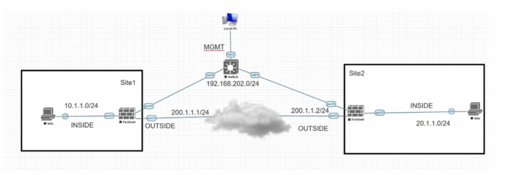
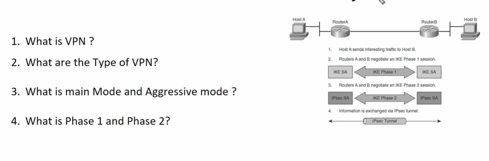
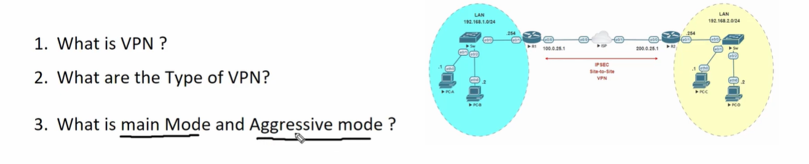

# Day 17: FortiGate IPsec VPN Fundamentals & Architectural Deep-Dive

**Author:** Salman Khan  
**Course:** FortiGate Firewall Series (Day 17)  
**Topic:** IPsec VPN Architecture, IKE Negotiation, Phase 1 vs Phase 2, Main/Aggressive Modes, DH Groups, and PFS  

---

## 1. Executive Summary & Overview

In modern enterprise network architecture, connecting geographically separated private networks over public infrastructure requires robust cryptographic protection. Because private IP addresses (RFC 1918) are non-routable over the public Internet, **Virtual Private Networks (VPNs)** serve as the backbone for secure inter-site communication.

This module breaks down the core theoretical foundations of **IPsec (Internet Protocol Security)** within FortiGate firewalls. It covers the complete lifecycle of IPsec tunnel establishment, from initial security parameter negotiation (Phase 1) to user-data payload encryption (Phase 2), along with cryptographic primitives like Diffie-Hellman (DH) key exchanges and Perfect Forward Secrecy (PFS).

---

## 2. Lab Topology & Environment Breakdown

Below is the architectural layout representing a typical Site-to-Site IPsec VPN environment managed by FortiGate firewalls across an untrusted WAN/Internet core.



### Topology Parameters & IP Addressing Scheme

| Element | Site 1 (Initiator / Local) | Site 2 (Responder / Remote) |
| :--- | :--- | :--- |
| **Firewall Hostname** | FortiGate-Site1 | FortiGate-Site2 |
| **Inside LAN Subnet** | `10.1.1.0/24` | `20.1.1.0/24` |
| **LAN Interface** | `port2` | `port2` |
| **WAN IP (Public)** | `200.1.1.1/24` (`port3`) | `200.1.1.2/24` (`port3`) |
| **MGMT IP Subnet** | `192.168.202.0/24` (`port1`) | `192.168.202.0/24` (`port1`) |
| **Underlay Network** | Internet / Public Cloud | Internet / Public Cloud |
| **Overlay Tunnel** | IPsec Virtual Tunnel Interface (VTI) | IPsec Virtual Tunnel Interface (VTI) |

---

## 3. Core Concepts & Foundations

### 3.1 What is a VPN?
A **Virtual Private Network (VPN)** is a technology that creates an isolated, encrypted overlay tunnel over a shared or public physical underlay network (such as the Internet). 

```
[ LAN: 10.1.1.0/24 ] ---> [ FortiGate A ] === ( Encrypted IPsec Tunnel over ISP ) ===> [ FortiGate B ] ---> [ LAN: 20.1.1.0/24 ]
```

#### Why do we need VPNs?
1. **Routability:** RFC 1918 private subnets cannot route across public Internet routers.
2. **Confidentiality:** Eavesdroppers on the ISP/Internet path cannot view plain-text traffic.
3. **Data Integrity:** Ensures data is not altered or tampered with in transit.
4. **Authentication:** Guarantees that communication occurs strictly between trusted peer firewalls.

---

### 3.2 Types of VPN Supported by FortiGate

FortiGate categorizes VPN deployment models into two primary architectures:

```
                          ┌────────────────────────┐
                          │    FortiGate VPNs      │
                          └───────────┬────────────┘
                                      │
               ┌──────────────────────┴──────────────────────┐
               ▼                                             ▼
   ┌───────────────────────┐                     ┌───────────────────────┐
   │    Site-to-Site VPN    │                     │   Remote Access VPN   │
   │  (Network-to-Network)  │                     │   (Client-to-Site)    │
   └───────────────────────┘                     └───────────────────────┘
```

1. **Site-to-Site VPN (Network-to-Network):**
   * Connects entire branch offices, remote sites, or corporate data centers together.
   * Established between two dedicated edge gateways (e.g., FortiGate to FortiGate, FortiGate to Cisco, Palo Alto, or AWS VPN Gateway).
   * Transparent to end hosts; PCs do not run software clients.

2. **Remote Access VPN (Client-to-Site / Dial-Up):**
   * Connects individual roaming users, remote workers, or laptops to the corporate network.
   * Utilizes client software such as **FortiClient** or web-based SSL-VPN portals.
   * User authenticates via Pre-Shared Key, User Credentials (AD/LDAP/SAML), or PKI Certificates.

---

### 3.3 Security Parameters (The Cryptographic Triad)

To secure traffic over untrusted networks, IPsec relies on three fundamental cryptographic pillars:

```
                      ┌─────────────────────────────────┐
                      │    IPsec Security Triad         │
                      └────────────────┬────────────────┘
                                       │
         ┌─────────────────────────────┼─────────────────────────────┐
         ▼                             ▼                             ▼
┌─────────────────┐           ┌─────────────────┐           ┌─────────────────┐
│ Encryption      │           │ Hashing         │           │ Authentication  │
│ Confidentiality │           │ Integrity       │           │ Identity        │
└─────────────────┘           └─────────────────┘           └─────────────────┘
```

1. **Encryption (Confidentiality):**
   * Transforms readable plain-text into unreadable cipher-text.
   * Prevents unauthorized eavesdropping.
   * **Algorithms:** AES-128, AES-256, 3DES (legacy).
   * *Example:* Plaintext `Hello` $\rightarrow$ Ciphertext `25128Z1390A...`

2. **Hashing (Data Integrity):**
   * Passes traffic payloads through a mathematical engine to calculate a unique fixed-length hash value (digest).
   * Sender attaches this hash value to the packet. The recipient computes the hash independently using the same function. If the values match, data integrity is guaranteed.
   * **Algorithms:** MD5 (legacy), SHA-1 (deprecated), SHA-256, SHA-512.
   * *Mismatch Action:* If transit data is tampered with, the computed hash changes, and the receiving firewall silently drops the packet.

3. **Authentication (Peer Identity):**
   * Validates the true identity of the remote VPN peer before allowing tunnel setup.
   * **Methods:**
     * **Pre-Shared Key (PSK):** A matching secret string configured manually on both endpoints.
     * **X.509 Digital Certificates (PKI):** Asymmetric public/private key pairs validated by a trusted Certificate Authority (CA).

---

## 4. IPsec Architecture: Phase 1 vs Phase 2

Establishing an IPsec VPN is a two-step process: **Phase 1** builds the secure control channel, and **Phase 2** builds the secure data channel.



### 4.1 Phase 1 (ISAKMP / IKE SA)
* **Goal:** Authenticate remote peers and create a secure, encrypted management tunnel (**IKE Security Association**).
* **Scope:** No end-user data travels inside Phase 1; it is dedicated purely to control-plane signaling and key negotiation.
* **Port / Protocol:** Uses **UDP Port 500** (or **UDP Port 4500** if NAT-Traversal / NAT-T is detected).

### 4.2 Phase 2 (IPsec SA / Quick Mode)
* **Goal:** Negotiate parameters used to protect actual data payloads (ICMP Ping, HTTP, Database traffic, etc.) and establish **IPsec Security Associations**.
* **Scope:** Actual user traffic flows exclusively within Phase 2 SAs.
* **Protocol:** Uses **IP Protocol 50 (ESP - Encapsulating Security Payload)** or **UDP 4500** when encapsulated over NAT.

---

### Detailed Comparison Table

| Feature / Attribute | Phase 1 (IKE SA / ISAKMP) | Phase 2 (IPsec SA / Quick Mode) |
| :--- | :--- | :--- |
| **Primary Purpose** | Gateway authentication & management tunnel setup | Protection of actual user traffic payloads |
| **Negotiation Modes** | **Main Mode** (6 Packets) or **Aggressive Mode** (3 Packets) | **Quick Mode** (3 Packets) |
| **Identities Exchanged** | Peer IPs, Hostnames, Certificates, PSKs | Local Subnets & Remote Subnets (Proxy IDs / Traffic Selectors) |
| **Protocols & Ports** | UDP 500 / UDP 4500 | IP Protocol 50 (ESP), IP Protocol 51 (AH), or UDP 4500 |
| **Key Generation** | Initial Diffie-Hellman Exchange | Uses Phase 1 Keying Material (or new DH key if PFS is enabled) |
| **Lifetime Default** | 86400 seconds (24 Hours) | 43200 seconds (12 Hours) or 28800 seconds (8 Hours) |

---

## 5. Main Mode vs. Aggressive Mode (Phase 1)

Phase 1 can negotiate using two distinct operational modes: **Main Mode** and **Aggressive Mode**.



### 5.1 Main Mode (6-Packet Exchange)

Main Mode uses six discrete exchange packets to establish the IKE SA. It offers maximum cryptographic protection by hiding the identities of both VPN gateways.

```
Initiator (Site 1)                                   Responder (Site 2)
        │                                                     │
        │─── Packet 1: Security Proposals (Encryption, Hash) ─►│
        │◄── Packet 2: Chosen Proposal Response ──────────────│  (Plaintext)
        │                                                     │
        │─── Packet 3: Diffie-Hellman Public Key + Nonce ────►│
        │◄── Packet 4: Diffie-Hellman Public Key + Nonce ─────│  (Plaintext)
        │                                                     │
        │=====================================================│  [DH Key Derived]
        │─── Packet 5: Encrypted Identity & PSK Hash ────────►│
        │◄── Packet 6: Encrypted Identity & PSK Hash ─────────│  (ENCRYPTED)
        │                                                     │
```

1. **Packets 1 & 2 (Proposal Exchange):** Negotiate security algorithms (Encryption, Hashing, DH Group, Lifetime). Sent in plaintext.
2. **Packets 3 & 4 (Key Exchange):** Exchange Diffie-Hellman public values and random numbers (nonces). Sent in plaintext. At this stage, both gateways calculate the shared secret key.
3. **Packets 5 & 6 (Authentication):** Exchanged **encrypted** using the newly derived DH key. Validates peer identity (PSK hash or Certificates).

* **Advantage:** Highly secure. Peer identities remain encrypted and protected against passive network sniffing.
* **Requirement:** Best suited for static Public IP configurations.

---

### 5.2 Aggressive Mode (3-Packet Exchange)

Aggressive Mode condenses Phase 1 negotiation into just three packets to speed up tunnel initialization.

```
Initiator (Site 1)                                   Responder (Site 2)
        │                                                     │
        │─── Packet 1: Proposals + DH Key + Peer ID (Plain) ─►│
        │◄── Packet 2: Chosen Proposal + DH Key + Auth Hash ──│
        │─── Packet 3: Final Authentication Confirmation ────►│
        │                                                     │
```

1. **Packet 1:** The initiator sends proposals, DH public key, and identity all at once in plain text.
2. **Packet 2:** The responder responds with its chosen proposal, DH key, and authentication response.
3. **Packet 3:** The initiator confirms authentication.

* **Disadvantage:** **Security Risk.** Because Packet 1 sends peer identity and PSK hashes in plain text, attackers can intercept traffic and attempt offline dictionary or brute-force attacks.
* **Use Case:** Used primarily in legacy dial-up VPNs where the initiator's WAN IP is dynamic. **Avoid in modern enterprise deployments.**

---

## 6. Key Exchange Mechanisms: Diffie-Hellman & PFS

### 6.1 Diffie-Hellman (DH) Key Exchange
Diffie-Hellman is an asymmetric mathematical algorithm that enables two network peers to establish a shared, secret symmetric encryption key over an insecure, untrusted channel (the Internet) without ever sending the secret key itself over the wire.

```
  Site 1 Private Key                                     Site 2 Private Key
         │                                                      │
         ▼                                                      ▼
[ Site 1 Math Engine ] ─── Shares Public Key over Internet ──► [ Site 2 Math Engine ]
         │                                                      │
         └─────────────────── Both Calculate ───────────────────┘
                                     │
                                     ▼
                      Identical Shared Secret Key!
```

#### How DH Works:
1. Each firewall generates a **Private Key** (kept strictly secret) and computes a **Public Key**.
2. They exchange Public Keys over the untrusted network.
3. Each firewall combines its own Private Key with the peer's Public Key.
4. Through modulo arithmetic, both sides independently calculate the exact same **Shared Master Secret Key**.

#### DH Groups:
Higher DH Group numbers represent larger key sizes, offering stronger mathematical security at the cost of higher CPU utilization:
* **DH Group 2 (1024-bit):** Legacy / Weak — *Do not use.*
* **DH Group 5 (1536-bit):** Legacy — *Avoid.*
* **DH Group 14 (2048-bit):** Minimum enterprise baseline.
* **DH Group 19 (256-bit Elliptic Curve / ECP256):** Recommended (High security + Fast performance).
* **DH Group 20 (384-bit Elliptic Curve / ECP384):** High-security enterprise baseline.

---

### 6.2 Perfect Forward Secrecy (PFS)

By default, Phase 2 derives its encryption keys directly from the master secret key generated during Phase 1. 

**The Risk:** If an attacker records historical encrypted data traffic and somehow compromises the Phase 1 master key in the future, they can retroactively decrypt all past Phase 2 traffic.

**The PFS Solution:**
When **PFS is enabled**, Phase 2 forces a brand-new Diffie-Hellman exchange every time a Phase 2 SA rekeys. 

```
Phase 1 Key Generated (DH Group 19)
        │
        ├─── Phase 2 (PFS OFF) ──> Reuses Phase 1 Master Key Material
        │
        └─── Phase 2 (PFS ON)  ──> Triggers NEW DH Exchange ──> Brand New Unique Key!
```

* **Benefit:** Compromising a single Phase 2 session key gives an attacker access *only* to data encrypted within that specific SA lifetime window. Past and future traffic remains fully secure.
* **Requirement:** PFS settings (and matching DH Groups) **must match identically** on both FortiGate peers.

---

## 7. Deep-Dive Phase 1 & Phase 2 Packet Negotiation

Below is the complete 9-packet lifecycle required to bring an IPsec VPN tunnel fully operational under IKEv1 Main Mode:

```
                  =======================================================
                  Phase 1: IKE SA Negotiation (Main Mode - 6 Packets)
                  =======================================================
Packet 1 (Init  -> Resp): Security Proposal (AES-256, SHA-256, DH19, Lifetime)
Packet 2 (Resp -> Init ): Proposal Accepted / Selected
Packet 3 (Init  -> Resp): DH Public Key Share (Initiator) + Nonce
Packet 4 (Resp -> Init ): DH Public Key Share (Responder) + Nonce
-----------------------------------------------------------------------------------------
           *** BOTH FIREWALLS GENERATE SHARED MASTER KEYS INTERNALLY ***
-----------------------------------------------------------------------------------------
Packet 5 (Init  -> Resp): Encrypted Peer Identity + PSK Authentication Hash
Packet 6 (Resp -> Init ): Encrypted Peer Identity + PSK Authentication Hash

   =======> PHASE 1 IS UP (Control Channel Established - IKE SA Active) <=======

                  =======================================================
                  Phase 2: IPsec SA Negotiation (Quick Mode - 3 Packets)
                  =======================================================
Packet 7 (Init  -> Resp): Hash, ESP Encryption Proposal, Proxy IDs (10.1.1.0/24 -> 20.1.1.0/24)
Packet 8 (Resp -> Init ): Hash, Accepted Proposal, Proxy IDs Confirmation
Packet 9 (Init  -> Resp): Final Hash ACK / Authorization Confirmation

   =======> PHASE 2 IS UP (Data Channel Established - IPsec SA Active) <=======
```

---

## 8. Technical Interview Preparation (Q&A Guide)

### Q1: What is the exact functional difference between Phase 1 and Phase 2 in IPsec VPNs?
**Answer:**  
Phase 1 (IKE SA / ISAKMP) establishes a secure, encrypted management channel between the two VPN gateways by authenticating peer identities and exchanging key material via UDP 500/4500. It operates using either Main Mode (6 packets) or Aggressive Mode (3 packets).  

Phase 2 (IPsec SA / Quick Mode) runs inside the encrypted Phase 1 tunnel. It negotiates parameters specifically for protecting end-user traffic (such as local/remote subnets, ESP encryption algorithms, and lifetimes) using 3 packets. Actual user payload traffic flows strictly through Phase 2.

---

### Q2: Why is Main Mode preferred over Aggressive Mode in enterprise environments?
**Answer:**  
Main Mode hides peer identities (IP address, hostnames, pre-shared key hashes) by encrypting them inside Packets 5 and 6 using the derived Diffie-Hellman key. Aggressive Mode sends peer identities in Packet 1 in clear text, exposing the pre-shared key hash to passive eavesdropping and offline brute-force attacks.

---

### Q3: What mandatory parameters MUST match on both firewalls for Phase 1 to reach UP status?
**Answer:**  
1. **Encryption Algorithm:** (e.g., AES-256)
2. **Authentication / Hash Algorithm:** (e.g., SHA-256)
3. **Diffie-Hellman (DH) Group:** (e.g., Group 14 or Group 19)
4. **Pre-Shared Key (PSK):** Must match character-for-character.
5. **Peer Remote Public IP Address Configuration**

---

### Q4: What mandatory parameters MUST match for Phase 2 to reach UP status?
**Answer:**  
1. **Encryption & Hashing Proposals:** (e.g., AES-256 / SHA-256)
2. **Proxy IDs / Traffic Selectors:** Local and Remote subnets must mirror each other (Local Subnet on Site A must match Remote Subnet on Site B, and vice versa).
3. **PFS (Perfect Forward Secrecy) Settings:** If PFS is enabled on Side A, it must be enabled on Side B with matching DH Groups.
4. **Phase 2 Lifetime:** (Recommended matching values).

---

### Q5: Scenario: Phase 1 is UP, but Phase 2 stays DOWN. What are the top troubleshooting causes?
**Answer:**  
1. **Proxy ID Mismatch:** Local and Remote subnets configured on Site A do not mirror Site B's configuration.
2. **PFS Mismatch:** PFS is enabled on one firewall and disabled on the other, or different DH Groups are configured in Phase 2.
3. **Proposal Mismatch:** Mismatch in Phase 2 encryption/hashing algorithms.
4. **Firewall Policy or Routing Issue:** No traffic has been initiated to trigger the Phase 2 dynamic tunnel setup, or static routes pointing traffic to the IPsec interface are missing.

---

### Q6: What is the difference between IKEv1 and IKEv2?
**Answer:**  
IKEv2 (RFC 7296) is a more efficient, modern iteration of the key exchange protocol. While IKEv1 requires 6 packets for Phase 1 Main Mode + 3 packets for Phase 2 Quick Mode (total 9 packets), IKEv2 negotiates both Phase 1 and Phase 2 in just **4 initial packets** (`IKE_SA_INIT` and `IKE_AUTH`), significantly reducing latency and connection setup times.

---

## 9. Real-World Troubleshooting & Verification Commands

When troubleshooting IPsec VPN issues on FortiGate firewalls, use the following FortiOS CLI commands:

### 9.1 Check VPN Tunnel Status
```bash
# Display summary of all configured IKE gateways (Phase 1)
diagnose vpn ike gateway list

# Display all active IPsec Security Associations (Phase 2)
diagnose vpn tunnel list
```

### 9.2 Real-Time Debugging (IKE Engine)
To trace real-time packet exchanges and pinpoint negotiation failures:
```bash
# Step 1: Set debug filter to target specific remote peer IP
diagnose debug application ike -1
diagnose debug filter p2-name <Tunnel_Name>
diagnose debug enable

# Step 2: Trigger traffic from host PC (e.g., ping across tunnel)
# Step 3: Disable debug once captured
diagnose debug disable
diagnose debug reset
```

### 9.3 Clear and Restart Tunnel Negotiation
```bash
# Reset Phase 1 connection to force renegotiation
diagnose vpn ike gateway clear name <Tunnel_Name>
```

---

## 10. Key Takeaways & Summary

```
                      ┌─────────────────────────────────┐
                      │    IPsec Lifecycle Summary      │
                      └────────────────┬────────────────┘
                                       │
        ┌──────────────────────────────┴──────────────────────────────┐
        ▼                                                             ▼
┌──────────────────────────────┐                             ┌──────────────────────────────┐
│       PHASE 1 (IKE SA)       │                             │      PHASE 2 (IPsec SA)      │
│  - Control Plane             │                             │  - Data Plane                │
│  - Gateway Authentication    │                             │  - User Traffic Protection   │
│  - Main Mode (6 Packets)     │ ─── Enables Phase 2 SAs ──► │  - Quick Mode (3 Packets)    │
│  - Derived Shared Secret Key │                             │  - Proxy IDs (Subnets)       │
└──────────────────────────────┘                             └──────────────────────────────┘
```

1. **Phase 1** authenticates the gateways and creates a secure control management tunnel over UDP 500/4500.
2. **Main Mode** uses 6 packets and encrypts peer identities; **Aggressive Mode** uses 3 packets and sends identities in plaintext (avoid in production).
3. **Diffie-Hellman (DH)** allows two peers to calculate an identical symmetric encryption key across an untrusted network without sending the secret itself over the wire.
4. **PFS (Perfect Forward Secrecy)** protects historical traffic by generating fresh DH keys for every Phase 2 negotiation.
5. **Phase 2** uses ESP (IP Protocol 50) to encrypt and transport user data payloads between defined local and remote subnets (Proxy IDs).
