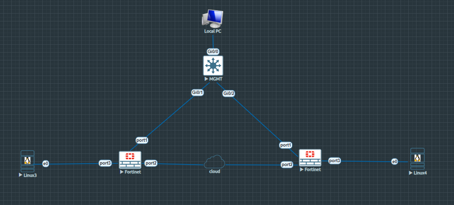
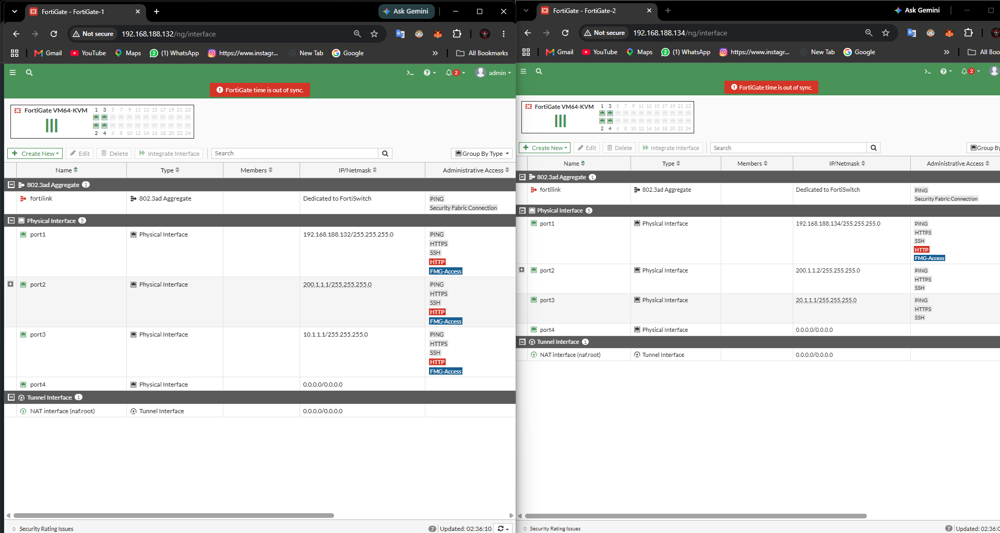
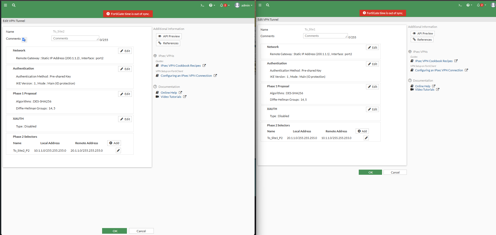
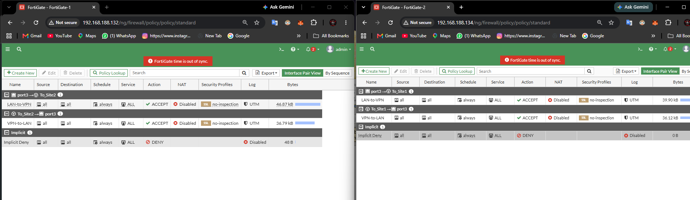
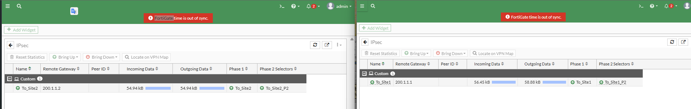
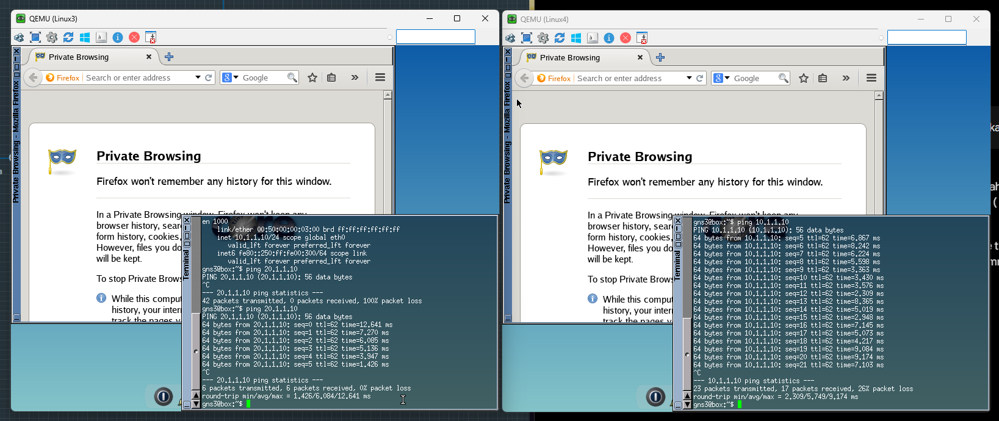

# Lab 13 — FortiGate Site-to-Site IPsec VPN Setup, Phase 1/2 Configuration & NAT Troubleshooting

A comprehensive, enterprise-grade laboratory and conceptual guide covering FortiGate Site-to-Site IPsec VPN configuration, IKEv1 Aggressive/Main Mode parameters, DES-SHA256 crypto proposals, Pre-Shared Key (PSK) authentication, Phase 2 security associations, static routing over VPN tunnels, and solving the classic NAT mismatch issue causing 100% packet loss.

---

## Repository Directory & File Structure Guide

To maintain consistency with your existing repository (`salman-network-security-labs/Fortigate-labs/`), create your next folder with the following exact structure:

```text
salman-network-security-labs/
└── Fortigate-labs/
    ├── Lab 11 — FortiGate DNS Filtering Setup...
    ├── Lab 12 — FortiGate IPsec VPN Remote Access...
    └── Lab 13 — FortiGate Site-to-Site IPsec VPN Setup, Phase 1/2 Configuration & NAT Troubleshooting/
        ├── README.md
        ├── Topology.png
        ├── Interfaces_Both.png
        ├── FG-1_Dashboard.png
        ├── FG-2_Dashboard.png
        ├── IPSEC_Tunnel_Config.png
        ├── Firewall_Policies.png
        ├── successful-ipsec-tunnel-status.png
        └── VPN-Ping.png
```

---

## Table of Contents

- [Executive Overview](#-executive-overview)
- [Key Learning Objectives](#-key-learning-objectives)
- [Conceptual Fundamentals: Site-to-Site IPsec VPN Architecture](#-conceptual-fundamentals-site-to-site-ipsec-vpn-architecture)
  - [Why Site-to-Site VPN is Critical for Enterprise Security](#why-site-to-site-vpn-is-critical-for-enterprise-security)
  - [Phase 1 (IKE) vs. Phase 2 (IPsec) Explained](#phase-1-ike-vs-phase-2-ipsec-explained)
- [Network Topology & Environment Specifications](#-network-topology--environment-specifications)
- [Step-by-Step Implementation & Configuration Guide](#-step-by-step-implementation--configuration-guide)
  - [Step 1: Interface Addressing & Initial Verification](#step-1-interface-addressing--initial-verification)
  - [Step 2: Custom IPsec Tunnel Configuration (Phase 1 & Phase 2)](#step-2-custom-ipsec-tunnel-configuration-phase-1--phase-2)
  - [Step 3: Static Routing Configuration](#step-3-static-routing-configuration)
  - [Step 4: Firewall Policy Creation & NAT Disabling](#step-4-firewall-policy-creation--nat-disabling)
- [Troubleshooting Deep Dive: The NAT Mismatch Issue](#-troubleshooting-deep-dive-the-nat-mismatch-issue)
  - [Root Cause Analysis](#root-cause-analysis)
  - [The Resolution](#the-resolution)
- [Lab Verification & Evidence](#-lab-verification--evidence)
  - [1. Tunnel Status Verification](#1-tunnel-status-verification)
  - [2. Bidirectional ICMP Ping Test](#2-bidirectional-icmp-ping-test)
- [Golden Troubleshooting Workflow for Future Labs](#-golden-troubleshooting-workflow-for-future-labs)
- [Reference Links & Acknowledgments](#-reference-links--acknowledgments)

---

##  xecutive Overview

In modern enterprise architecture, organizations frequently need to connect disparate local area networks (LANs) across remote geographic locations—such as connecting a Head Office in Karachi to a Branch Office in Sharjah. Because public internet infrastructure is inherently untrusted, sensitive corporate data cannot be transmitted in plaintext. 

A **Site-to-Site IPsec VPN** creates a secure, encrypted virtual tunnel over the public internet between two security gateways (FortiGate firewalls). In this lab, we successfully established a fully functional, bidirectional Site-to-Site IPsec VPN between **FortiGate-1** (Site 1) and **FortiGate-2** (Site 2) using custom IKEv1 parameters, configured static routes, created explicit firewall policies, and diagnosed/resolved the critical NAT mismatch bug that causes 100% packet loss on tunnel traffic.

---

## Key Learning Objectives

- **Understand Site-to-Site Topologies:** Learn how to interconnect two separate enterprise networks (`10.1.1.0/24` and `20.1.1.0/24`) securely across a simulated public internet cloud.
- **Master IPsec Phases:** Configure Internet Key Exchange (IKEv1) Phase 1 parameters (DES-SHA256, DH Group 5/14, PSK authentication) and Phase 2 selectors.
- **Configure Static Routing over VPN:** Direct traffic destined for the remote subnet through the respective VPN tunnel interface (`To_Site2` / `To_Site1`).
- **Resolve NAT Mismatch Issues:** Understand why Network Address Translation (NAT) must be explicitly disabled on internal LAN-to-VPN and VPN-to-LAN firewall policies to preserve original private source IPs and match Phase 2 selectors.
- **Validate Bidirectional Connectivity:** Execute and verify successful zero-packet-loss ICMP pings between Linux endpoints across both sites.

---

## Conceptual Fundamentals: Site-to-Site IPsec VPN Architecture

### Why Site-to-Site VPN is Critical for Enterprise Security
When data travels between two enterprise offices over the internet, it passes through multiple third-party routers and ISPs. Without encryption, anyone on the path can capture packets using tools like Wireshark. An IPsec VPN encapsulates original layer-3 packets inside ESP (Encapsulating Security Payload) packets, ensuring confidentiality, integrity, and authentication.

### Phase 1 (IKE) vs. Phase 2 (IPsec) Explained
An IPsec VPN is established in two distinct phases:
1. **Phase 1 (IKE - Internet Key Exchange):** Establishes a secure, authenticated management channel (Security Association - SA) between the two FortiGate public IP addresses. It negotiates authentication methods (Pre-Shared Key), encryption algorithms (`des-sha256`), Diffie-Hellman groups, and lifetime timers.
2. **Phase 2 (IPsec SA):** Uses the secure tunnel established in Phase 1 to negotiate the actual parameters for protecting data traffic. It defines **Phase 2 Selectors** (`src-subnet` and `dst-subnet`), specifying which internal subnets are permitted to communicate through the tunnel (e.g., `10.1.1.0/24` talking to `20.1.1.0/24`).

---

## Network Topology & Environment Specifications

The laboratory setup is hosted on GNS3 / EVE-NG with the following topology:

```text
[Linux3 (10.1.1.10)] <---> [port3] FortiGate-1 [port2] <--- (Cloud / Internet) ---> [port2] FortiGate-2 [port3] <---> [Linux4 (20.1.1.10)]
                                 |                                                          |
                             [port1]                                                    [port1]
                                 \-------------------------[MGMT Switch]-------------------/
                                                                |
                                                          [Local PC GUI]
```



### Interface & Addressing Summary

| Device / Node | Interface | IP Address / Subnet | Role / Description |
| :--- | :--- | :--- | :--- |
| **FortiGate-1** | port1 | `192.168.188.132/24` (DHCP) | Management Network & Default Gateway |
| **FortiGate-1** | port2 | `200.1.1.1/24` (Static) | WAN Interface connected to Internet Cloud (Peer Gateway) |
| **FortiGate-1** | port3 | `10.1.1.1/24` (Static) | Internal LAN Gateway for Site 1 (`10.1.1.0/24`) |
| **Linux3** | eth0 | `10.1.1.10/24` (Gateway: `10.1.1.1`) | End-user test host at Site 1 |
| **FortiGate-2** | port1 | `192.168.188.134/24` (DHCP) | Management Network |
| **FortiGate-2** | port2 | `200.1.1.2/24` (Static) | WAN Interface connected to Internet Cloud (Peer Gateway) |
| **FortiGate-2** | port3 | `20.1.1.1/24` (Static) | Internal LAN Gateway for Site 2 (`20.1.1.0/24`) |
| **Linux4** | eth0 | `20.1.1.10/24` (Gateway: `20.1.1.1`) | End-user test host at Site 2 |
| **MGMT Workstation** | -- | `192.168.188.x/24` | FortiGate Web GUI Management Access |

---

## ⚙ Step-by-Step Implementation & Configuration Guide

### Step 1: Interface Addressing & Initial Verification
Before configuring the VPN, ensure that all physical interfaces (`port1` for management, `port2` for WAN/internet connectivity, and `port3` for internal LAN) are correctly assigned with their respective IP addresses on both FortiGate firewalls.



Verify interface configuration via CLI on FortiGate-1:
```text
config system interface
    edit "port1"
        set mode dhcp
    next
    edit "port2"
        set ip 200.1.1.1 255.255.255.0
    next
    edit "port3"
        set ip 10.1.1.1 255.255.255.0
    next
end
```

### Step 2: Custom IPsec Tunnel Configuration (Phase 1 & Phase 2)
To maintain granular control over encryption parameters and understand underlying mechanics, we configured a **Custom IPsec VPN Tunnel** rather than using automated templates.

1. Navigate to **VPN > IPsec Tunnels > Create New > IPsec Tunnel**.
2. Select **Custom** and name the tunnel (`To_Site2` on FortiGate-1 and `To_Site1` on FortiGate-2).
3. **Phase 1 Settings:**
   - **Remote Gateway:** Static IP address of the peer firewall (`200.1.1.2` on FG-1, `200.1.1.1` on FG-2).
   - **Interface:** `port2` (WAN).
   - **Authentication Method:** Pre-shared Key (`fortinet123`).
   - **IKE Version:** `1` (Main Mode).
   - **Encryption / Authentication:** `DES-SHA256`.
   - **Diffie-Hellman Group:** `5` or `14`.
4. **Phase 2 Selectors:**
   - **FortiGate-1 (`To_Site2_P2`):** Local Subnet `10.1.1.0/24` $\rightarrow$ Remote Subnet `20.1.1.0/24`.
   - **FortiGate-2 (`To_Site1_P2`):** Local Subnet `20.1.1.0/24` $\rightarrow$ Remote Subnet `10.1.1.0/24`.



CLI equivalent configuration for FortiGate-1 Phase 2:
```text
config vpn ipsec phase2-interface
    edit "To_Site2_P2"
        set phasename "To_Site2"
        set proposal des-sha256
        set src-subnet 10.1.1.0 255.255.255.0
        set dst-subnet 20.1.1.0 255.255.255.0
    next
end
```

### Step 3: Static Routing Configuration
To instruct FortiGate where to send traffic destined for the remote office network, configure static routes pointing directly to the VPN tunnel interface.

On **FortiGate-1**:
```text
config router static
    edit 2
        set dst 20.1.1.0 255.255.255.0
        set device "To_Site2"
    next
end
```

On **FortiGate-2**:
```text
config router static
    edit 2
        set dst 10.1.1.0 255.255.255.0
        set device "To_Site1"
    next
end
```

### Step 4: Firewall Policy Creation & NAT Disabling
Two-way firewall policies must be created on both firewalls to permit traffic between the internal LAN (`port3`) and the VPN tunnel interface (`To_Site2` / `To_Site1`). Crucially, **NAT must be disabled** on both policies.



On **FortiGate-1**:
```text
config firewall policy
    edit 1
        set name "LAN-to-VPN"
        set srcintf "port3"
        set dstintf "To_Site2"
        set srcaddr "all"
        set dstaddr "all"
        set action accept
        set schedule "always"
        set service "ALL"
        set nat disable
    next
    edit 2
        set name "VPN-to-LAN"
        set srcintf "To_Site2"
        set dstintf "port3"
        set srcaddr "all"
        set dstaddr "all"
        set action accept
        set schedule "always"
        set service "ALL"
        set nat disable
    next
end
```

---

## 🔍 Troubleshooting Deep Dive: The NAT Mismatch Issue

### Root Cause Analysis
During initial testing, ping requests from Linux3 (`10.1.1.10`) to Linux4 (`20.1.1.10`) resulted in 100% packet loss even though Phase 1 and Phase 2 tunnels were green. 

1. **The NAT Conflict:** By default, internet-bound firewall policies have NAT enabled (`set nat enable`). When NAT is enabled, the FortiGate replaces the original private source IP (`10.1.1.10`) with its WAN public IP (`200.1.1.1`).
2. **Phase 2 Selector Failure:** IPsec VPN tunnel security associations rely on exact source and destination subnets defined in Phase 2 selectors (`10.1.1.0/24` to `20.1.1.0/24`). When NAT translated the source IP to a public IP, the packet no longer matched the Phase 2 cryptographic selectors, causing the firewall to silently drop the packet.

### The Resolution
Disabling NAT on both the `LAN-to-VPN` and `VPN-to-LAN` policies ensured that original private source IP addresses were preserved, allowing seamless matching inside the encrypted IPsec tunnel.

```text
config firewall policy
    edit 1
        set nat disable
    next
    edit 2
        set nat disable
    next
end
```

---

## ✅ Lab Verification & Evidence

### 1. Tunnel Status Verification
Navigating to **Monitor > IPsec Monitor** on both FortiGate firewalls confirms that Phase 1 and Phase 2 tunnels (`To_Site2` and `To_Site1`) are fully up (Green status) with active incoming and outgoing byte counters.



### 2. Bidirectional ICMP Ping Test
Testing connectivity from **Linux3** (`10.1.1.10`) to **Linux4** (`20.1.1.10`) and vice versa shows successful ICMP replies with **0% packet loss**.



Verification command on Linux3:
```bash
gns3@box:~$ ping 20.1.1.10
PING 20.1.1.10 (20.1.1.10): 56 data bytes
64 bytes from 20.1.1.10: icmp_seq=0 ttl=62 time=12.641 ms
64 bytes from 20.1.1.10: icmp_seq=1 ttl=62 time=7.270 ms
64 bytes from 20.1.1.10: icmp_seq=2 ttl=62 time=6.085 ms
--- 20.1.1.10 ping statistics ---
6 packets transmitted, 6 packets received, 0% packet loss
```

---

## Golden Troubleshooting Workflow for Future Labs

Whenever Site-to-Site IPsec VPN connectivity or traffic forwarding fails in FortiGate labs, follow this 3-step diagnostic checklist:

1. **Verify Tunnel Status:** Check **Monitor > IPsec Monitor** to ensure both Phase 1 and Phase 2 SAs are active and exchanging encrypted bytes.
2. **Check Static Routes:** Run `show router static` to confirm that remote subnets point directly to the respective VPN tunnel interface (`To_Site2` / `To_Site1`).
3. **Verify NAT is Disabled:** Ensure `set nat disable` is configured on all internal LAN-to-VPN and VPN-to-LAN firewall policies to protect original private subnets from being translated.

- **Author:** Salman Khan
