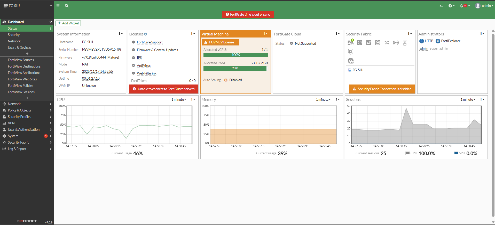

# Multi-Site IPsec VPN Lab: FortiGate (Sharjah) to Palo Alto (Karachi)

This repository documents the end-to-end design, configuration, troubleshooting, and verification of a multi-site site-to-site IPsec VPN tunnel between a FortiGate firewall (Sharjah) and a Palo Alto firewall (Karachi) over a direct WAN link. The internal subnets communicate securely across firewalls despite evaluation license cryptographic constraints.

---

## Table of Contents

- [Topology Overview](#topology-overview)
- [Lab Objectives and Concepts Learned](#lab-objecties-and-concepts-learned)
- [Repository Structure and Folder Creation Guide](#repository-structure-and-folder-creation-guide)
- [Step-by-Step Configuration Guide](#step-by-step-configuration-guide)
  - [1. FortiGate Configuration (Sharjah)](#1-fortigate-configuration-sharjah)
  - [2. Palo Alto Configuration (Karachi)](#2-palo-alto-configuration-karachi)
- [Troubleshooting and Key Challenges](#troubleshooting-and-key-challenges)
- [Verification and Testing](#verification-and-testing)

---

## Topology Overview

The lab simulates a direct WAN link connecting a branch office in Sharjah (`10.1.1.0/24`) and headquarters in Karachi (`20.1.1.0/24`). 


### Network Parameters
- **WAN Link / Transit Subnet:** `200.1.1.0/24`
- **Sharjah Firewall (FortiGate):**
  - Outside Interface (`port2`): `200.1.1.10/24`
  - Inside Interface (`port3`): `10.1.1.1/24`
  - Internal Node (`Linux3`): `10.1.1.10/24`
- **Karachi Firewall (Palo Alto):**
  - Outside Interface (`ethernet1/2`): `200.1.1.20/24`
  - Inside Interface (`ethernet1/1`): `20.1.1.1/24`
  - Internal Node (`Linux4`): `20.1.1.10/24`

---

## Lab Objectives and Concepts Learned

### What Was Learned
1. **Vendor Interoperability:** Integrating a FortiGate firewall with a Palo Alto firewall using standard IKEv1 Main Mode and IPsec ESP tunnels.
2. **License Constraints Handling:** Adapting enterprise configurations to adhere to FortiGate evaluation license limitations, restricting available cryptographic algorithms to legacy standards (DES, MD5, SHA1) and specific Diffie-Hellman groups (Groups 14 and 5).
3. **Phase 2 Proxy ID Alignment:** Ensuring strict subnet mirroring (Proxy IDs) between FortiGate Phase 2 selectors and Palo Alto Proxy IDs.
4. **Stateful Firewall Policy Enforcement:** Managing intra-zone and inter-zone security rules, security zones (`inside` / `outside`), and virtual router bindings.
5. **Clock Synchronization in VPNs:** Understanding why system time discrepancies break IKE security association (SA) negotiations.

### Why It Was Configured This Way
- **IKEv1 Main Mode:** Chosen for its deterministic identity exchange and broad compatibility across different vendor platforms.
- **Pre-Shared Key (PSK):** Used for lightweight and reliable authentication in lab environments without requiring a full PKI infrastructure.
- **Custom Crypto Profiles:** Because evaluation licenses limit modern ciphers (such as AES-GCM or SHA-256 in certain restricted modules), matching profiles to foundational ciphers (DES/SHA1/Group 14) ensures successful key exchange without negotiation rejections.

---

## Repository Structure and Folder Creation Guide

To add this lab to your existing GitHub repository (`salman-network-security-labs`), follow these step-by-step instructions to create the folder structure:

1. Navigate to your main repository page on GitHub.
2. Inside your `Fortigate-labs` folder (or root directory depending on your structure), click on **Add file** -> **Create new file**.
3. In the filename input box, type the folder path followed by your file name, for example:
   ```text
   Fortigate-labs/Lab 06 — FortiGate to Palo Alto IPsec VPN/README.md
   ```
4. Upload all corresponding images into the exact same folder so that Markdown relative links resolve properly.
5. Commit the changes directly to your `main` branch.

---

## Step-by-Step Configuration Guide

### 1. FortiGate Configuration (Sharjah)
- **Dashboard & System Status:** Verified system metrics, firmware, and manual system time settings to avoid synchronization errors.
  
  

- **IPsec Tunnel Settings (`S2K-VPN`):** Configured IKEv1 Main Mode, static peer IP (`200.1.1.20`), and restricted Phase 1/Phase 2 proposals to DES, MD5, SHA1, and DH Group 14.

  

- **Firewall Policies:** Established rules allowing traffic from LAN-to-VPN and VPN-to-LAN across interface pairs.

  

### 2. Palo Alto Configuration (Karachi)
- **Virtual Router Assignment:** Bound physical interfaces (`ethernet1/1`, `ethernet1/2`) and the tunnel interface (`tunnel.1`) to the `default` virtual router to satisfy routing requirements.

  

- **IKE Gateway & Crypto Profiles:** Configured IKEv1 gateway pointing to Sharjah (`200.1.1.10`) and matched the `fortigate-ike` profile.

  

- **IPsec Crypto Profiles:** Created `fortigate-ipsec` matching DES encryption, SHA1/MD5 authentication, and DH Group 14.

  

- **Proxy IDs:** Defined local (`20.1.1.0/24`) and remote (`10.1.1.0/24`) subnets precisely.

- **Security Policies:** Created the `Allow-VPN-Traffic` rule permitting traffic within the `inside` zone.

  

---

## Troubleshooting and Key Challenges

1. **Time Synchronization Errors:** 
   - *Issue:* FortiGate displayed a warning banner indicating time was out of sync, causing IKE phase 1 negotiations to drop.
   - *Resolution:* Adjusted manual system time settings under system configuration to match expected baseline parameters.
2. **Interface Binding Error on Commit:**
   - *Issue:* Palo Alto rejected initial commits due to unassigned virtual routers on `ethernet1/1` and `ethernet1/2`.
   - *Resolution:* Added both interfaces into the `default` virtual router.
3. **Crypto Proposal Mismatches:**
   - *Issue:* Initial attempts using AES-256 failed due to evaluation license limits.
   - *Resolution:* Aligned both firewalls strictly to DES, SHA1, and Group 14.

---

## Verification and Testing

After committing configurations on both firewalls and bringing up the tunnel via the monitors, cross-network ping tests were executed between internal Linux nodes (`Linux3` and `Linux4`).


- **Sharjah Linux3 (`10.1.1.10`)** successfully pinged **Karachi Linux4 (`20.1.1.10`)** with zero packet loss, confirming active and encrypted transit across the IPsec tunnel.