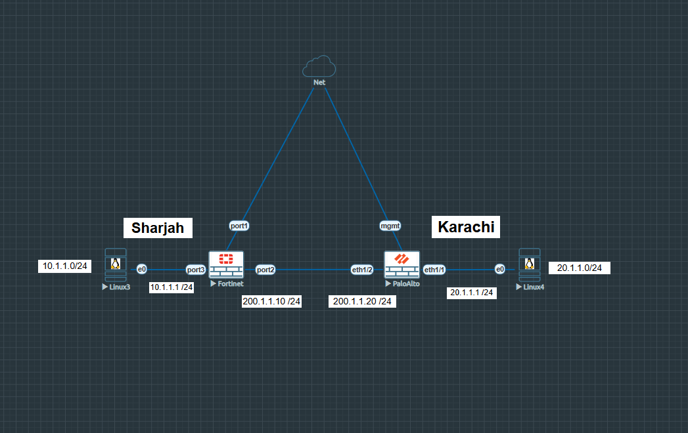
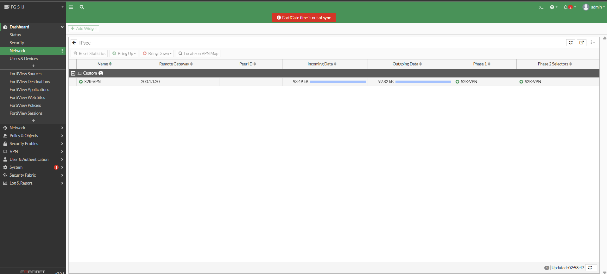
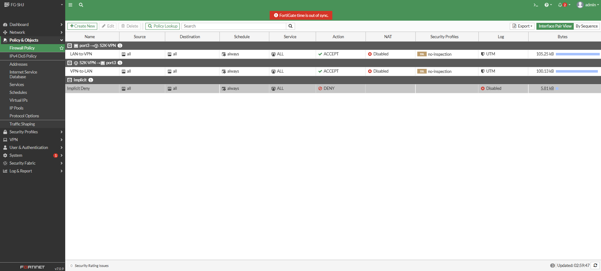
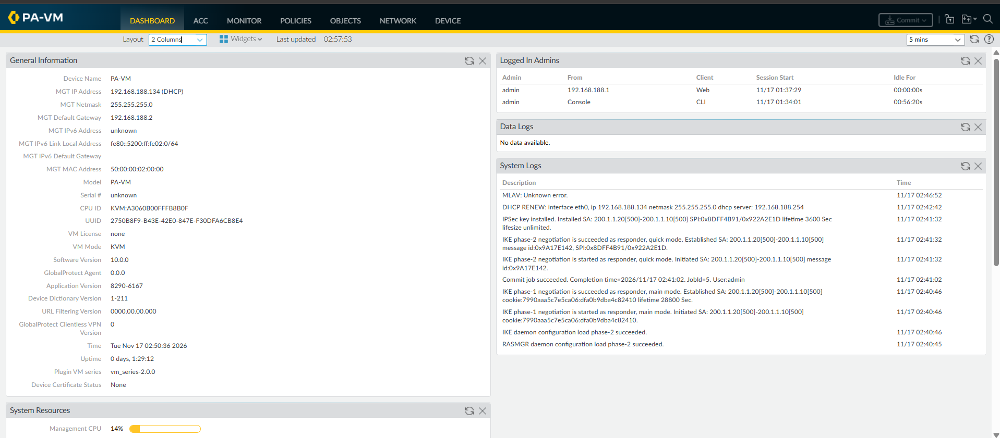
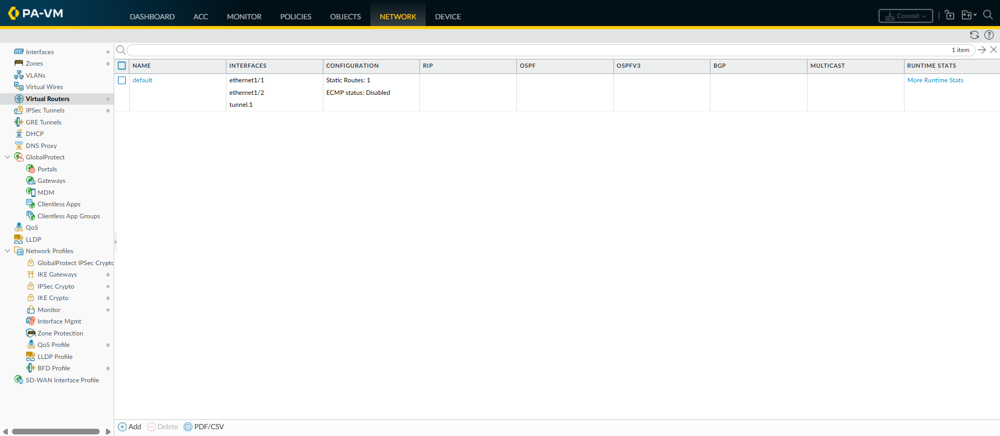
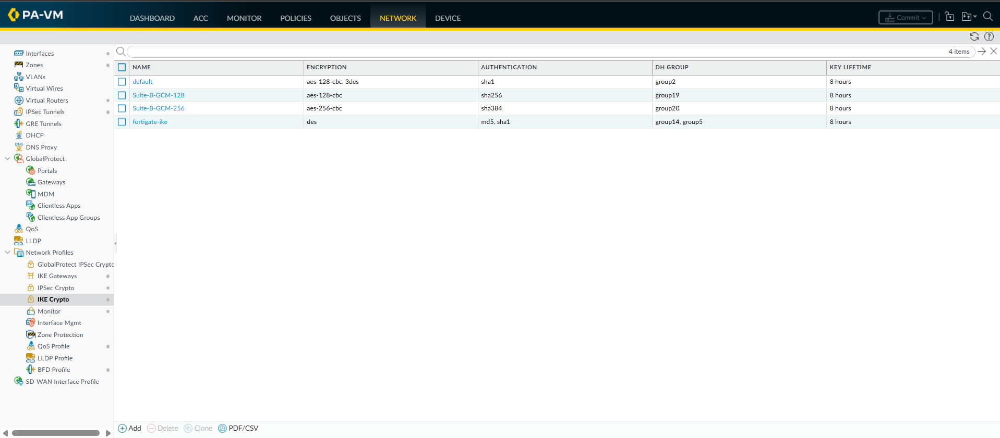
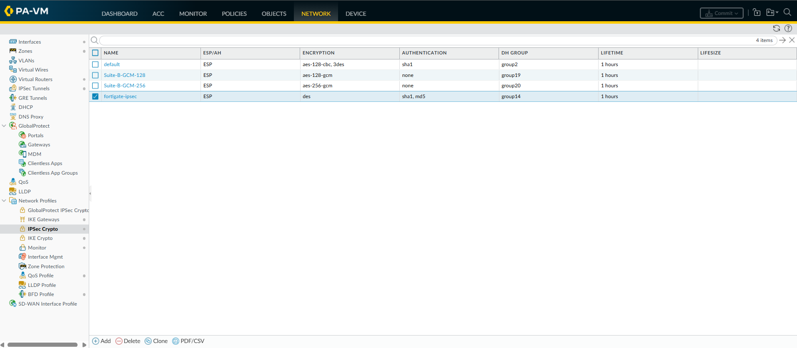
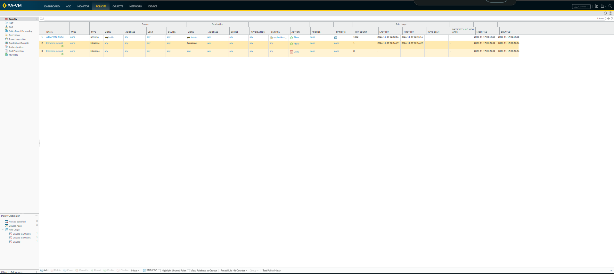

# Multi-Site IPsec VPN Lab: FortiGate (Sharjah) to Palo Alto (Karachi)

This repository documents the end-to-end architecture, configuration, troubleshooting, and verification of a multi-site site-to-site IPsec VPN tunnel between a FortiGate firewall (Sharjah) and a Palo Alto firewall (Karachi) over a direct transit WAN link. Despite evaluation license cryptographic constraints on the FortiGate VM, full bidirectional encrypted connectivity was achieved between the internal Linux nodes across both sites.

---

## Table of Contents

* [1. Topology Overview and IP Addressing](#1-topology-overview-and-ip-addressing)
* [2. Lab Objectives and Concepts Learned](#2-lab-objectives-and-concepts-learned)
* [3. Repository Structure and GitHub Upload Guide](#3-repository-structure-and-github-upload-guide)
* [4. Step-by-Step FortiGate Configuration (Sharjah)](#4-step-by-step-fortigate-configuration-sharjah)
* [5. Step-by-Step Palo Alto Configuration (Karachi)](#5-step-by-step-palo-alto-configuration-karachi)
* [6. Troubleshooting and Key Engineering Challenges](#6-troubleshooting-and-key-engineering-challenges)
* [7. Verification and End-to-End Ping Testing](#7-verification-and-end-to-end-ping-testing)

---

## 1. Topology Overview and IP Addressing

The lab environment simulates a dedicated WAN link connecting a branch office in Sharjah (`10.1.1.0/24`) with headquarters in Karachi (`20.1.1.0/24`) inside EVE-NG.



### IP Addressing and Interface Mapping Table

| Site / Device | Interface / Role | IP Address / Subnet | Security Zone / Virtual Router |
| :--- | :--- | :--- | :--- |
| **Transit WAN Link** | Point-to-Point Link | `200.1.1.0/24` | Untrusted / Outside |
| **FortiGate (Sharjah)** | `port2` (WAN / Outside) | `200.1.1.10/24` | Outside |
| **FortiGate (Sharjah)** | `port3` (LAN / Inside) | `10.1.1.1/24` | Inside |
| **Sharjah Host (`Linux3`)** | `eth0` (Internal Node) | `10.1.1.10/24` | Gateway: `10.1.1.1` |
| **Palo Alto (Karachi)** | `ethernet1/2` (WAN / Outside) | `200.1.1.20/24` | Zone: `outside` / VR: `default` |
| **Palo Alto (Karachi)** | `ethernet1/1` (LAN / Inside) | `20.1.1.1/24` | Zone: `inside` / VR: `default` |
| **Palo Alto (Karachi)** | `tunnel.1` (Logical VPN) | Unnumbered | Zone: `inside` / VR: `default` |
| **Karachi Host (`Linux4`)** | `eth0` (Internal Node) | `20.1.1.10/24` | Gateway: `20.1.1.1` |

---

## 2. Lab Objectives and Concepts Learned

### What Was Learned

1. **Multi-Vendor IPsec Interoperability:** Establishing a standard IKEv1 Main Mode and IPsec ESP tunnel between two different enterprise firewall vendors (Fortinet FortiOS and Palo Alto PAN-OS).
2. **Working Under Evaluation License Restrictions:** FortiGate evaluation VM licenses restrict encryption to legacy algorithms (`DES`) and specific authentication/Diffie-Hellman parameters (`MD5`, `SHA1`, `DH Group 14`, `DH Group 5`). Learning how to downgrade and align Palo Alto cryptographic profiles to match the constrained peer is a critical real-world skill when integrating with legacy or restricted hardware.
3. **Strict Phase 2 Proxy ID Mirroring:** Understanding how route-based VPNs on Palo Alto require explicit Proxy IDs (`20.1.1.0/24` local to `10.1.1.0/24` remote) to match FortiGate's policy/selector-based Phase 2 definitions (`10.1.1.0/24` local to `20.1.1.0/24` remote).
4. **Palo Alto Virtual Router and Zone Architecture:** Recognizing that Palo Alto interfaces cannot route traffic or commit cleanly unless explicitly bound to both a Security Zone and a Virtual Router (`default`).
5. **Cryptographic Timestamp Sensitivity:** Observing how unsynchronized system clocks cause IKE Phase 1 security association (SA) negotiations to fail across multi-vendor peers.

### Why It Was Configured This Way

* **IKEv1 Main Mode:** Selected for deterministic 6-message identity protection exchange and universal compatibility across heterogeneous firewall platforms.
* **Pre-Shared Key (`Secret123`):** Used to authenticate peers cleanly in an isolated lab topology without deploying an external Certificate Authority (CA).
* **Single DH Group in Phase 2 (`Group 14`):** Because Palo Alto's IPsec Crypto Profile only allows selecting a single Diffie-Hellman group for Perfect Forward Secrecy (PFS), FortiGate's Phase 2 selector was trimmed from `14, 5` down to `14` to guarantee an exact cryptographic match.

---

## 3. Repository Structure and GitHub Upload Guide

To organize this lab inside your existing repository (`salman-network-security-labs`) alongside your previous labs, follow these steps:

1. Open your GitHub repository: `https://github.com/Salman-1210/salman-network-security-labs`
2. Navigate into the `Fortigate-labs` directory.
3. Click **Add file** > **Create new file**.
4. In the name field at the top, type the new folder name followed by a forward slash `/` and `README.md`:
   ```text
   Lab 06 — Multi-Site IPsec VPN (FortiGate to Palo Alto)/README.md
   ```
5. Paste the contents of this `README.md` file into the editor and click **Commit changes**.
6. Inside that newly created `Lab 06 — Multi-Site IPsec VPN (FortiGate to Palo Alto)` folder, click **Add file** > **Upload files** and upload all 10 image files with their exact names so every embedded image renders properly:
   * `Topology.png`
   * `FG-Dashboard.png`
   * `FG-Ipsec-config.png`
   * `FG-Policy_config.png`
   * `PA-Dashboard-config.png`
   * `PA-VR-config.png`
   * `PA-IKE-config.png`
   * `Palo-Alto_Ipsec_config.png`
   * `PA-Policies.png`
   * `sharjah-karachi-ping-test.jpg` (or `sharjah-karachi-ping-test_2.jpg`)

---

## 4. Step-by-Step FortiGate Configuration (Sharjah)

### Step 4.1: System Verification and Time Synchronization
Verified system status, VM license state, and adjusted system time settings to eliminate clock drift warnings prior to initiating IKE negotiations.


### Step 4.2: IPsec Tunnel Configuration (`S2K-VPN`)
Configured a custom IPsec tunnel under **VPN > IPsec Tunnels** with the following parameters:
* **Remote Gateway:** Static IP Address `200.1.1.20` via `port2`
* **Authentication:** Pre-shared Key (`Secret123`), IKE Version `1`, Mode `Main (ID protection)`
* **Phase 1 Proposal:** Encryption `DES`, Authentication `MD5` and `SHA1`, Diffie-Hellman Groups `14, 5`
* **Phase 2 Selectors:** Local Subnet `10.1.1.0/24`, Remote Subnet `20.1.1.0/24`, Encryption `DES`, Authentication `MD5` and `SHA1`, PFS enabled with `DH Group 14`



### Step 4.3: Firewall Security Policies and Static Routing
Created bidirectional firewall policies under **Policy & Objects > Firewall Policy** (`LAN-to-VPN` from `port3` to `S2K-VPN` and `VPN-to-LAN` from `S2K-VPN` to `port3`) with NAT disabled, alongside a static route pointing `20.1.1.0/24` into the `S2K-VPN` tunnel interface.



---

## 5. Step-by-Step Palo Alto Configuration (Karachi)

### Step 5.1: System Overview and Logging Verification
Verified Palo Alto VM-Series management settings and monitored System Logs to confirm successful Phase 1 and Phase 2 Security Association (SA) installation.



### Step 5.2: Interfaces, Zones, and Virtual Router Binding
Assigned `ethernet1/1` (`20.1.1.1/24`) and `tunnel.1` to the `inside` zone, and `ethernet1/2` (`200.1.1.20/24`) to the `outside` zone. Bound all three interfaces to the `default` Virtual Router and configured static route `to-sharjah` (`10.1.1.0/24` via `tunnel.1`).



### Step 5.3: IKE Crypto Profile (`fortigate-ike`) and IKE Gateway
Created custom IKE Crypto Profile `fortigate-ike` under **Network > Network Profiles > IKE Crypto** matching FortiGate's exact Phase 1 capabilities:
* **DH Group:** `group14`, `group5`
* **Encryption:** `des`
* **Authentication:** `md5`, `sha1`



### Step 5.4: IPsec Crypto Profile (`fortigate-ipsec`) and Proxy IDs
Created custom IPsec Crypto Profile `fortigate-ipsec` under **Network > Network Profiles > IPsec Crypto** and bound it to tunnel `S2K-VPN`:
* **IPsec Protocol:** `ESP`
* **Encryption:** `des`
* **Authentication:** `sha1`, `md5`
* **DH Group (PFS):** `group14`
* **Proxy ID (`proxy1`):** Local `20.1.1.0/24` to Remote `10.1.1.0/24`



### Step 5.5: Security Policy Rulebase
Configured security rule `Allow-VPN-Traffic` under **Policies > Security** allowing traffic between the `inside` zone interfaces (`ethernet1/1` and `tunnel.1`) with active hit counters confirming packet inspection.



---

## 6. Troubleshooting and Key Engineering Challenges

1. **System Time Mismatch Dropping IKE SAs:**
   * *Symptom:* FortiGate displayed a red banner (`FortiGate time is out of sync`), and Phase 1 failed to establish against Palo Alto even though previous FortiGate-to-FortiGate labs tolerated the drift.
   * *Root Cause:* Cross-vendor IKE implementations enforce stricter timestamp and lifetime validation during SA establishment.
   * *Resolution:* Disabled automatic NTP sync (`set ntpsync disable`) to preserve evaluation VM stability and configured manual date/time settings under **System > Settings** to align with the lab environment.

2. **Palo Alto Commit Failure on Interface Assignment:**
   * *Symptom:* Initial commit failed with routing validation errors on `ethernet1/1` and `ethernet1/2`.
   * *Root Cause:* Interfaces were assigned to zones and given IP addresses without being attached to a Virtual Router.
   * *Resolution:* Added `ethernet1/1`, `ethernet1/2`, and `tunnel.1` to the `default` Virtual Router.

3. **Cryptographic Algorithm and PFS Group Mismatch:**
   * *Symptom:* Tunnel remained down after initial commit because Palo Alto defaulted to AES-128/AES-256 and SHA-256, while FortiGate's evaluation license only permitted `DES`. Additionally, FortiGate Phase 2 had both `Group 14` and `Group 5` checked, whereas Palo Alto only accepts one DH group per IPsec profile.
   * *Resolution:* Created custom profiles (`fortigate-ike` and `fortigate-ipsec`) using `des`, `md5`, `sha1`, and unchecked `Group 5` on FortiGate Phase 2 so both sides negotiated exclusively on `Group 14`.

---

## 7. Verification and End-to-End Ping Testing

Once configurations were committed on Palo Alto and the tunnel was brought up on FortiGate's IPsec Monitor, both Phase 1 and Phase 2 indicators turned green with incrementing incoming/outgoing byte counters.

Continuous ICMP ping tests were executed between the internal endpoints across the encrypted tunnel:
* **From Karachi (`Linux4` - `20.1.1.10`) to Sharjah (`Linux3` - `10.1.1.10`):** `64 bytes from 10.1.1.10: seq=210 ttl=62 time=14.203 ms` (0% packet loss)
* **From Sharjah (`Linux3` - `10.1.1.10`) to Karachi (`Linux4` - `20.1.1.10`):** `64 bytes from 20.1.1.10: seq=241 ttl=62 time=11.927 ms` (0% packet loss)

