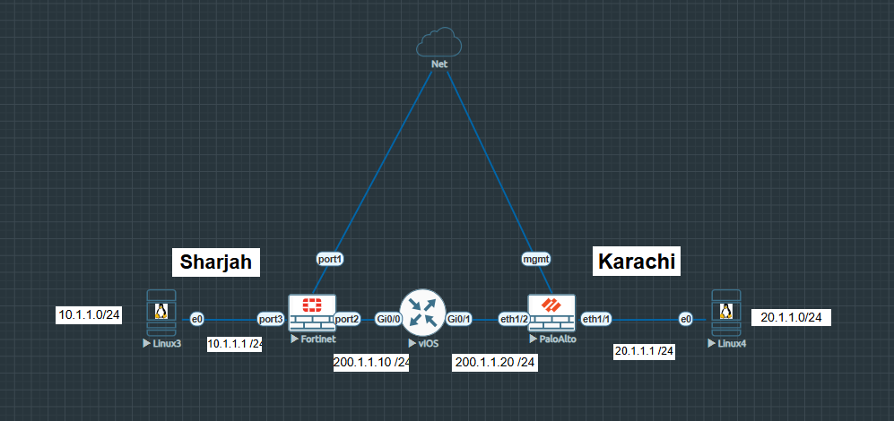
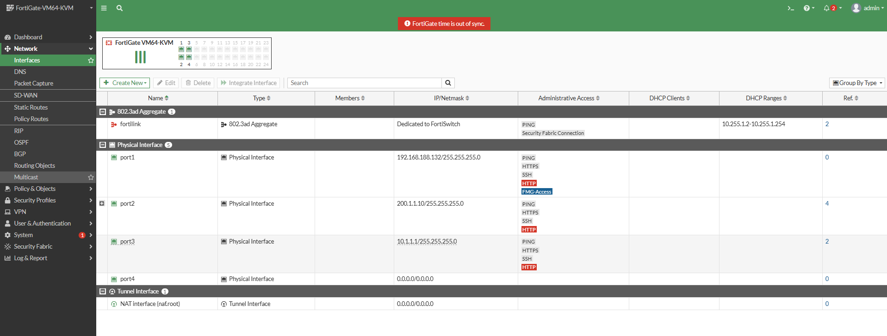
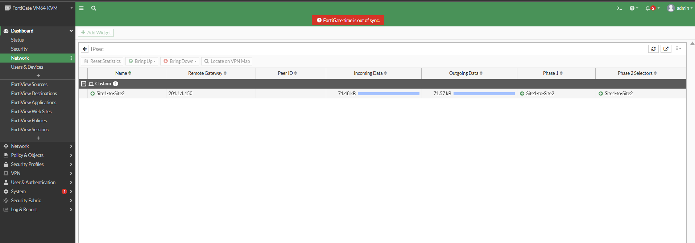
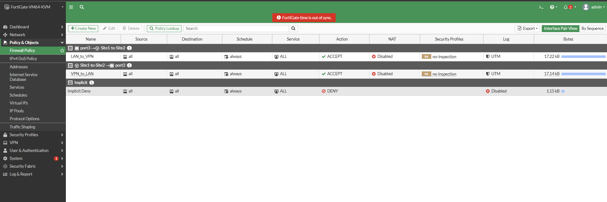
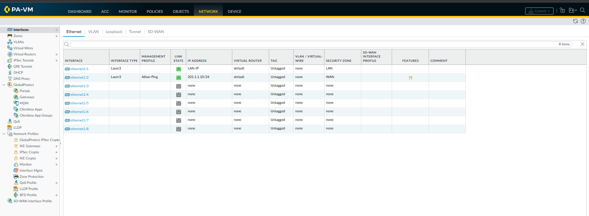
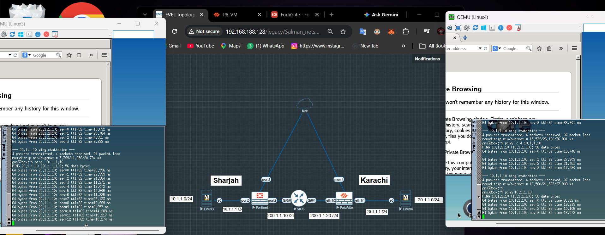

# Multi-Vendor Site-to-Site IPsec VPN: FortiGate (Sharjah) to PaloAlto (Karachi) via Cisco vIOS Static NAT and NAT-T

## Table of Contents

- [1. Project Overview and Lab Objectives](#1-project-overview-and-lab-objectives)
- [2. Lab Files in This Repository](#2-lab-files-in-this-repository)
- [3. Network Topology and IP Addressing Plan](#3-network-topology-and-ip-addressing-plan)
- [4. Architectural Deep Dive: Static NAT and NAT-T (UDP 4500)](#4-architectural-deep-dive-static-nat-and-nat-t-udp-4500)
  - [4.1 Why Static NAT Was Configured on Cisco vIOS](#41-why-static-nat-was-configured-on-cisco-vios)
  - [4.2 Why NAT-T (NAT Traversal) Was Required](#42-why-nat-t-nat-traversal-was-required)
- [5. Lab Topology Breakdown](#5-lab-topology-breakdown)
- [6. FortiGate (Sharjah) Configuration and Verification](#6-fortigate-sharjah-configuration-and-verification)
  - [6.1 System Status and Environment](#61-system-status-and-environment)
  - [6.2 Network Interfaces](#62-network-interfaces)
  - [6.3 IPsec VPN Tunnel (Phase 1 and Phase 2)](#63-ipsec-vpn-tunnel-phase-1-and-phase-2)
  - [6.4 Firewall Security Policies](#64-firewall-security-policies)
- [7. PaloAlto (Karachi) Configuration and Verification](#7-paloalto-karachi-configuration-and-verification)
  - [7.1 System Status, Config Logs, and IKE/IPsec System Logs](#71-system-status-config-logs-and-ikeipsec-system-logs)
  - [7.2 Layer 3 Interfaces, Zones, and Management Profile](#72-layer-3-interfaces-zones-and-management-profile)
  - [7.3 IPsec Tunnel and IKE Gateway Setup](#73-ipsec-tunnel-and-ike-gateway-setup)
  - [7.4 Security Policies](#74-security-policies)
- [8. End-to-End Bidirectional Verification (Sharjah to Karachi Ping)](#8-end-to-end-bidirectional-verification-sharjah-to-karachi-ping)
- [9. Complete Packet Flow Walkthrough (Step-by-Step)](#9-complete-packet-flow-walkthrough-step-by-step)
  - [9.1 Outbound Path: Linux3 (10.1.1.10) to Linux4 (20.1.1.10)](#91-outbound-path-linux3-101110-to-linux4-201110)
  - [9.2 Return Path: Linux4 (20.1.1.10) to Linux3 (10.1.1.10)](#92-return-path-linux4-201110-to-linux3-101110)
- [10. Issues Faced and Troubleshooting Resolutions](#10-issues-faced-and-troubleshooting-resolutions)

---

## 1. Project Overview and Lab Objectives

Enterprise networks frequently connect branch offices across public or provider-managed networks using heterogeneous firewall vendors. In this **EVE-NG** lab, a complete **Site-to-Site IPsec VPN** is engineered between a **FortiGate-VM64-KVM** firewall at the **Sharjah** branch and a **PaloAlto PA-VM** firewall at the **Karachi** branch, separated by a **Cisco vIOS** transit router performing **Static NAT**.

The primary objectives achieved in this lab are:
1. Establish Layer 3 routed connectivity across transit WAN links between Sharjah (`200.1.1.0/24`), Cisco vIOS, and Karachi (`201.1.1.0/24`).
2. Configure **1-to-1 Static NAT** (`201.1.1.150` <-> `201.1.1.10`) on the intermediate Cisco vIOS router to simulate a NAT boundary in front of the Karachi firewall.
3. Build a multi-vendor **IKEv1 Site-to-Site IPsec VPN** (`Site1-to-Site2` on FortiGate and `VPN-Sharjah` on PaloAlto) with matching Phase 1 parameters, Phase 2 encryption/authentication, and Proxy IDs / Traffic Selectors (`10.1.1.0/24` <-> `20.1.1.0/24`).
4. Verify automatic **NAT Traversal (NAT-T over UDP Port 4500)** negotiation between both firewalls across the NAT router.
5. Configure bidirectional firewall security policies on both FortiGate and PaloAlto so internal hosts **Linux3 (`10.1.1.10`)** and **Linux4 (`20.1.1.10`)** achieve 100% end-to-end ICMP ping reachability.

---

## 2. Lab Files in This Repository

- **[`Salman_netsec_lab.unl`](./Salman_netsec_lab.unl)** — Exported EVE-NG lab topology file that can be imported directly into EVE-NG to recreate the exact node connections.
- **`Topology.png`** — Visual EVE-NG network topology diagram showing all devices, interfaces, and subnets.
- **`FGT_Dashboard.png`, `FGT_Interfaces.png`, `FGT_Ipsec_Tunnel.png`, `fgt_policy.png`** — FortiGate (Sharjah) system status, interfaces, active IPsec tunnel monitor, and firewall policies.
- **`PA_Dashboard.png`, `PA-Interfaces.png`, `PA_Tunnels.png`, `PA_Policy.png`** — PaloAlto (Karachi) system/IKE logs, Layer 3 interface configuration, active IPsec tunnel status, and security policies.
- **`Sharjah-Karachi_Ping.png`** — Final bidirectional end-to-end ping proof between `Linux3` (`10.1.1.10`) and `Linux4` (`20.1.1.10`).

---

## 3. Network Topology and IP Addressing Plan

| Device / Node | Location / Role | Interface | IP Address / Mask | Zone / Virtual Router / Notes |
| :--- | :--- | :--- | :--- | :--- |
| **Linux3** | Sharjah LAN Client | `e0` | `10.1.1.10/24` | Default Gateway: `10.1.1.1` (FortiGate `port3`) |
| **FortiGate-VM64-KVM** | Sharjah Edge Firewall | `port1` | `192.168.188.132/24` | Out-of-band GUI/SSH management via `Net` |
| **FortiGate-VM64-KVM** | Sharjah Edge Firewall | `port3` | `10.1.1.1/24` | Internal LAN gateway (`PING`, `HTTPS`, `SSH`, `HTTP`) |
| **FortiGate-VM64-KVM** | Sharjah Edge Firewall | `port2` | `200.1.1.10/24` | External WAN interface facing Cisco vIOS `Gi0/0` |
| **Cisco vIOS Router** | Transit ISP / NAT Router | `Gi0/0` | `200.1.1.1/24` | Facing Sharjah WAN (`port2`) |
| **Cisco vIOS Router** | Transit ISP / NAT Router | `Gi0/1` | `201.1.1.1/24` | Facing Karachi WAN (`eth1/2`); Static NAT `201.1.1.150` <-> `201.1.1.10` |
| **PaloAlto PA-VM** | Karachi Edge Firewall | `mgmt` (`eth0`) | `192.168.188.134/24` | Out-of-band GUI/SSH management via `Net` |
| **PaloAlto PA-VM** | Karachi Edge Firewall | `ethernet1/2` | `201.1.1.10/24` | Security Zone: `WAN`, VR: `default`, Mgmt Profile: `Allow-Ping` |
| **PaloAlto PA-VM** | Karachi Edge Firewall | `ethernet1/1` | `20.1.1.1/24` | Security Zone: `LAN`, VR: `default` |
| **PaloAlto PA-VM** | Karachi Edge Firewall | `tunnel.1` | Unnumbered | Logical IPsec tunnel interface bound to `VPN-Sharjah` |
| **Linux4** | Karachi LAN Client | `e0` | `20.1.1.10/24` | Default Gateway: `20.1.1.1` (PaloAlto `ethernet1/1`) |

---

## 4. Architectural Deep Dive: Static NAT and NAT-T (UDP 4500)

### 4.1 Why Static NAT Was Configured on Cisco vIOS

In production environments, a branch firewall often sits behind an ISP router or upstream NAT gateway that maps a public/external IP address to the firewall's actual WAN interface IP. To replicate this exact real-world behavior:
- **PaloAlto (`ethernet1/2`)** is assigned the physical/local WAN address **`201.1.1.10/24`**.
- **Cisco vIOS** is configured with **1-to-1 Static NAT** mapping **`201.1.1.150`** <-> **`201.1.1.10`**, along with a default route (`0.0.0.0/0 via 201.1.1.10`).
- **FortiGate (`Site1-to-Site2`)** does not connect directly to `201.1.1.10`; instead, its Remote Gateway is pointed to the NAT-mapped IP **`201.1.1.150`**. When packets reach vIOS, the router translates the destination IP from `201.1.1.150` to `201.1.1.10` and forwards them to PaloAlto.

### 4.2 Why NAT-T (NAT Traversal) Was Required

Standard IPsec uses **ESP (Encapsulating Security Payload — IP Protocol 50)** to encrypt and authenticate IP packets. Unlike TCP or UDP, raw ESP headers **do not contain Layer 4 source or destination port numbers**. When a NAT device sits between two VPN peers:
- Traditional NAT/PAT relies on Layer 4 port numbers to track and translate sessions, and changing outer IP headers on unencapsulated ESP traffic breaks NAT state tracking.
- During **IKE Phase 1** negotiation, FortiGate and PaloAlto exchange `NAT-D` (NAT Discovery) payloads, compare the hashed source/destination IP and port values, and automatically detect that Cisco vIOS is translating addresses in the middle.
- Once NAT is detected, both firewalls automatically switch from `UDP 500` to **NAT-T (`UDP Port 4500`)**, encapsulating the encrypted ESP payload inside a standard UDP header (`200.1.1.10:4500 -> 201.1.1.150:4500`). This allows Cisco vIOS to translate and forward the encrypted VPN traffic cleanly while maintaining NAT keepalives.

---

## 5. Lab Topology Breakdown

The topology diagram (`Topology.png`) illustrates the complete physical and logical interconnection of the lab:
- **Left Side (Sharjah Branch):** `Linux3` (`10.1.1.10/24` on subnet `10.1.1.0/24`) connects via `e0` to **FortiGate** `port3` (`10.1.1.1/24`). FortiGate connects out to the transit router via `port2` (`200.1.1.10/24`), while `port1` connects to the `Net` cloud for out-of-band web management.
- **Center (Transit / NAT Core):** **Cisco vIOS** connects to FortiGate on `Gi0/0` (`200.1.1.1/24`) and to PaloAlto on `Gi0/1` (`201.1.1.1/24`), performing Static NAT translation between `201.1.1.150` and `201.1.1.10`.
- **Right Side (Karachi Branch):** **PaloAlto** receives WAN traffic on `eth1/2` (`201.1.1.10/24`), connects its `mgmt` interface to the `Net` cloud for GUI management, and serves the Karachi LAN (`20.1.1.0/24`) via `eth1/1` (`20.1.1.1/24`) connected to `Linux4` (`20.1.1.10/24`).

---

## 6. FortiGate (Sharjah) Configuration and Verification

### 6.1 System Status and Environment

`FGT_Dashboard.png` verifies the operational state of **`FortiGate-VM64-KVM`** running **FortiOS v7.0.9 build0444** in **NAT mode**. System resource utilization (CPU, memory, and active sessions) is healthy, confirming the virtual appliance is ready for IPsec encryption and routing.

### 6.2 Network Interfaces

`FGT_Interfaces.png` displays the Layer 3 physical interface setup on FortiGate:
- **`port1` (`192.168.188.132/24`):** Management interface connected to the lab management bridge with `PING`, `HTTPS`, `SSH`, `HTTP`, and `FMG-Access` enabled.
- **`port2` (`200.1.1.10/24`):** External WAN interface connected to Cisco vIOS `Gi0/0` (`200.1.1.1/24`), serving as the local VPN termination endpoint. A static route directs traffic for `201.1.1.0/24` (and remote subnet `20.1.1.0/24` via the tunnel) out toward `200.1.1.1`.
- **`port3` (`10.1.1.1/24`):** Internal LAN interface acting as the default gateway for `Linux3` (`10.1.1.10/24`).

### 6.3 IPsec VPN Tunnel (Phase 1 and Phase 2)

`FGT_Ipsec_Tunnel.png` is the primary verification of the IPsec tunnel from the Sharjah side:
- **Tunnel Name:** `Site1-to-Site2` (Custom IPsec VPN bound to `port2`).
- **Remote Gateway:** `201.1.1.150` (the Static NAT external IP mapped by Cisco vIOS to PaloAlto's `201.1.1.10`).
- **Tunnel Status:** Both **Phase 1 (`Site1-to-Site2`)** and **Phase 2 Selectors (`Site1-to-Site2`)** show green up arrows.
- **Traffic Selectors (Proxy IDs):** Local subnet `10.1.1.0/24` paired with Remote subnet `20.1.1.0/24`.
- **Live Data Counters:** Both **Incoming Data (`71.48 kB`)** and **Outgoing Data (`71.57 kB`)** are actively incrementing, proving bidirectional ESP encapsulation and decapsulation over NAT-T (`UDP 4500`).

### 6.4 Firewall Security Policies

`fgt_policy.png` shows the two mandatory stateful firewall policies configured above `Implicit Deny` to allow bidirectional VPN traffic:
1. **`LAN_to_VPN` (`port3` -> `Site1-to-Site2`):** Source `all`, Destination `all`, Service `ALL`, Action `ACCEPT`, **NAT `Disabled`** (critical so internal `10.1.1.0/24` addresses are preserved inside the encrypted tunnel rather than source-NATted to `port2`).
2. **`VPN_to_LAN` (`Site1-to-Site2` -> `port3`):** Source `all`, Destination `all`, Service `ALL`, Action `ACCEPT`, **NAT `Disabled`**, allowing decrypted traffic arriving from Karachi (`20.1.1.0/24`) to reach `Linux3` (`10.1.1.10`). Both policies show active byte counters (`17.22 kB` and `17.14 kB`).

---

## 7. PaloAlto (Karachi) Configuration and Verification

### 7.1 System Status, Config Logs, and IKE/IPsec System Logs

`PA_Dashboard.png` provides critical control-plane and management verification on **`PA-VM`** (PAN-OS `10.0.0`, Management IP `192.168.188.134`):
- **Config Logs (Top Right):** Records the configuration edits on `network interface ethernet ethernet1/2`, creation/attachment of `network profiles interface-management-profile Allow-Ping`, and successful `commit` operations.
- **System Logs (Center):** Explicitly confirms successful multi-vendor tunnel establishment over NAT-T:
  - `IKE phase-2 negotiation is succeeded as responder, quick mode. Established SA: 201.1.1.10[4500]-200.1.1.10[4500]`
  - `IPSec key installed. Installed SA: 201.1.1.10[4500]-200.1.1.10[4500]`

### 7.2 Layer 3 Interfaces, Zones, and Management Profile

`PA-Interfaces.png` shows the Layer 3 interface setup under **Network > Interfaces**:
- **`ethernet1/1`:** Configured as `Layer3` with IP `20.1.1.1/24` (`LAN-IP`), assigned to Virtual Router `default` and Security Zone **`LAN`**, serving as the gateway for `Linux4`.
- **`ethernet1/2`:** Configured as `Layer3` with IP **`201.1.1.10/24`**, assigned to Virtual Router `default` and Security Zone **`WAN`**, with link state green (up) and the **`Allow-Ping`** Interface Management Profile attached so ICMP reachability from Cisco vIOS (`201.1.1.1`) succeeds.

### 7.3 IPsec Tunnel and IKE Gateway Setup

`PA_Tunnels.png` shows the active VPN configuration under **Network > IPsec Tunnels**:
- **Tunnel Name:** `VPN-Sharjah` (`Auto Key`).
- **IKE Gateway / Peer:** Bound to external interface `ethernet1/2` with Peer Address **`200.1.1.10`** (FortiGate's WAN IP) and **IKE Info** showing a green active status indicator.
- **Tunnel Interface:** Bound to logical interface **`tunnel.1`** inside Virtual Router **`default`** and Security Zone **`LAN`**, with **Tunnel Info** showing a green up status indicator. A static route in the `default` virtual router directs `10.1.1.0/24` to next-hop `tunnel.1`.

### 7.4 Security Policies

`PA_Policy.png` shows the Security Policy rulebase under **Policies > Security**:
1. **`LAN-to-VPN`:** Permits internal traffic between Zone `LAN` (`20.1.1.0/24`) and Zone `LAN` (`10.1.1.0/24`, reachable via `tunnel.1` in the `LAN` zone) with Action **`Allow`**.
2. **`WAN-to-VPN`:** Permits IKE/IPsec/NAT-T control and data packets on Zone `WAN` between `200.1.1.10` and `201.1.1.10` with Action **`Allow`**.
3. Default **`intrazone-default` (`Allow`)** and **`interzone-default` (`Deny`)** rules sit at the bottom of the rulebase.

---

## 8. End-to-End Bidirectional Verification (Sharjah to Karachi Ping)

> **Repository Note:** Ensure the uploaded screenshot file in the GitHub folder matches the exact filename referenced in Markdown (`Sharjah-Karachi_Ping.png` or `Sharjah-Karachi_Ping.jpg`). Below is the embedded view using the exact repository filename `Sharjah-Karachi_Ping.png`:

`Sharjah-Karachi_Ping.png` is the final end-to-end proof that the entire multi-vendor VPN, Static NAT, NAT-T encapsulation, routing, and security policy stack is functioning properly:
- **Left Terminal (`Linux3` — Sharjah LAN `10.1.1.10`):** Executes `ping 20.1.1.10` (`Linux4` in Karachi) and receives continuous ICMP echo replies (`64 bytes from 20.1.1.10: ttl=62`) with **`0% packet loss`** (`4 packets transmitted, 4 packets received`). The TTL value of `62` confirms the packet traversed two Layer 3 routing hops (FortiGate and PaloAlto) cleanly across the tunnel.
- **Center Window (`EVE-NG Topology`):** Displays the live lab topology connecting Sharjah (`10.1.1.0/24`) and Karachi (`20.1.1.0/24`) through FortiGate, Cisco vIOS, and PaloAlto.
- **Right Terminal (`Linux4` — Karachi LAN `20.1.1.10`):** Executes `ping -c 4 10.1.1.10` (`Linux3` in Sharjah) and receives continuous ICMP echo replies (`64 bytes from 10.1.1.10: ttl=62`) with **`0% packet loss`** (`4 packets transmitted, 4 packets received`), proving full bidirectional communication.

---

## 9. Complete Packet Flow Walkthrough (Step-by-Step)

### 9.1 Outbound Path: Linux3 (10.1.1.10) to Linux4 (20.1.1.10)

1. **Packet Generation at Sharjah Host (`Linux3`):**
   - `Linux3` (`10.1.1.10`) creates an ICMP Echo Request with Source IP `10.1.1.10` and Destination IP `20.1.1.10`. Because `20.1.1.10` is outside `10.1.1.0/24`, `Linux3` forwards the frame to its default gateway, **FortiGate `port3` (`10.1.1.1`)**.
2. **Policy Check, Encryption, and NAT-T Encapsulation (`FortiGate`):**
   - FortiGate evaluates the packet against firewall policy **`LAN_to_VPN`** (`port3` -> `Site1-to-Site2`) and permits it without source NAT.
   - The destination `20.1.1.0/24` matches the Phase 2 selector of **`Site1-to-Site2`**. FortiGate encrypts the entire original IP packet using the negotiated IPsec SA (`ESP`), wraps it in a **NAT-T UDP header (`Source Port 4500` -> `Destination Port 4500`)**, and adds an outer IP header (`Source: 200.1.1.10` -> `Destination: 201.1.1.150`).
   - Using its static route toward `200.1.1.1`, FortiGate transmits the encrypted UDP 4500 packet out **`port2`**.
3. **Static NAT Translation and Transit Routing (`Cisco vIOS Router`):**
   - Cisco vIOS receives the packet on **`Gi0/0` (`200.1.1.1`)**.
   - Matching its Static NAT table (`201.1.1.150` <-> `201.1.1.10`), vIOS rewrites the outer destination IP from `201.1.1.150` to **`201.1.1.10`** while preserving the `UDP 4500` ports and encrypted payload.
   - vIOS forwards the translated packet out **`Gi0/1` (`201.1.1.1`)** toward PaloAlto.
4. **Decryption, Zone Inspection, and LAN Delivery (`PaloAlto PA-VM`):**
   - PaloAlto receives the packet on **`ethernet1/2` (`201.1.1.10`, Zone `WAN`)**.
   - Security rule **`WAN-to-VPN`** permits the NAT-T session. PaloAlto strips the UDP 4500 header, decrypts the ESP payload using the `VPN-Sharjah` Phase 2 SA, and injects the inner packet (`10.1.1.10` -> `20.1.1.10`) onto **`tunnel.1` (`Zone LAN`)**.
   - Security rule **`LAN-to-VPN`** allows the traffic, and the `default` virtual router forwards the packet out **`ethernet1/1` (`20.1.1.1`)** to **`Linux4` (`20.1.1.10`)**.

### 9.2 Return Path: Linux4 (20.1.1.10) to Linux3 (10.1.1.10)

5. **Echo Reply Generation (`Linux4`):**
   - `Linux4` (`20.1.1.10`) generates an ICMP Echo Reply (`Source: 20.1.1.10`, `Destination: 10.1.1.10`) and sends it to **PaloAlto `ethernet1/1` (`20.1.1.1`)**.
6. **Encryption and Outbound NAT-T (`PaloAlto PA-VM`):**
   - PaloAlto routes `10.1.1.0/24` into `tunnel.1`, permits it via **`LAN-to-VPN`**, encrypts it with ESP, wraps it in **NAT-T (`201.1.1.10:4500` -> `200.1.1.10:4500`)**, and sends it out **`ethernet1/2`** to Cisco vIOS (`201.1.1.1`).
7. **Reverse Static NAT (`Cisco vIOS Router`):**
   - Cisco vIOS receives the packet on `Gi0/1`, translates the outer source IP from `201.1.1.10` back to **`201.1.1.150`** via its Static NAT entry, and forwards it out `Gi0/0` (`200.1.1.1`) to FortiGate (`200.1.1.10`).
8. **Decryption and Final Delivery (`FortiGate` -> `Linux3`):**
   - FortiGate receives the packet on `port2` (`200.1.1.10`), decrypts the ESP payload, validates it against **`VPN_to_LAN`** (`Site1-to-Site2` -> `port3`), and delivers the ICMP Echo Reply out `port3` (`10.1.1.1`) to **`Linux3` (`10.1.1.10`)**.

---

## 10. Issues Faced and Troubleshooting Resolutions

1. **PaloAlto WAN Interface (`ethernet1/2`) Not Responding to ICMP Ping:**
   - *Symptom:* Direct ping from Cisco vIOS `Gi0/1` (`201.1.1.1`) to PaloAlto `ethernet1/2` (`201.1.1.10`) timed out (`0% success`).
   - *Cause:* PaloAlto blocks management/ping traffic on Layer 3 data interfaces by default unless an Interface Management Profile is attached.
   - *Fix:* Created the **`Allow-Ping`** Interface Management Profile (with `Ping` enabled) and attached it to `ethernet1/2`.
2. **PaloAlto Commit Failure (`Overlapping Subnet / Duplicate Address`):**
   - *Symptom:* Committing changes on PaloAlto failed with `address 201.1.1.10/24 on interface ethernet1/2 has overlapping subnet with address 201.1.1.10/24 on interface ethernet1/2`.
   - *Cause:* Both an address object (`WAN-IP`) and a direct IP entry (`201.1.1.10/24`) existed simultaneously in the IPv4 list of `ethernet1/2`.
   - *Fix:* Removed the duplicate entry under `ethernet1/2 > IPv4`, kept a single checked `201.1.1.10/24` entry, and committed cleanly. Following the commit, `ping 201.1.1.10` from vIOS succeeded at `100%` (`5/5`), and both Phase 1 and Phase 2 VPN tunnels came up immediately.