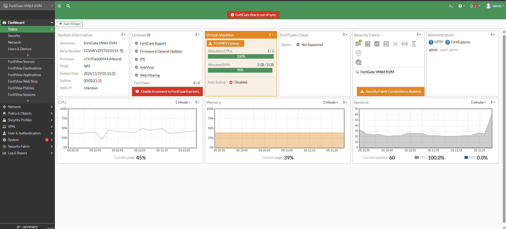
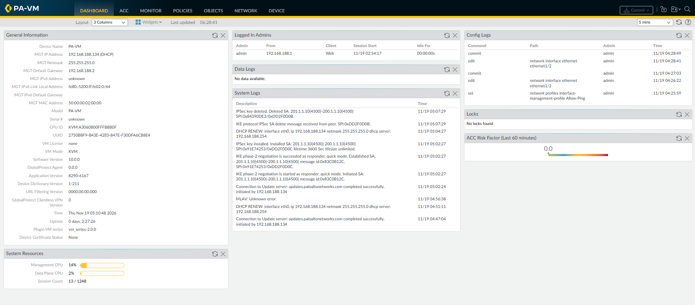
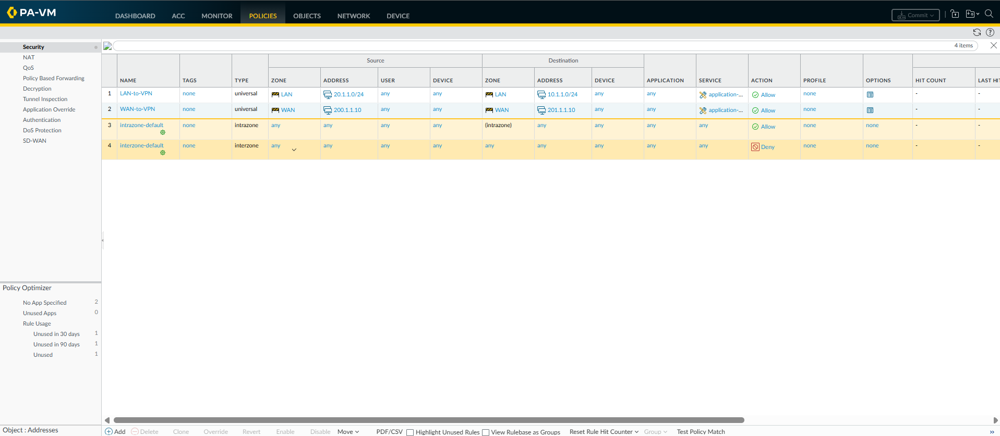
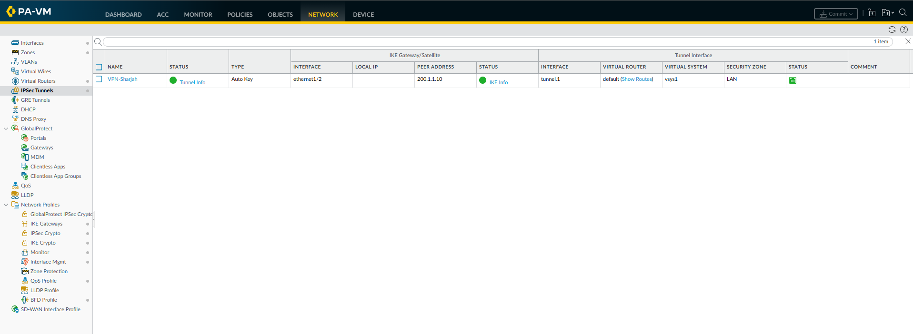

# Lab: Site-to-Site IPsec VPN (FortiGate Sharjah to PaloAlto Karachi via Cisco vIOS Static NAT & NAT-T)

## Table of Contents

- [1. Lab Overview & Why We Did This](#1-lab-overview--why-we-did-this)
- [2. Network Topology & Addressing](#2-network-topology--addressing)
- [3. Why Static NAT & NAT-T Were Needed](#3-why-static-nat--nat-t-were-needed)
- [4. Step-by-Step Configuration & Verification (With Screenshots)](#4-step-by-step-configuration--verification-with-screenshots)
  - [4.1 EVE-NG Topology](#41-eve-ng-topology)
  - [4.2 FortiGate (Sharjah) Setup & Tunnel](#42-fortigate-sharjah-setup--tunnel)
  - [4.3 PaloAlto (Karachi) Setup, Policies & Tunnel](#43-paloalto-karachi-setup-policies--tunnel)
  - [4.4 End-to-End Bidirectional Ping Verification](#44-end-to-end-bidirectional-ping-verification)
- [5. Complete Packet Flow & Device Responsibilities](#5-complete-packet-flow--device-responsibilities)
- [6. Key Takeaways & Troubleshooting Notes](#6-key-takeaways--troubleshooting-notes)

---

## 1. Lab Overview & Why We Did This

This lab builds a **multi-vendor Site-to-Site IPsec VPN** between two simulated branch sites in **EVE-NG**:
- **Sharjah Site:** **Linux3** (`10.1.1.10/24`) behind a **FortiGate-VM64-KVM** firewall (`port3` LAN `10.1.1.1/24`, `port2` WAN `200.1.1.10/24`).
- **Karachi Site:** **Linux4** (`20.1.1.10/24`) behind a **PaloAlto PA-VM** firewall (`ethernet1/1` LAN `20.1.1.1/24`, `ethernet1/2` WAN `201.1.1.10/24`).
- **Transit / NAT Core:** A **Cisco vIOS** router connecting the two WAN segments (`Gi0/0` `200.1.1.1/24` and `Gi0/1` `201.1.1.1/24`) with **Static NAT** (`201.1.1.150` $\leftrightarrow$ `201.1.1.10`).

The goal was to securely connect two private LAN subnets (`10.1.1.0/24` and `20.1.1.0/24`) across a routed/NAT path so **Linux3** and **Linux4** can ping each other bidirectionally over an encrypted VPN tunnel.

---

## 2. Network Topology & Addressing

| Device / Host | Site / Role | Interface / Port | IP / Subnet / Notes |
| :--- | :--- | :--- | :--- |
| **Linux3** | Sharjah LAN Host | `e0` | `10.1.1.10/24` (LAN `10.1.1.0/24`) |
| **FortiGate-VM64-KVM** | Sharjah Firewall | `port3` (LAN) | `10.1.1.1/24` (PING, HTTPS, SSH, HTTP) |
| **FortiGate-VM64-KVM** | Sharjah WAN | `port2` | `200.1.1.10/24` (VPN / WAN peer side) |
| **Cisco vIOS** | Transit / NAT Router | `Gi0/0` / `Gi0/1` | `200.1.1.1/24` & `201.1.1.1/24`; Static NAT `201.1.1.150` $\leftrightarrow$ `201.1.1.10` |
| **PaloAlto PA-VM** | Karachi WAN | `ethernet1/2` | `201.1.1.10/24`, Zone `WAN`, VR `default`, Mgmt Profile `Allow-Ping` |
| **PaloAlto PA-VM** | Karachi LAN | `ethernet1/1` | `20.1.1.1/24`, Zone `LAN`, VR `default` |
| **Linux4** | Karachi LAN Host | `e0` | `20.1.1.10/24` (LAN `20.1.1.0/24`) |

---

## 3. Why Static NAT & NAT-T Were Needed

- **Why Static NAT (`201.1.1.150` $\leftrightarrow$ `201.1.1.10`):** In this topology, the Cisco vIOS router sits between the WAN networks and translates between the mapped address (`201.1.1.150`) and PaloAlto's WAN IP (`201.1.1.10`), allowing external VPN traffic targeting `201.1.1.150` to reach `ethernet1/2` (`201.1.1.10`).
- **Why NAT-T (UDP 4500) Was Needed:** Standard IPsec ESP (protocol 50) does not carry TCP/UDP port numbers, which can cause issues when traversing NAT devices. When the VPN peers detect NAT along the path, **NAT Traversal (NAT-T)** encapsulates IPsec packets inside **UDP Port 4500** so they pass through NAT cleanly while keeping Phase 1 and Phase 2 intact.

---

## 4. Step-by-Step Configuration & Verification (With Screenshots)

### 4.1 EVE-NG Topology

`Topology.png` shows the complete EVE-NG lab layout connecting **Sharjah** (`Linux3` in `10.1.1.0/24` $\rightarrow$ `Fortinet` `port3` `10.1.1.1/24` and `port2` `200.1.1.10/24`) through the **vIOS** router (`Gi0/0` and `Gi0/1`) to **Karachi** (`PaloAlto` `eth1/2` and `eth1/1` `20.1.1.1/24` $\rightarrow$ `Linux4` in `20.1.1.0/24`), along with out-of-band/management links (`port1`, `mgmt` to `Net`).

---

### 4.2 FortiGate (Sharjah) Setup & Tunnel

`FGT_Dashboard.png` confirms the FortiGate VM (`FortiGate-VM64-KVM`, running FortiOS `v7.0.9 build0444`, NAT mode) is up and running in the lab environment.

`FGT_Interfaces.png` shows the configured FortiGate interfaces: `port1` (`192.168.188.132/255.255.255.0` for management), `port2` (`200.1.1.10/255.255.255.0` facing the transit network), and `port3` (`10.1.1.1/255.255.255.0` facing the Sharjah LAN), with administrative protocols (`PING`, `HTTPS`, `SSH`, `HTTP`) enabled.

`FGT_Ipsec_Tunnel.png` shows the IPsec monitor for tunnel **`Site1-to-Site2`** (remote gateway `201.1.1.150`), with **Phase 1** and **Phase 2 Selectors** both **up** (green arrows) and active incoming (`71.48 kB`) and outgoing (`71.57 kB`) traffic counters.

`fgt_policy.png` shows the FortiGate firewall policies allowing traffic in both directions across the tunnel: `LAN_to_VPN` (`port3` $\rightarrow$ `Site1-to-Site2`, `ACCEPT`) and `VPN_to_LAN` (`Site1-to-Site2` $\rightarrow$ `port3`, `ACCEPT`), above the default `Implicit Deny`.

---

### 4.3 PaloAlto (Karachi) Setup, Policies & Tunnel

`PA_Dashboard.png` shows the PaloAlto `PA-VM` dashboard (Software Version `10.0.0`, management IP `192.168.188.134`), along with **Config Logs** (showing edits to `ethernet1/2`, `Allow-Ping` interface management profile, and commits) and **System Logs** (showing IKE Phase 2 negotiation and IPsec SA installation on UDP port `4500`).

`PA_Policy.png` shows the PaloAlto security rules **`LAN-to-VPN`** (Zone `LAN` `20.1.1.0/24` $\rightarrow$ Zone `LAN` `10.1.1.0/24`, `Allow`) and **`WAN-to-VPN`** (Zone `WAN` `200.1.1.10` $\rightarrow$ Zone `WAN` `201.1.1.10`, `Allow`), along with the default `intrazone-default` (`Allow`) and `interzone-default` (`Deny`) rules.

`PA_Tunnels.png` shows the PaloAlto IPsec tunnel **`VPN-Sharjah`** (`Auto Key`) bound to external interface `ethernet1/2` with peer address `200.1.1.10` and tunnel interface `tunnel.1` in virtual router `default` and security zone `LAN`, with both **Tunnel Info** and **IKE Info** showing active/up status.

`PA-Interfaces.png` shows `ethernet1/2` configured as Layer3 with IP `201.1.1.10/24`, virtual router `default`, security zone `WAN`, link up, and the **`Allow-Ping`** management profile attached so ping tests to `201.1.1.10` succeed.

---

### 4.4 End-to-End Bidirectional Ping Verification

`Sharjah-Karachi_Ping.jpg` shows the final verification across the lab:
- **Left (`Linux3`, `10.1.1.10`):** Pinging `20.1.1.10` (`Linux4`) with replies (`0% packet loss`).
- **Center (`EVE-NG` topology):** Full end-to-end path between Sharjah and Karachi.
- **Right (`Linux4`, `20.1.1.10`):** Pinging `10.1.1.10` (`Linux3`) with replies (`0% packet loss`).

---

## 5. Complete Packet Flow & Device Responsibilities

1. **Outbound (`Linux3` $\rightarrow$ `Linux4`):**
   - `Linux3` (`10.1.1.10`) sends an ICMP echo request to `20.1.1.10` via its default gateway **FortiGate** (`port3` `10.1.1.1`).
   - **FortiGate** matches the traffic against the `Site1-to-Site2` VPN selectors (`10.1.1.0/24` $\leftrightarrow$ `20.1.1.0/24`), allows it via `LAN_to_VPN`, encrypts it, and encapsulates it using **NAT-T (UDP 4500)** from `port2` (`200.1.1.10`) toward `201.1.1.150`.
   - **Cisco vIOS** receives the packet on `Gi0/0` (`200.1.1.1`), applies **Static NAT** (`201.1.1.150` $\leftrightarrow$ `201.1.1.10`), and forwards it out `Gi0/1` (`201.1.1.1`) to **PaloAlto** (`ethernet1/2` `201.1.1.10`).
   - **PaloAlto** receives the UDP 4500 IPsec packet on `ethernet1/2` (`WAN` zone), decrypts it, applies policy/routing via `tunnel.1` / `ethernet1/1` (`LAN` zone `20.1.1.1/24`), and delivers the packet to **Linux4** (`20.1.1.10`).
2. **Return (`Linux4` $\rightarrow$ `Linux3`):**
   - `Linux4` (`20.1.1.10`) sends the ICMP echo reply back to `10.1.1.10` through **PaloAlto** (`ethernet1/1` $\rightarrow$ `ethernet1/2`), which encrypts and sends it via NAT-T (`UDP 4500`) through **vIOS** and **FortiGate** (`port2` $\rightarrow$ `port3`) back to **Linux3**.

---

## 6. Key Takeaways & Troubleshooting Notes

- **Interface Management Profile on PaloAlto:** Without attaching `Allow-Ping` to `ethernet1/2` and committing, ping tests to `201.1.1.10` do not get ICMP replies even when the interface IP is configured.
- **Avoid Duplicate / Overlapping Subnet Entries Before Commit:** Removing duplicate IP entries on PaloAlto `ethernet1/2` resolved the commit error (`overlapping subnet` / `duplicate address`) and allowed the configuration to commit cleanly.
- **Static NAT + NAT-T Work Together:** Static NAT on the router handles address translation (`201.1.1.150` $\leftrightarrow$ `201.1.1.10`), while NAT-T (`UDP 4500`) wraps the encrypted IPsec traffic so it traverses NAT cleanly.
- **Bidirectional Verification:** Confirming ping in both directions (`Linux3` $\rightarrow$ `Linux4` and `Linux4` $\rightarrow$ `Linux3`) proves routing, VPN Phase 1/Phase 2 SAs, NAT/NAT-T, and firewall policies are all working end-to-end.