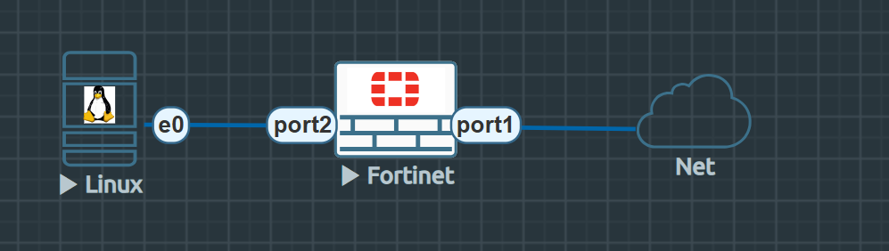
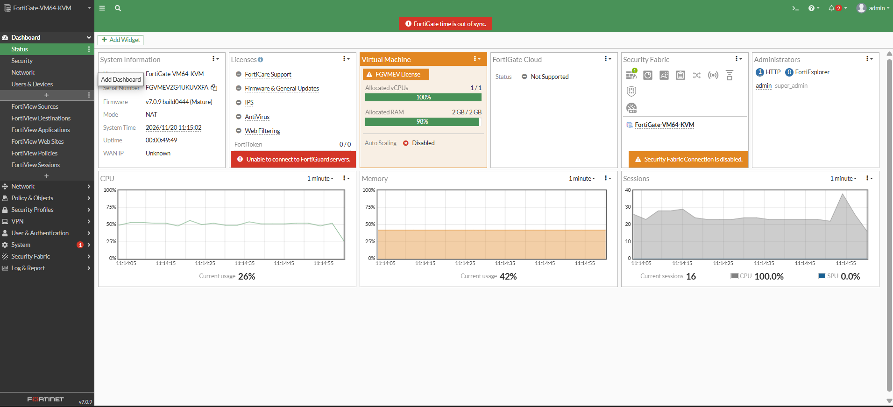
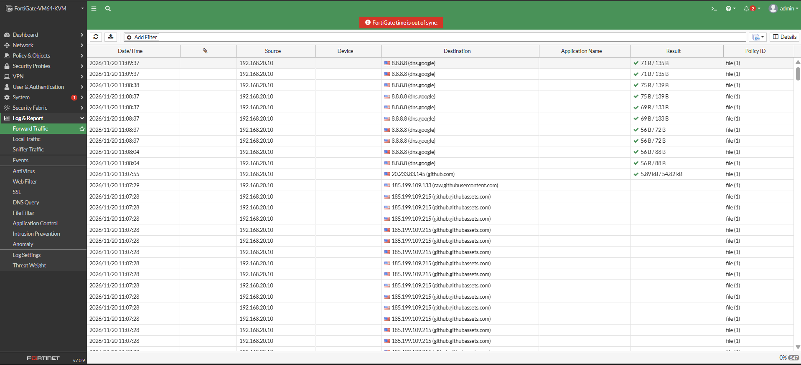
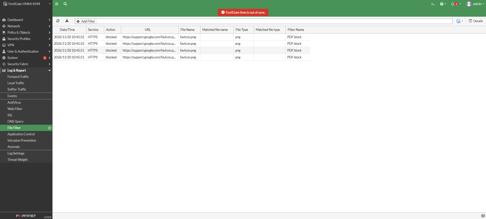
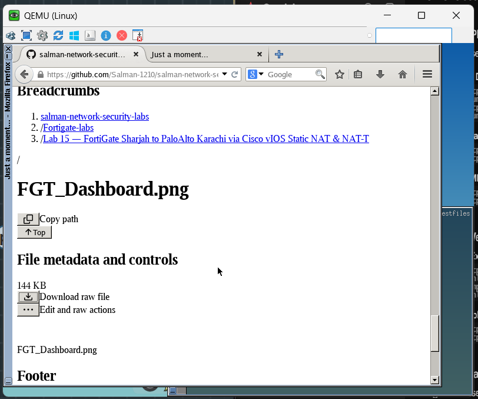

# Lab 16 — FortiGate File Filtering & SSL Inspection (Blocking PDF & PNG Downloads)


---

## Table of Contents
1. [Lab Overview & Objective](#1-lab-overview--objective)
2. [Network Topology & Architecture](#2-network-topology--architecture)
3. [What I Learned](#3-what-i-learned)
4. [What I Configured & Why](#4-what-i-configured--why)
5. [Lab Verification & Visual Walkthrough](#5-lab-verification--visual-walkthrough)
   - [Topology Diagram](#51-topology-diagram)
   - [FortiGate System Dashboard](#52-fortigate-system-dashboard)
   - [Forward Traffic Logs](#53-forward-traffic-logs)
   - [Active File Filter Logs (Key Evidence)](#54-active-file-filter-logs-key-evidence)
   - [Client-Side Download Verification on Linux](#55-client-side-download-verification-on-linux)
6. [Complete End-to-End Packet Flow & Working](#6-complete-end-to-end-packet-flow--working)
7. [EVE-NG Lab Topology XML](#7-eve-ng-lab-topology-xml)

---

## 1. Lab Overview & Objective

In this lab, I implemented **FortiGate File Filtering** combined with **SSL/SSH Deep Inspection** to detect and block specific file extensions (`.pdf` and `.png`) over encrypted HTTPS traffic. 

Modern web traffic (such as GitHub, Google, and file-hosting portals) runs over HTTPS. Without deep inspection, a firewall cannot look inside encrypted TLS sessions to identify file types being downloaded. By configuring a custom **File Filter Profile** (`PDF block`) alongside **SSL Deep Inspection** on the outbound firewall policy, the FortiGate successfully intercepted, inspected, and blocked `.png` and `.pdf` file transfers initiated from an internal Linux host.

---

## 2. Network Topology & Architecture

The lab environment is built inside **EVE-NG** using QEMU virtual machines:

| Device / Node | Role | OS / Firmware | Interface | IP / Network Assignment |
| :--- | :--- | :--- | :--- | :--- |
| **Linux** | Internal LAN Client | TinyCore Linux 6.4 | `e0` | `192.168.20.10/24` (LAN) |
| **Fortinet** | Next-Gen Firewall (NGFW) | FortiOS `v7.0.9` | `port2` (LAN) | `192.168.20.1/24` (Gateway) |
| **Fortinet** | Next-Gen Firewall (NGFW) | FortiOS `v7.0.9` | `port1` (WAN) | DHCP / NAT via `pnet0` |
| **Net (Cloud)** | External Internet Access | EVE-NG `pnet0` | Bridge | Connects to Host NAT / Internet |

---

## 3. What I Learned

* **Why File Filtering Needs SSL Deep Inspection:** Basic *Certificate Inspection* only checks the SNI (Server Name Indication) and server certificate; it cannot see the HTTP payload or file extensions inside an HTTPS session. To block `.pdf` or `.png` files downloaded over HTTPS (like from GitHub or Google), **Deep Inspection** must be enabled.
* **Granular Extension Control:** FortiGate File Filter profiles can inspect both **HTTP** and **HTTPS** protocols and match specific file types (such as `pdf`, `png`, `exe`, `zip`) in incoming, outgoing, or both directions.
* **Log Correlation:** Learned how to verify traffic behavior across two different log views in FortiGate:
  * **Forward Traffic Logs** (`Log & Report > Forward Traffic`) to verify DNS resolution, NAT translation, and Policy ID matching (`file (1)`).
  * **File Filter Logs** (`Log & Report > File Filter`) to confirm exact blocked URLs, matched file names (`favicon.png`), file types (`png`), and the triggered filter profile (`PDF block`).
* **Client-Side Troubleshooting in Lightweight Linux VMs:** Verified network reachability (`ping 8.8.8.8`), DNS resolution (`nslookup github.com 8.8.8.8`), and tested real-world file downloads via legacy Firefox on TinyCore Linux.

---

## 4. What I Configured & Why

### Step 1: Network Interfaces & Default Routing
* **What:** Configured `port2` as the internal LAN gateway (`192.168.20.1/24`) connected to the Linux client (`192.168.20.10`), and `port1` as the external WAN interface connected to the `Net` (`pnet0`) cloud.
* **Why:** Establishes Layer 3 connectivity between the internal host, the FortiGate firewall, and the external internet.

### Step 2: File Filter Security Profile (`PDF block`)
* **What:** Created a custom File Filter profile named **`PDF block`** under `Security Profiles > File Filter`. Added rules to inspect both HTTP and HTTPS traffic and set the action to **Block** for `.pdf` and `.png` file types.
* **Why:** Prevents internal users from downloading unauthorized document or image files from external websites, reducing data leakage and malware delivery risks.

### Step 3: SSL/SSH Inspection Profile (`deep-inspection`)
* **What:** Enabled **Deep Inspection** on the outbound firewall policy (and installed/trusted the FortiGate CA certificate on the client or bypassed browser warnings for testing).
* **Why:** Decrypts inbound/outbound TLS traffic on the firewall so the File Filter engine can inspect the actual file headers and extensions inside HTTPS streams.

### Step 4: Firewall Policy (`LAN to WAN`)
* **What:** Configured an IPv4 Firewall Policy (Policy ID `1`, named `file`) allowing traffic from `port2` (LAN) to `port1` (WAN) with **NAT enabled**, **File Filter (`PDF block`)** attached, **Deep Inspection** applied, and **Log Allowed Traffic (All Sessions)** enabled.
* **Why:** Enforces security inspection on all outbound internet traffic while performing Source NAT (PAT) so `192.168.20.10` can communicate over the internet.

---

## 5. Lab Verification & Visual Walkthrough

### 5.1 Topology Diagram


* **Overview:** This diagram shows the clean two-zone EVE-NG lab setup. The **Linux** client (`e0`) connects directly to the FortiGate firewall's internal interface (`port2`), while the firewall's external interface (`port1`) connects to the **Net** cloud (`pnet0`) for internet access.

---

### 5.2 FortiGate System Dashboard


* **Overview:** The FortiGate-VM64-KVM status dashboard confirming firmware **`v7.0.9 build0444`**, operating in **NAT mode** with 1 vCPU and 2 GB RAM allocated. Active sessions and resource utilization graphs confirm the firewall is healthy and actively processing traffic.

---

### 5.3 Forward Traffic Logs


* **Detailed Analysis:** Navigating to **Log & Report > Forward Traffic**, we can observe live traffic originating from the Linux host (`192.168.20.10`):
  * DNS queries to `8.8.8.8` (`dns.google`) are permitted and resolved cleanly.
  * HTTPS sessions to `20.233.83.145` (`github.com`), `185.199.109.133` (`raw.githubusercontent.com`), and `185.199.109.215` (`github.githubassets.com`) are matched against **Policy ID `file (1)`**.
  * This proves that general web browsing and DNS resolution work normally while passing through our inspection policy.

---

### 5.4 Active File Filter Logs (Key Evidence)


* **Detailed Analysis (Primary Proof of Enforcement):** Navigating to **Log & Report > File Filter** provides direct confirmation that the security profile is actively intercepting and blocking files inside encrypted HTTPS sessions:
  * **Service:** `HTTPS` (proving SSL Deep Inspection is actively decrypting the session).
  * **Action:** `blocked` (the firewall reset/dropped the file transfer before it reached the client).
  * **URL & File Name:** Requests for `favicon.png` from `https://support.google.com/favicon.p...` were caught in real time.
  * **File Type & Filter Name:** Detected as File Type **`png`** and matched against the custom security profile **`PDF block`**.

---

### 5.5 Client-Side Download Verification on Linux


* **Detailed Analysis:** On the TinyCore Linux client inside QEMU, Firefox was used to navigate to the GitHub repository (`Salman-1210/salman-network-security-labs`) and attempt to download `FGT_Dashboard.png` (`144 KB`) using **"Download raw file"**.
  * Because the traffic routes through FortiGate Policy `file (1)` with the `PDF block` File Filter active, the firewall inspects the HTTPS response stream from `raw.githubusercontent.com`, detects the `.png` file signature/extension, and immediately blocks the download from completing on the Linux machine.

---

## 6. Complete End-to-End Packet Flow & Working

Here is the exact step-by-step lifecycle of what happened when the Linux machine attempted to browse GitHub and download a `.png` / `.pdf` file:

1. **Client Request Initiation (Linux VM):**
   * The Linux client (`192.168.20.10`) opens Firefox and requests `https://github.com` or clicks **"Download raw file"** on a `.png` / `.pdf` file.
   * First, Linux sends a **DNS query (UDP 53)** to `8.8.8.8` to resolve `github.com` and `raw.githubusercontent.com`.
2. **Ingress & Policy Lookup (FortiGate `port2`):**
   * The packet arrives at FortiGate `port2` (`192.168.20.1`).
   * FortiGate checks its routing table (default route via `port1`) and matches the traffic against **Firewall Policy ID `1` (`file`)** from `port2` $\rightarrow$ `port1`.
3. **Source NAT / PAT Translation (FortiGate `port1`):**
   * FortiGate translates the private source IP `192.168.20.10` into `port1`'s external IP address using **PAT (Port Address Translation)** and forwards the TLS handshake to GitHub's servers.
4. **SSL/TLS Deep Inspection (Man-in-the-Middle Decryption):**
   * Because **Deep Inspection** is enabled on Policy `1`, FortiGate establishes one TLS session with GitHub (`raw.githubusercontent.com`) and a separate TLS session with the Linux client using its own CA certificate.
   * This allows FortiGate to view the decrypted HTTP `GET` request and the incoming server response headers/payload in plaintext inside its inspection engine.
5. **File Filter Inspection & Enforcement (`PDF block`):**
   * As GitHub's server sends back the file stream (`FGT_Dashboard.png` or a `.pdf` document), FortiGate's **File Filter engine** scans the content and file extension.
   * It matches the **`png`** / **`pdf`** rule defined in the **`PDF block`** profile.
6. **Action Taken & Logging:**
   * FortiGate immediately **blocks** the file transfer, terminates/resets the download stream so the Linux browser cannot save the file, and generates a security event log under **Log & Report > File Filter** showing `Service: HTTPS`, `Action: blocked`, `File Type: png`, and `Filter Name: PDF block`.

---

## 7. EVE-NG Lab Topology XML

Below is the exact EVE-NG `.unl` topology configuration used for this lab:

```xml
<?xml version="1.0" encoding="UTF-8" standalone="yes"?>
<lab name="Salman_netsec_lab" version="1" scripttimeout="300" lock="0" author="Salman">
  <topology>
    <nodes>
      <node id="1" name="Fortinet" type="qemu" template="fortinet" image="fortinet-v7.0.9" console="telnet" cpu="1" cpulimit="0" ram="2048" ethernet="4" uuid="57ace3fa-ba21-40ee-92b9-f3b8cca1d48e" qemu_options="-machine type=pc,accel=kvm -serial mon:stdio -nographic -no-user-config -nodefaults -display none -vga std -rtc base=utc" qemu_version="4.1.0" qemu_arch="x86_64" qemu_nic="e1000" delay="0" icon="Firewall-2D-FGT-S.svg" config="0" left="450" top="393">
        <interface id="0" name="port1" type="ethernet" network_id="1"/>
        <interface id="1" name="port2" type="ethernet" network_id="2"/>
      </node>
      <node id="2" name="Linux" type="qemu" template="linux" image="linux-tinycore-6.4" console="vnc" cpu="1" cpulimit="0" ram="256" ethernet="1" uuid="d73de3d8-2052-4927-922d-16609c0237b6" firstmac="00:50:00:00:02:00" qemu_options="-machine type=pc,accel=kvm -vga std -usbdevice tablet -boot order=cd -cpu host" qemu_version="2.12.0" qemu_arch="x86_64" qemu_nic="virtio-net-pci" delay="0" icon="Server-2D-Linux-S.svg" config="0" left="318" top="387">
        <interface id="0" name="e0" type="ethernet" network_id="2"/>
      </node>
    </nodes>
    <networks>
      <network id="1" type="pnet0" name="Net" left="594" top="399" visibility="1" icon="01-Cloud-Default.svg"/>
      <network id="2" type="bridge" name="Net-Linuxiface_0" left="477" top="381" visibility="0" icon="lan.png"/>
    </networks>
  </topology>
</lab>
```