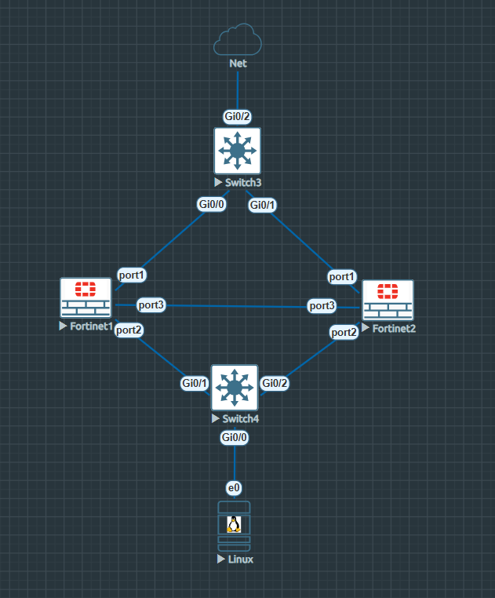
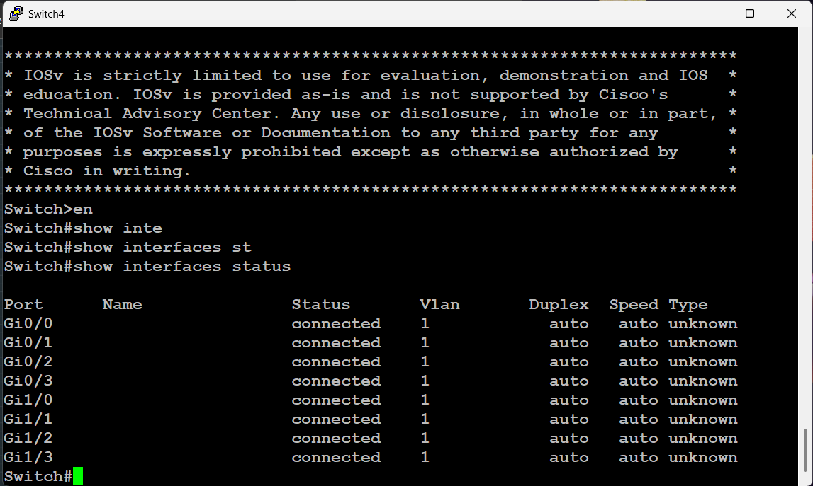

# Lab 17 — FortiGate Active-Passive (A-P) High Availability (HA) Failover

## Table of Contents

* [Lab Overview](#lab-overview)
* [What I Learned](#what-i-learned)
* [What I Configured and Why](#what-i-configured-and-why)
* [Design Logic and Architecture](#design-logic-and-architecture)
* [Topology and Device Roles](#topology-and-device-roles)
* [Step-by-Step Verification and Screenshots](#step-by-step-verification-and-screenshots)
  * [Full Network Topology](#full-network-topology)
  * [Switch Port Status Verification](#switch-port-status-verification)
  * [Baseline Pre-Failover State (FGT-1 Primary)](#baseline-pre-failover-state-fgt-1-primary)
  * [Brief Latency Spikes During State and Sync Activity](#brief-latency-spikes-during-state-and-sync-activity)
  * [Post-Failover State (FGT-2 Primary)](#post-failover-state-fgt-2-primary)
* [Complete Packet Flow and Connection Architecture](#complete-packet-flow-and-connection-architecture)
* [Troubleshooting](#troubleshooting)

## Lab Overview

This lab implements and tests **FortiGate Active-Passive (A-P) High Availability (HA)** in **EVE-NG** as **Lab 17**. Two FortiGate firewalls (`Fortinet1` / `FGT-1` and `Fortinet2` / `FGT-2`) operate together in an HA cluster alongside upper switch `Switch3`, lower switch `Switch4`, an upstream `Net` cloud connection, and a `Linux` client (`192.168.20.10`) sending continuous pings to the LAN gateway (`192.168.20.1`). The lab verifies pre-failover roles, observes brief ping latency spikes during state/sync activity, triggers role failover so `FGT-2` becomes `Primary`, and documents the complete packet flow and design logic.

## What I Learned

* **Identifying Active vs. Standby Nodes:** In `get system ha status`, the active node is listed as `Primary` with `vcluster 1: work` and `HA operating index = 0`, while the standby node is listed as `Secondary` with `vcluster 1: standby` and `HA operating index = 1`.
* **Monitored Interfaces vs. HA Heartbeat:** `port1` and `port2` are monitored under `MONDEV stats` toward `Switch3` and `Switch4`, while `port3` provides a direct link between `Fortinet1` and `Fortinet2` for HA heartbeat and state/configuration synchronization.
* **Configuration Sync vs. Role Failover:** Administrative interface changes (`set status down` or `set status up`) on the active node synchronize across the HA cluster and can cause brief round-trip time (RTT) spikes on live traffic without forcing a role swap.
* **Controlled Failover via HA Uptime Reset:** Running `diagnose sys ha reset-uptime` on `FGT-1` shifts the `Primary` (`work`) role to `FGT-2` (`FGVMEV3YHZ83OA52`) while `FGT-1` (`FGVMEVFTWYP3UG9E`) transitions to `Secondary` (`standby`), keeping `Linux` ping to `192.168.20.1` running.

## What I Configured and Why

* **Continuous LAN Ping (`Linux` to `192.168.20.1`):** Kept a continuous ping running from `Linux` (`e0`) to `192.168.20.1` so any gateway disruption or latency spike could be observed directly while testing HA states.
* **Pre-Failover HA and Switch Verification:** Ran `get system ha status` on `Fortinet1` and `Fortinet2` and `show interfaces status` on the switch to confirm port status, `0` dropped/error packets, and cluster roles before testing failover.
* **HA Failover Trigger (`diagnose sys ha reset-uptime`):** Ran `diagnose sys ha reset-uptime` on `FGT-1` to test role switchover cleanly and confirm that `FGT-2` takes over as `Primary` (`work`) while keeping LAN traffic alive.

## Design Logic and Architecture

* **Redundant Firewall Pair (`FGT-1` and `FGT-2`):** Using two FortiGate appliances in Active-Passive mode eliminates a single firewall point of failure while keeping only one firewall (`Primary` / `work`) actively forwarding traffic at a time.
* **Separated North-South and East-West Paths:** Upper switch `Switch3` aggregates upstream connectivity (`Net` on `Gi0/2`) to both firewalls (`port1`), lower switch `Switch4` connects both firewalls (`port2`) to the LAN segment (`Linux` on `Gi0/0`), and the direct `port3` link connects `Fortinet1` and `Fortinet2` for HA heartbeat and synchronization.
* **Continuous Endpoint Probing:** Keeping a continuous ICMP ping from `Linux` (`192.168.20.10`) to `192.168.20.1` provides an end-to-end data-plane probe across the switch and active firewall path during state changes and failover.

## Topology and Device Roles

* **Net:** Upstream cloud/external network connected to `Switch3` via `Gi0/2`.
* **Switch3:** Upper switch connecting `Net` (`Gi0/2`), `Fortinet1` `port1` (`Gi0/0`), and `Fortinet2` `port1` (`Gi0/1`).
* **Fortinet1 (`FGT-1`, Serial `FGVMEVFTWYP3UG9E`):** FortiGate HA member starting as `Primary` (`work`, index `0`) and moving to `Secondary` (`standby`, index `1`) after failover.
* **Fortinet2 (`FGT-2`, Serial `FGVMEV3YHZ83OA52`):** FortiGate HA member starting as `Secondary` (`standby`, index `1`) and moving to `Primary` (`work`, index `0`) after failover.
* **HA Heartbeat Link (`port3` <-> `port3`):** Direct link between `Fortinet1` and `Fortinet2` for HA heartbeat and synchronization.
* **Switch4:** Lower switch connecting `Fortinet1` `port2` (`Gi0/1`), `Fortinet2` `port2` (`Gi0/2`), and `Linux` `e0` (`Gi0/0`).
* **Linux:** Client host (`192.168.20.10`) sending continuous pings to LAN gateway `192.168.20.1`.

## Step-by-Step Verification and Screenshots

### Full Network Topology

`Topology.png` shows the complete Lab 17 topology in EVE-NG. `Net` connects to `Switch3` (`Gi0/2`), which links to `Fortinet1` `port1` (`Gi0/0`) and `Fortinet2` `port1` (`Gi0/1`). Both FortiGate firewalls share a direct `port3` link between them and connect down through `port2` to `Switch4` (`Gi0/1` and `Gi0/2`), while `Linux` (`e0`) connects to `Switch4` (`Gi0/0`).

### Switch Port Status Verification

`Switch_Interfaces.png` shows the switch console running `show interfaces status`, confirming that ports `Gi0/0` through `Gi1/3` are `connected` in `VLAN 1` with `auto` duplex and speed.

### Baseline Pre-Failover State (FGT-1 Primary)

`before-failover-fgt1-primary.jpg` is a main reference capture showing the healthy pre-failover state. Both `Fortinet2` (`FGT-2`) and `Fortinet1` (`FGT-1`) show `MONDEV stats` with `port1` and `port2` `up` and `0` dropped/error packets. `FGT-1` (`FGVMEVFTWYP3UG9E`) is `Primary` (`vcluster 1: work 169.254.0.1`, `HA operating index = 0`) and `FGT-2` (`FGVMEV3YHZ83OA52`) is `Secondary` (`vcluster 1: standby 169.254.0.1`, `HA operating index = 1`). Below, the EVE-NG canvas and `Linux` terminal (`seq=998+`) show continuous ping replies from `192.168.20.1`.

### Brief Latency Spikes During State and Sync Activity

`little_down_time.png` zooms in on the `Linux` ping output to `192.168.20.1` (`seq=1331` to `seq=1375`). Most replies stay around `3 ms` to `8 ms`, with two brief latency spikes (`622.678 ms` at `seq=1367` and `700.654 ms` at `seq=1372`) circled in red during interface/HA sync activity before returning to normal millisecond response times.

### Post-Failover State (FGT-2 Primary)

`after_link_failure.jpg` is a main reference capture taken after running `diagnose sys ha reset-uptime` on `FGT-1`. The HA roles swapped cleanly: `FGT-2` (`FGVMEV3YHZ83OA52`) is now `Primary` (`vcluster 1: work 169.254.0.2`, `HA operating index = 0`) and `FGT-1` (`FGVMEVFTWYP3UG9E`) is now `Secondary` (`vcluster 1: standby 169.254.0.2`, `HA operating index = 1`), with `MONDEV stats` showing `port1` and `port2` `up` and `0` drops/errors. In the `Linux` terminal (`seq=1781+`), ping replies from `192.168.20.1` continue smoothly with no loss of gateway reachability.

## Complete Packet Flow and Connection Architecture

1. **Physical and Logical Connections:**
   * `Net` connects to `Switch3` (`Gi0/2`), and `Switch3` connects to `Fortinet1` `port1` (`Gi0/0`) and `Fortinet2` `port1` (`Gi0/1`).
   * `Fortinet1` and `Fortinet2` connect directly on `port3` for HA heartbeat and state/config synchronization.
   * `Fortinet1` `port2` (`Gi0/1`) and `Fortinet2` `port2` (`Gi0/2`) connect to `Switch4`, and `Linux` (`e0`) connects to `Switch4` (`Gi0/0`).
2. **HA Control and Synchronization Flow (`port3`):**
   * `Fortinet1` and `Fortinet2` exchange HA role status (`Primary` / `Secondary`), virtual cluster state (`work` / `standby`), and `MONDEV` health data across `port3` so both units stay in sync.
3. **Data Plane ICMP Echo Request / Reply Flow (`Linux` <-> `192.168.20.1`):**
   * `Linux` (`192.168.20.10`) sends ICMP echo requests out interface `e0` to `Switch4` (`Gi0/0`), which forwards them toward the active firewall (`Primary` / `work`).
   * Initially, `FGT-1` acts as `Primary` (`work`) (`before-failover-fgt1-primary.jpg`) and handles gateway `192.168.20.1` replies.
   * During state/sync activity, brief RTT spikes (`little_down_time.png`) can occur while echo replies continue without packet loss.
   * After `diagnose sys ha reset-uptime` on `FGT-1`, `FGT-2` becomes `Primary` (`work`) and `FGT-1` becomes `Secondary` (`standby`) (`after_link_failure.jpg`), while `Linux` continues receiving ICMP echo replies from `192.168.20.1`.

## Troubleshooting

* **CLI Session Timeout on FortiGate Consoles:** Idle console sessions on `Fortinet1` and `Fortinet2` timed out during the lab. Logging back in with `admin` credentials restored CLI access without disrupting HA cluster state or `Linux` ping traffic.
* **CLI `port1` Shutdown Did Not Swap `Primary` Role:** Setting `port1` to `status down` on `FGT-1` (`config system interface` -> `edit port1` -> `set status down` -> `end`) synced across the HA cluster, keeping `FGT-1` as `Primary`. Setting `status up` restored `port1`.
* **Brief Ping Latency Spikes (`622.678 ms` and `700.654 ms`):** As shown in `little_down_time.png`, temporary RTT spikes appeared during interface/HA sync activity while packets still succeeded and returned to normal response times.
* **Deleting `port1` Link on EVE-NG Canvas Did Not Force Immediate Failover:** Removing the `port1` link between `Fortinet1` and `Switch3` on the canvas did not immediately trigger a role swap. After reconnecting the `port1` link on the canvas, running `diagnose sys ha reset-uptime` on `FGT-1` cleanly shifted `Primary` (`work`) to `FGT-2` (`after_link_failure.jpg`).
