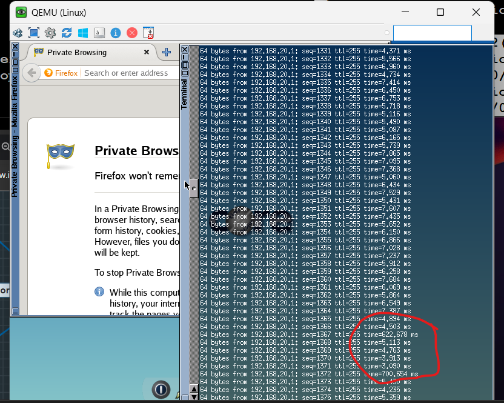

# Lab 06 — FortiGate Active-Passive (A-P) High Availability (HA) Failover

Previous Lab Reference: [Lab 05 — FortiGate Interface Types (/ vs Redundant)](https://github.com/Salman-1210/salman-network-security-labs/tree/main/Fortigate-labs/Lab%2005%20%E2%80%94%20FortiGate%20Interface%20Types%20(/%20vs%20Redundant))

## Table of Contents

- [Lab Overview](#lab-overview)
- [What I Learned](#what-i-learned)
- [What I Configured and Why](#what-i-configured-and-why)
- [Topology and Device Roles](#topology-and-device-roles)
- [Step-by-Step Verification and Screenshots](#step-by-step-verification-and-screenshots)
  - [Full Network Topology](#full-network-topology)
  - [Switch Port Status Verification](#switch-port-status-verification)
  - [Baseline Pre-Failover State (FGT-1 Primary)](#baseline-pre-failover-state-fgt-1-primary)
  - [Brief Latency Spikes During State and Sync Activity](#brief-latency-spikes-during-state-and-sync-activity)
  - [Post-Failover State (FGT-2 Primary)](#post-failover-state-fgt-2-primary)
- [Troubleshooting](#troubleshooting)
- [Complete Connection and Traffic Flow](#complete-connection-and-traffic-flow)

---

## Lab Overview

This lab tests and verifies **FortiGate Active-Passive (A-P) High Availability (HA)** inside **EVE-NG**. Two FortiGate firewalls (`Fortinet1` / `FGT-1` and `Fortinet2` / `FGT-2`) form an HA cluster connected with `Switch3`, `Switch4`, an upstream `Net` cloud connection, and a `Linux` client (`192.168.20.10`) sending continuous pings to the LAN gateway (`192.168.20.1`). The lab covers verifying initial HA roles, observing brief ping latency spikes during state/sync events, triggering a failover so `FGT-2` becomes `Primary`, and confirming continuous LAN reachability.

---

## What I Learned

- **Primary vs. Secondary Identification:** In `get system ha status`, the active node appears as `Primary` with `vcluster 1: work` and `HA operating index = 0`, while the standby node appears as `Secondary` with `vcluster 1: standby` and `HA operating index = 1`.
- **Monitored vs. Heartbeat Interfaces:** `port1` and `port2` are tracked under `MONDEV stats` toward `Switch3` and `Switch4`, while `port3` directly connects `Fortinet1` and `Fortinet2` for HA heartbeat and state/config synchronization.
- **Configuration Sync Behavior:** Changing an interface administrative state (`set status down` or `set status up`) on the active node replicates across the HA cluster and can cause a brief latency spike on active traffic without swapping cluster roles.
- **Controlled Role Failover:** Running `diagnose sys ha reset-uptime` on `FGT-1` shifts the `Primary` (`work`) role to `FGT-2` (`FGVMEV3YHZ83OA52`) and moves `FGT-1` (`FGVMEVFTWYP3UG9E`) to `Secondary` (`standby`) while keeping `Linux` ping to `192.168.20.1` running.

---

## What I Configured and Why

- **Continuous LAN Ping (`Linux` to `192.168.20.1`):** Kept a continuous ICMP ping running from the `Linux` client (`e0`) to `192.168.20.1` so any gateway reachability loss or latency spike could be observed directly alongside firewall CLI outputs.
- **Baseline HA and Switch Checks:** Checked `get system ha status` on `Fortinet1` and `Fortinet2` and `show interfaces status` on the switch to verify link states and HA cluster health before triggering failover.
- **HA Failover Execution (`diagnose sys ha reset-uptime`):** Used HA uptime reset on `FGT-1` to test role switchover cleanly and confirm that `FGT-2` took over as `Primary` (`work`) without breaking LAN ping traffic.

---

## Topology and Device Roles

- **Net:** Upstream external/cloud network connected to `Switch3` via `Gi0/2`.
- **Switch3:** Upper switch connecting `Net` (`Gi0/2`), `Fortinet1` `port1` (`Gi0/0`), and `Fortinet2` `port1` (`Gi0/1`).
- **Fortinet1 (`FGT-1`, Serial `FGVMEVFTWYP3UG9E`):** FortiGate HA member starting as `Primary` (`work`, index `0`) and becoming `Secondary` (`standby`, index `1`) after failover.
- **Fortinet2 (`FGT-2`, Serial `FGVMEV3YHZ83OA52`):** FortiGate HA member starting as `Secondary` (`standby`, index `1`) and becoming `Primary` (`work`, index `0`) after failover.
- **HA Heartbeat Link (`port3` <-> `port3`):** Direct link between `Fortinet1` and `Fortinet2` carrying HA cluster state and synchronization traffic.
- **Switch4:** Lower switch connecting `Fortinet1` `port2` (`Gi0/1`), `Fortinet2` `port2` (`Gi0/2`), and `Linux` `e0` (`Gi0/0`).
- **Linux:** Client machine (`192.168.20.10`) running continuous ping toward LAN gateway `192.168.20.1`.

---

## Step-by-Step Verification and Screenshots

### Full Network Topology

`Topology.png` shows the complete EVE-NG lab topology: `Net` connects to `Switch3` (`Gi0/2`), which links to `Fortinet1` `port1` (`Gi0/0`) and `Fortinet2` `port1` (`Gi0/1`). `Fortinet1` and `Fortinet2` are linked directly via `port3` and connect down through `port2` to `Switch4` (`Gi0/1` and `Gi0/2`), while `Linux` (`e0`) connects to `Switch4` (`Gi0/0`).

---

### Switch Port Status Verification

`Switch_Interfaces.png` displays the output of `show interfaces status` on the switch, confirming active/connected interfaces (`Gi0/0` through `Gi1/3` in `VLAN 1`, `auto` duplex and speed).

---

### Baseline Pre-Failover State (FGT-1 Primary)

`before-failover-fgt1-primary.jpg` is a main reference capture showing the healthy pre-failover state. Both `Fortinet2` (`FGT-2`) and `Fortinet1` (`FGT-1`) show `MONDEV stats` with `port1` and `port2` `up` and `0` dropped/error packets. `FGT-1` (`FGVMEVFTWYP3UG9E`) is `Primary` (`vcluster 1: work 169.254.0.1`, `HA operating index = 0`) and `FGT-2` (`FGVMEV3YHZ83OA52`) is `Secondary` (`vcluster 1: standby 169.254.0.1`, `HA operating index = 1`). Below, the EVE-NG canvas and `Linux` terminal (`seq=998+`) confirm continuous ping replies from `192.168.20.1`.

---

### Brief Latency Spikes During State and Sync Activity

`little_down_time.png` shows a close-up of the `Linux` terminal ping to `192.168.20.1` (`seq=1331` to `seq=1375`). Most replies stay around `3 ms` to `8 ms`, with two brief latency spikes (`622.678 ms` at `seq=1367` and `700.654 ms` at `seq=1372`) highlighted in red during interface/HA sync activity before returning to normal response times.

---

### Post-Failover State (FGT-2 Primary)

`after_link_failure.jpg` is a main reference capture showing the cluster after failover (`diagnose sys ha reset-uptime` on `FGT-1`). The HA roles swapped cleanly: `FGT-2` (`FGVMEV3YHZ83OA52`) is now `Primary` (`vcluster 1: work 169.254.0.2`, `HA operating index = 0`) and `FGT-1` (`FGVMEVFTWYP3UG9E`) is now `Secondary` (`vcluster 1: standby 169.254.0.2`, `HA operating index = 1`), with `MONDEV stats` showing `port1` and `port2` `up` and `0` drops/errors. In the `Linux` terminal (`seq=1781+`), ping replies from `192.168.20.1` continue smoothly with no loss of gateway reachability.

---

## Troubleshooting

- **CLI Session Timeout During Lab Steps:** Console sessions on `Fortinet1` and `Fortinet2` timed out when idle between steps. Logging back in with `admin` credentials restored CLI access without affecting HA cluster state or `Linux` ping traffic.
- **Setting `port1` Down in CLI Did Not Swap `Primary` Role:** Running `config system interface` -> `edit port1` -> `set status down` -> `end` on `FGT-1` synced the administrative status change to `FGT-2` through HA config synchronization, so `FGT-1` stayed `Primary`. Re-enabling `set status up` restored `port1` on both nodes.
- **Brief Ping Latency Spikes (`622.678 ms` and `700.654 ms`):** As seen in `little_down_time.png`, occasional RTT spikes occurred during interface/HA sync processing, while packets still succeeded (`0` packet loss) and returned to normal millisecond times.
- **Deleting `port1` Link on EVE-NG Canvas Did Not Force Failover Immediately:** Removing the `port1` link between `Fortinet1` and `Switch3` on the canvas did not immediately force a role swap on its own. After reconnecting the `port1` link on the canvas, running `diagnose sys ha reset-uptime` on `FGT-1` cleanly switched `Primary` (`work`) to `FGT-2` (`after_link_failure.jpg`).

---

## Complete Connection and Traffic Flow

1. **Physical and Virtual Topology Connections:**
   - Upstream `Net` connects to `Switch3` on `Gi0/2`.
   - `Switch3` connects to `Fortinet1` `port1` (`Gi0/0`) and `Fortinet2` `port1` (`Gi0/1`).
   - `Fortinet1` and `Fortinet2` connect directly to each other on `port3` for HA heartbeat and synchronization.
   - `Fortinet1` `port2` (`Gi0/1`) and `Fortinet2` `port2` (`Gi0/2`) connect to `Switch4`, and `Linux` (`e0`) connects to `Switch4` (`Gi0/0`).
2. **HA Control and Synchronization Flow:**
   - `Fortinet1` and `Fortinet2` exchange HA role, virtual cluster (`work`/`standby`), and `MONDEV` health information over their HA path (`port3`), keeping both nodes synchronized.
3. **Data Plane and Failover Traffic Flow:**
   - `Linux` (`192.168.20.10`) sends continuous ICMP echo requests through `Switch4` to LAN gateway `192.168.20.1`.
   - `FGT-1` initially handled the active `Primary` (`work`) role (`before-failover-fgt1-primary.jpg`), brief sync/state activity produced temporary RTT spikes (`little_down_time.png`), and failover shifted `Primary` (`work`) to `FGT-2` while `FGT-1` became `Secondary` (`standby`) (`after_link_failure.jpg`), with `Linux` ping to `192.168.20.1` continuing uninterrupted.