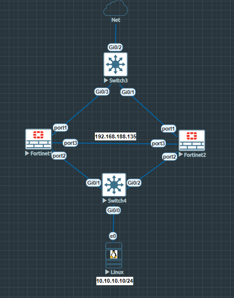
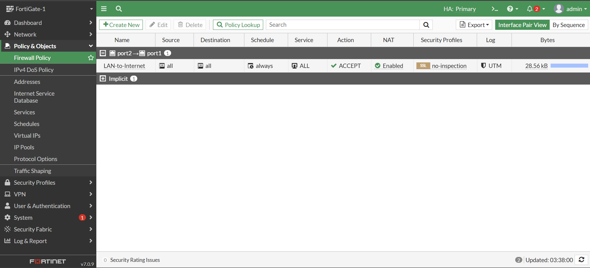
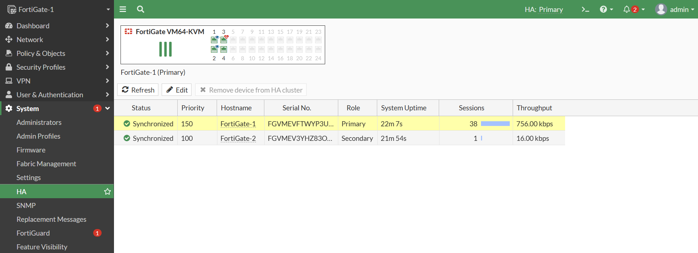
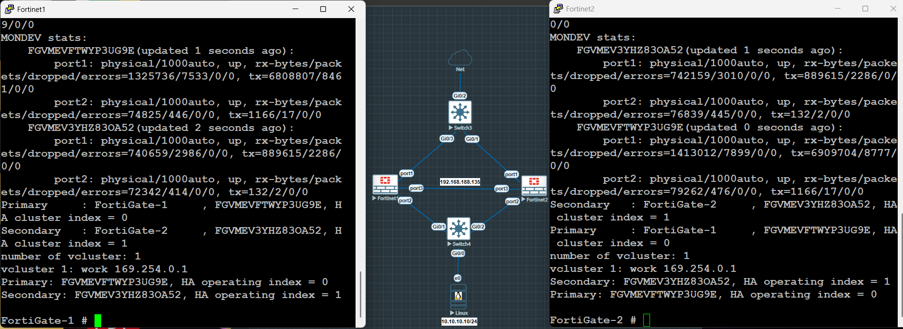
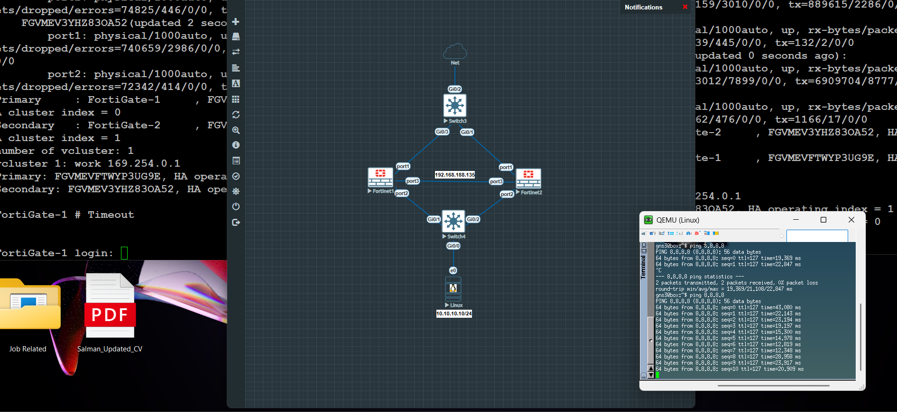
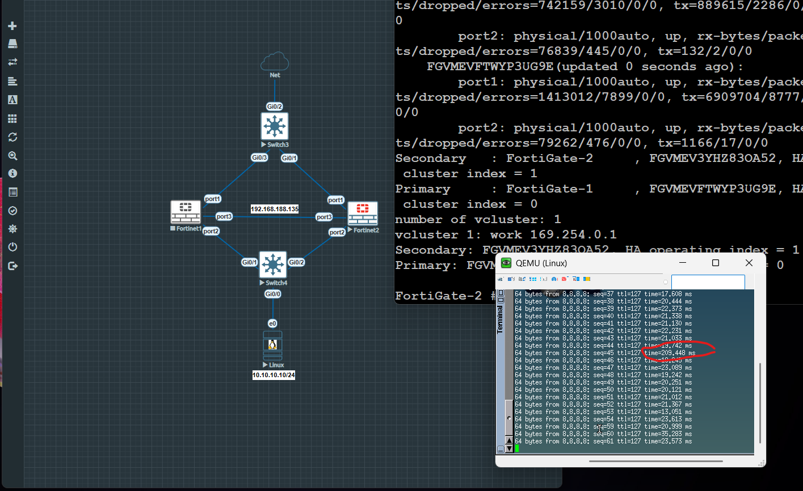

# Lab 18 — FortiGate High Availability (HA) Failover, Failback & Session Continuity

---

## Table of Contents
1. [Lab Overview & Objectives](#-lab-overview--objectives)
2. [Network Topology](#-network-topology)
3. [What I Learned Today](#-what-i-learned-today)
4. [What I Configured & Why](#-what-i-configured--why)
   - [Firewall Policy & NAT Configuration](#1-firewall-policy--nat-configuration)
   - [HA Cluster Roles, Priority & Monitoring](#2-ha-cluster-roles-priority--monitoring)
5. [Step-by-Step Verification & Lab Walkthrough](#-step-by-step-verification--lab-walkthrough)
   - [Step 1: HA GUI Dashboard & Synchronization Status](#step-1-ha-gui-dashboard--synchronization-status)
   - [Step 2: CLI HA Status & Interface Monitoring (`MONDEV`)](#step-2-cli-ha-status--interface-monitoring-mondev)
   - [Step 3: Baseline Connectivity Test (Before Failover)](#step-3-baseline-connectivity-test-before-failover)
   - [Step 4: Primary Failure & Failover Test](#step-4-primary-failure--failover-test)
   - [Step 5: Primary Recovery & Failback Test (FortiGate-1 Back Online)](#step-5-primary-recovery--failback-test-fortigate-1-back-online)
6. [Complete End-to-End Traffic Flow & Device Architecture](#-complete-end-to-end-traffic-flow--device-architecture)

---

## Lab Overview & Objectives

In **Lab 18**, I built upon the **Active-Passive (A-P) High Availability (HA)** architecture from Lab 17 to thoroughly test **cluster synchronization, baseline traffic flow, primary unit failover, and failback recovery** when the original Primary firewall comes back online.

The key objectives of this lab were:
* Verify configuration and session synchronization between **FortiGate-1 (Primary)** and **FortiGate-2 (Secondary)**.
* Inspect low-level HA cluster health, virtual MAC/cluster indexing, and monitored interface (`MONDEV`) statistics via CLI.
* Observe real-time ICMP ping behavior from an internal Linux host (`10.10.10.10/24`) to the internet (`8.8.8.8`) during **three critical states**:
  1. Normal Operation (Before Failover)
  2. Failover Event (FortiGate-1 fails; FortiGate-2 takes over)
  3. Recovery / Failback Event (FortiGate-1 comes back online)

---

## Network Topology

### Topology Breakdown:
* **WAN Edge (`Switch3`):** Connects the ISP/Internet cloud (`Net` on `Gi0/2`) to both firewalls (`FortiGate-1 port1` via `Gi0/3` and `FortiGate-2 port1` via `Gi0/1`).
* **HA Cluster Nodes:**
  * **FortiGate-1 (Primary):** Serial `FGVMEVFTWYP3UG9E` | Management IP: `192.168.188.135`
  * **FortiGate-2 (Secondary):** Serial `FGVMEV3YHZ83OA52`
* **Heartbeat Link (`port3`):** Direct link between `FortiGate-1 (port3)` and `FortiGate-2 (port3)` for HA keepalives, configuration sync, and session table replication.
* **LAN Core (`Switch4`):** Connects `FortiGate-1 (port2)` via `Gi0/1` and `FortiGate-2 (port2)` via `Gi0/2` down to the internal LAN host (`Linux` at `10.10.10.10/24` on `Gi0/0`).

---

## What I Learned Today

* **Failback Behavior & Latency Spikes:** When a failed Primary firewall (`FortiGate-1`) comes back online (with override enabled / higher priority `150`), the cluster renegotiates roles and shifts active traffic processing back to `FortiGate-1`. During this transition, active sessions experience a brief latency spike (e.g., jumping from `~20 ms` to `~185 ms`) without dropping the continuous connection.
* **Virtual Cluster (`vcluster 1`) Mechanics:** Both FortiGates operate under a shared virtual cluster (`169.254.0.1` internal HA communication) using **Virtual MAC addresses**. This ensures that `Switch3` and `Switch4` do not need to relearn gateway IP addresses when roles switch.
* **Interface Monitoring (`MONDEV`):** FortiGate continuously tracks physical link state (`physical/1000auto, up`), RX/TX bytes, and packet drops on monitored ports (`port1` and `port2`) across **both** cluster members simultaneously.
* **Configuration & Session Synchronization:** Any firewall policy created on the Primary (`FortiGate-1`) is automatically replicated to the Secondary (`FortiGate-2`) over the heartbeat interface (`port3`).

---

## What I Configured & Why

### 1. Firewall Policy & NAT Configuration

* **What I Configured:**
  * Created an IPv4 Firewall Policy named **`LAN-to-Internet`**.
  * **Incoming Interface:** `port2` (LAN) | **Outgoing Interface:** `port1` (WAN).
  * **Source & Destination:** `all` | **Service:** `ALL` | **Action:** `ACCEPT`.
  * **NAT:** `Enabled` (Source NAT using Outgoing Interface Address) with `no-inspection` SSL profile.
* **Why I Configured It:**
  * By default, FortiGate blocks all transit traffic via its **Implicit Deny** rule. Enabling NAT on `port2 -> port1` translates the private LAN IP (`10.10.10.10`) to the WAN interface IP so the Linux machine can reach external destinations (`8.8.8.8`), and this policy automatically syncs to `FortiGate-2`.

### 2. HA Cluster Roles, Priority & Monitoring
* **What I Configured:**
  * **Mode:** Active-Passive (A-P)
  * **FortiGate-1 Priority:** `150` (Elected as **Primary**, `HA cluster index = 0`)
  * **FortiGate-2 Priority:** `100` (Elected as **Secondary**, `HA cluster index = 1`)
  * **Heartbeat Interface:** `port3`
  * **Monitored Interfaces:** `port1` (WAN) and `port2` (LAN)
* **Why I Configured It:**
  * Setting a higher priority (`150` vs `100`) establishes a deterministic election so `FortiGate-1` is always preferred as the Primary gateway. Monitoring `port1` and `port2` ensures that if either WAN or LAN connectivity breaks on the Primary, an immediate failover occurs.

---

## Step-by-Step Verification & Lab Walkthrough

### Step 1: HA GUI Dashboard & Synchronization Status

* **Observation:** Navigating to **System > HA** on `FortiGate-1` confirms that both cluster members show a green **`Synchronized`** status.
* **Key Details:**
  * `FortiGate-1` (`Priority: 150`) holds the **Primary** role, handling active user sessions (`38 sessions` at `756.00 kbps`).
  * `FortiGate-2` (`Priority: 100`) stands by as **Secondary**, maintaining synchronized state (`1 session` / heartbeat overhead at `16.00 kbps`).
  * Port icons at the top clearly show `port1` and `port2` as monitored (eye icon) and `port3` as the dedicated HA heartbeat link (red heart icon).

---

### Step 2: CLI HA Status & Interface Monitoring (`MONDEV`)

* **Observation:** Comparing the CLI outputs of `FortiGate-1` (left) and `FortiGate-2` (right) reveals identical cluster awareness across both firewalls:
  * **Primary:** `FortiGate-1` (`FGVMEVFTWYP3UG9E`, `HA cluster index = 0`, `HA operating index = 0`)
  * **Secondary:** `FortiGate-2` (`FGVMEV3YHZ83OA52`, `HA cluster index = 1`, `HA operating index = 1`)
  * **Virtual Cluster:** `vcluster 1: work 169.254.0.1`
  * **`MONDEV stats`:** Both firewalls actively track RX/TX counters and error rates for `port1` and `port2` on both local and peer serial numbers, confirming zero dropped packets or link errors.

---

### Step 3: Baseline Connectivity Test (Before Failover)

* **Observation:** From the internal Linux machine (`10.10.10.10/24`), a continuous ping (`ping 8.8.8.8`) was initiated while `FortiGate-1` was active.
* **Result:** Traffic flows smoothly through `FortiGate-1` with consistent, low round-trip latency averaging **`13 ms – 23 ms`** and **0% packet loss**.

---

### Step 4: Primary Failure & Failover Test

* **Observation:** When `FortiGate-1` experienced a failure event, `FortiGate-2` immediately detected the loss of heartbeats on `port3` and promoted itself to the active gateway role.
* **Result (Highlighted in Red):**
  * Looking at the Linux QEMU terminal (`seq=44` to `seq=45`), the ping latency momentarily spiked to **`209.448 ms`** during the exact second `FortiGate-2` took ownership of the Virtual MAC addresses and updated the switches' MAC address tables.
  * Immediately at `seq=46`, latency returned to normal (**`19.245 ms`**) without breaking the continuous ICMP stream.

---

### Step 5: Primary Recovery & Failback Test (FortiGate-1 Back Online)

* **Observation:** Once `FortiGate-1` booted back up and rejoined the HA cluster, it synchronized its configuration/sessions with `FortiGate-2` and reclaimed its **Primary** role (due to its higher priority of `150`).
* **Result (Highlighted in Red):**
  * In the Linux QEMU terminal (`seq=154` to `seq=162`), as traffic seamlessly failed back from `FortiGate-2` to `FortiGate-1`, a brief transition latency spike of **`185.594 ms`** occurred (`seq=162`), followed immediately by normal **`27.202 ms` / `19.829 ms`** responses (`seq=163+`).
  * This proves **non-disruptive failback** and full high-availability resilience in both directions.

---

## Complete End-to-End Traffic Flow & Device Architecture

Below is the complete step-by-step explanation of how every device interacts in this topology during normal operation, failover, and recovery:

1. **Traffic Origination (`Linux Host - 10.10.10.10/24`):**
   * The Linux client sends an ICMP Echo Request destined for `8.8.8.8` to its default gateway (`10.10.10.1`).
   * The Linux host resolves `10.10.10.1` via ARP to the **HA Virtual MAC Address** of `port2` (not a physical hardware MAC of a single box).

2. **LAN Switching Layer (`Switch4`):**
   * `Switch4` receives the frame on `Gi0/0` and forwards it out of the port where the HA Virtual MAC is currently active:
     * **Normal / Failback State:** Forwards out `Gi0/1` to `FortiGate-1 (port2)`.
     * **Failover State:** Forwards out `Gi0/2` to `FortiGate-2 (port2)` after `FortiGate-2` sends Gratuitous ARP (GARP) frames upon taking over.

3. **Stateful Inspection, NAT & Session Sync (`FortiGate-1` & `FortiGate-2`):**
   * The active firewall receives the packet on `port2`, matches the **`LAN-to-Internet`** firewall policy (`port2 -> port1`), applies **Source NAT**, and creates an entry in its **Session Table**.
   * Simultaneously, over the dedicated **`port3` Heartbeat Link**, the Primary firewall replicates this session state and configuration to the Secondary firewall so the backup unit is always warm and ready.

4. **WAN Switching & Internet Egress (`Switch3` & `Net`):**
   * The active FortiGate transmits the NATted packet out of `port1` using the WAN Virtual MAC address.
   * `Switch3` receives the frame (on `Gi0/3` from `FortiGate-1` or `Gi0/1` from `FortiGate-2`) and forwards it out `Gi0/2` toward the **`Net` (Internet)** cloud, reaching `8.8.8.8`.
   * Return ICMP Echo Replies follow the exact reverse path back through `Switch3` $\rightarrow$ Active FortiGate (un-NATted via session table) $\rightarrow$ `Switch4` $\rightarrow$ `Linux (10.10.10.10)`.

5. **Failover & Failback Transition Mechanism:**
   * **During Failover:** `FortiGate-2` misses heartbeat packets on `port3`, assumes the Primary role (`index 0`), binds the Virtual MACs to its own `port1` and `port2`, and broadcasts **Gratuitous ARPs (GARP)** to force `Switch3` and `Switch4` to update their CAM/MAC tables (`~209 ms` transition).
   * **During Failback (`FGT-back_online .png`):** `FortiGate-1` comes back online, syncs state via `port3`, reclaims the Primary role due to `Priority 150 > 100`, and sends GARPs to `Switch3` and `Switch4` to pull traffic back cleanly (`~185 ms` transition) with zero session loss.
